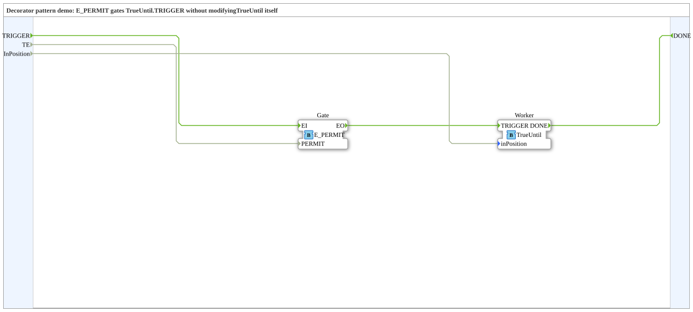

# DecoratorDemo: Decorator-Muster (Freigabe-Tor)

* * * * * * * * * *

## Einleitung

`DecoratorDemo` ist die Demo zum **Decorator-Muster** (IEC-61499-Grundkurs, Modul 6, Valeriy Vyatkin, Folie 68). Laut Quelle sperrt ein `E_PERMIT` das Ereignis `TRIGGER` vor dem Baustein `TrueUntil`, **ohne `TrueUntil` selbst zu verändern**: Der Schritt läuft nur, solange die Bedingung `TE` den Wert `TRUE` hat.

### Schnittstelle der SubApp

| Name | Art | Typ | Beschreibung |
|---|---|---|---|
| `TRIGGER` | Ereignis-Eingang | `Event` | Schritt anfordern – läuft nur, solange `TE` = `TRUE` ist |
| `DONE` | Ereignis-Ausgang | `Event` | Der Schritt ist fertig (kommt nur, wenn `TE` beim Eintreffen von `TRIGGER` `TRUE` war) |
| `TE` | Daten-Eingang | `BOOL` (Start `TRUE`) | Decorator-Bedingung |
| `InPosition` | Daten-Eingang | `BOOL` | Demo: simuliert, dass der Aktor des Schritts seine Position erreicht hat |

## Verwendete Funktionsbausteine (FBs)

| Instanz | Typ | Parameter | Erklärung |
|---|---|---|---|
| `Gate` | [E_PERMIT](https://meisterschulen-am-ostbahnhof-munchen-docs.readthedocs.io/projects/4diac-library-reference-docs/de/latest/Bibliotheken/StandardLibraries/events/E_PERMIT/) | – | Lässt `EI` nur zum Ausgang `EO` durch, wenn `PERMIT` = `TRUE` |
| `Worker` | `Meins::DesingPatterns::ChainOfActionsPattern::TrueUntil` | – | Der „dekorierte" Schritt: fährt eine Position an und wartet, bis `inPosition` `TRUE` wird, dann meldet er `DONE` (siehe Chain-of-Actions-Demo) |

## Programmablauf und Verbindungen

1. `TRIGGER` → `Gate.EI`; `TE` → `Gate.PERMIT`.
2. `Gate.EO` → `Worker.TRIGGER`: Das Ereignis erreicht den Schritt nur bei `TE` = `TRUE`.
3. `InPosition` → `Worker.inPosition`.
4. `Worker.DONE` → `DONE`.

Mit `TE` = `FALSE` bleibt der Schritt unberührt: `TRIGGER` wird am `Gate` verworfen und es kommt kein `DONE`.

## Zusammenfassung

`DecoratorDemo` zeigt das Decorator-Muster in der einfachsten Form: ein vorgeschalteter `E_PERMIT` ergänzt eine Freigabebedingung, ohne den dekorierten Baustein `TrueUntil` zu ändern.

---

### 🌐 Passende Themen-Unterseiten auf ms-muc-docs.de

- [🌐 Eclipse 4diac IDE & Farb-Referenz auf ms-muc-docs.de](https://www.ms-muc-docs.de/iec-61499/eclipse-4diac/)
