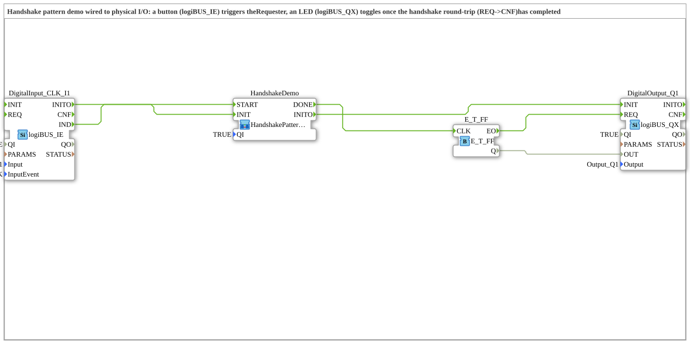

# HandshakePatternDemoIO: Handshake-Muster an echter I/O

* * * * * * * * * *

## Einleitung

`HandshakePatternDemoIO` verdrahtet die Handshake-Demo `HandshakePatternDemo` (IEC-61499-Grundkurs, Modul 6, Valeriy Vyatkin) mit physischer I/O: Ein Taster (`logiBUS_IE`) löst den Requester aus, eine LED (`logiBUS_QX`) wechselt ihren Zustand, sobald der Handshake-Rundlauf (REQ → CNF) abgeschlossen ist. Die Taster-/LED-Verdrahtung ist laut Versionsvermerk dem Beispiel `test_B/Uebungen/Uebung_004a` nachempfunden. Die Schnittstelle der SubApp ist leer.

## Verwendete Funktionsbausteine (FBs)

| Instanz | Typ | Parameter | Erklärung |
|---|---|---|---|
| `DigitalInput_CLK_I1` | [logiBUS_IE](https://meisterschulen-am-ostbahnhof-munchen-docs.readthedocs.io/projects/4diac-library-reference-docs/de/latest/Bibliotheken/ExternalLibraries/logiBUS/io/DI/logiBUS_IE/) | `QI` = `TRUE`, `Input` = `Input_I1`, `InputEvent` = `BUTTON_SINGLE_CLICK` | Taster (Einzelklick) |
| `HandshakeDemo` | `Meins::DesingPatterns::HandshakePattern::HandshakePatternDemo` (SubApp) | `QI` = `TRUE` | Handshake-Demo mit Requester und Responder; Eingang `START`, Ausgang `DONE` |
| `E_T_FF` | [E_T_FF](https://meisterschulen-am-ostbahnhof-munchen-docs.readthedocs.io/projects/4diac-library-reference-docs/de/latest/Bibliotheken/StandardLibraries/events/E_T_FF/) | – | Toggle-Flipflop: wechselt bei jedem `CLK` den Zustand |
| `DigitalOutput_Q1` | [logiBUS_QX](https://meisterschulen-am-ostbahnhof-munchen-docs.readthedocs.io/projects/4diac-library-reference-docs/de/latest/Bibliotheken/ExternalLibraries/logiBUS/io/DO/logiBUS_QX/) | `QI` = `TRUE`, `Output` = `Output_Q1` | LED an Ausgang Q1 |

## Programmablauf und Verbindungen

1. **Start**: `DigitalInput_CLK_I1.IND` → `HandshakeDemo.START` – der Tastendruck lässt den Requester sein `REQ` senden.
2. **Rückmeldung**: `HandshakeDemo.DONE` → `E_T_FF.CLK` – die LED wird erst umgeschaltet, wenn das `CNF` des Responders tatsächlich zurückgekommen ist.
3. **LED**: `E_T_FF.EO` → `DigitalOutput_Q1.REQ`, `E_T_FF.Q` → `DigitalOutput_Q1.OUT`.
4. **Initialisierung**: `DigitalInput_CLK_I1.INITO` → `HandshakeDemo.INIT`, danach `HandshakeDemo.INITO` → `DigitalOutput_Q1.INIT`.

## Zusammenfassung

`HandshakePatternDemoIO` macht den Handshake sichtbar: Jeder Tastendruck schaltet die LED erst nach abgeschlossenem Anfrage-/Bestätigungs-Rundlauf um.

---

### 🌐 Passende Themen-Unterseiten auf ms-muc-docs.de

- [🌐 Eclipse 4diac IDE & Farb-Referenz auf ms-muc-docs.de](https://www.ms-muc-docs.de/iec-61499/eclipse-4diac/)
