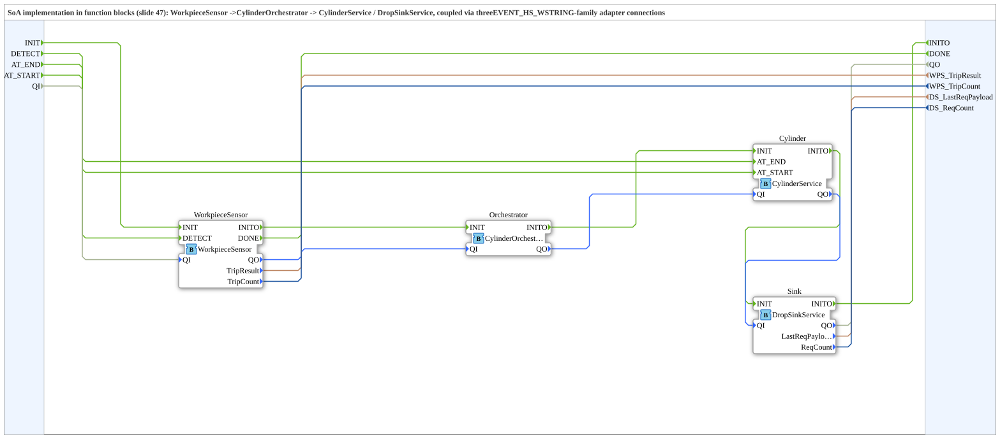

# MessageExchangeDemo: Nachrichtenaustausch über Handshake-Adapter

* * * * * * * * * *

## Einleitung

`MessageExchangeDemo` setzt die „SoA-Implementierung in Funktionsbausteinen" (IEC-61499-Grundkurs, Modul 6, Valeriy Vyatkin, Folie 47) um und rekonstruiert den CylH-Nachrichtenaustausch (Folien 42–46) mit **vier zusammenarbeitenden Funktionsbausteinen**: `WorkpieceSensor` → `CylinderOrchestrator` → `CylinderService` / `DropSinkService`. Gekoppelt werden sie über drei Adapter-Verbindungen aus der Familie `EVENT_HS_WSTRING`.

### Schnittstelle der SubApp

| Name | Art | Typ | Beschreibung |
|---|---|---|---|
| `INIT` / `INITO` | Ereignis | `EInit` | Initialisierung / Bestätigung |
| `DETECT` | Ereignis-Eingang | `Event` | Simulierter Sensor WPS: Werkstück angekommen, startet den Rundlauf |
| `AT_END` | Ereignis-Eingang | `Event` | Simulierter Sensor CYL.end: Stößel in Endlage |
| `AT_START` | Ereignis-Eingang | `Event` | Simulierter Sensor CYL.start: Stößel wieder in Startlage |
| `DONE` | Ereignis-Ausgang | `Event` | `WorkpieceSensor` hat das `CNF` erhalten: Rundlauf abgeschlossen |
| `QI` / `QO` | Daten | `BOOL` | Ereignis-Qualifizierer |
| `WPS_TripResult` | Daten-Ausgang | `WSTRING` | Nutzlast des letzten `CNF` am `WorkpieceSensor` (erwartet `RSP_CYL_TRIP_COMPLETE`) |
| `WPS_TripCount` | Daten-Ausgang | `UINT` | Anzahl abgeschlossener Rundläufe |
| `DS_LastReqPayload` | Daten-Ausgang | `WSTRING` | Nutzlast des letzten `REQ` am `DropSinkService` (erwartet `REQ_DROP`) |
| `DS_ReqCount` | Daten-Ausgang | `UINT` | Anzahl empfangener Drop-`REQ` |

## Verwendete Funktionsbausteine (FBs)

Alle vier Bausteine liegen im Paket `Meins::DesingPatterns::HandshakePattern`.

| Instanz | Typ | Erklärung |
|---|---|---|
| `WorkpieceSensor` | `WorkpieceSensor` | Startet bei `DETECT` die Anfrage `REQ_TRIP` über den Adapter `ACTIVATE`; liefert `TripResult`, `TripCount` und `DONE` |
| `Orchestrator` | `CylinderOrchestrator` | Nimmt die Anfrage vom Sensor entgegen (`SRSP`), leitet sie an den Zylinder weiter (`SREQ1`) und fordert das Ablegen beim Sink an (`SREQ2`) |
| `Cylinder` | `CylinderService` | Zylinder-Dienst mit Ereignissen `AT_END` und `AT_START`; antwortet über `SRSP` |
| `Sink` | `DropSinkService` | Senken-Dienst; liefert `LastReqPayload` und `ReqCount` |

## Programmablauf und Verbindungen

- **Adapter-Kopplung** (jeweils mit Kommentar in der Quelle):
    - `WorkpieceSensor.ACTIVATE` → `Orchestrator.SRSP`: Der Sensor fordert den Rundlauf an (`REQ_TRIP`); der Orchestrator antwortet, sobald der gesamte Rundlauf als abgeschlossen bestätigt ist.
    - `Orchestrator.SREQ1` → `Cylinder.SRSP`: Der Orchestrator reicht die Anfrage weiter und reagiert auf das `IND` mitten im Rundlauf (Endlage erreicht) und das abschließende `CNF` (Rundlauf fertig).
    - `Orchestrator.SREQ2` → `Sink.SRSP`: Der Orchestrator fordert das Ablegen an, sobald der Zylinder die Endlage meldet.
- **Initialisierungskette**: `INIT` → `WorkpieceSensor` → `Orchestrator` → `Cylinder` → `Sink` → `INITO`; entsprechend wird `QI` durch die vier Bausteine zu `QO` durchgereicht.
- **Ereignisse**: `DETECT` → `WorkpieceSensor.DETECT`, `AT_END` → `Cylinder.AT_END`, `AT_START` → `Cylinder.AT_START`, `WorkpieceSensor.DONE` → `DONE`.
- **Daten**: `WorkpieceSensor.TripResult`/`TripCount` und `Sink.LastReqPayload`/`ReqCount` werden nach außen geführt.

## Zusammenfassung

`MessageExchangeDemo` zeigt den Handshake-Gedanken als Nachrichtenaustausch zwischen vier Diensten: Sensor, Orchestrator, Zylinder und Senke tauschen Anfragen und Bestätigungen ausschließlich über Adapter aus; die Zähler und Nutzlasten an der Schnittstelle machen den Ablauf beobachtbar.

---

### 🌐 Passende Themen-Unterseiten auf ms-muc-docs.de

- [🌐 Eclipse 4diac IDE & Farb-Referenz auf ms-muc-docs.de](https://www.ms-muc-docs.de/iec-61499/eclipse-4diac/)
