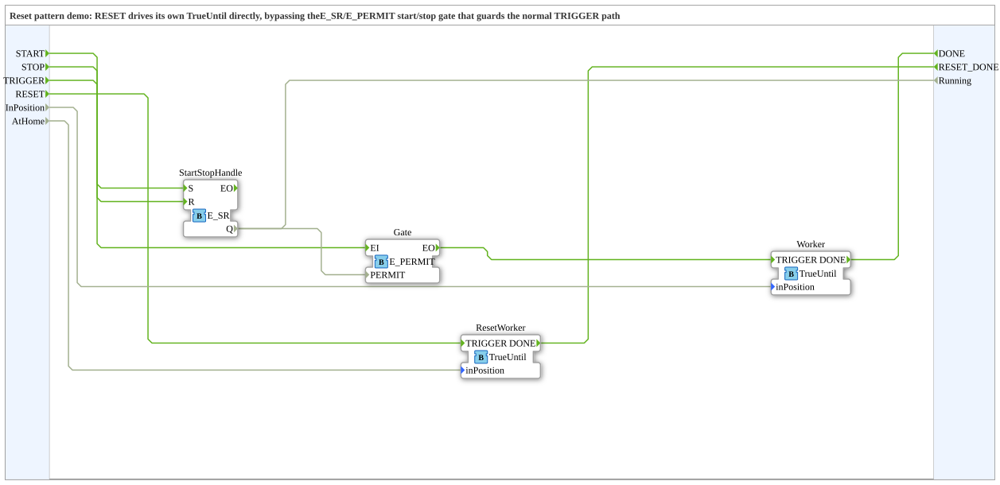

# ResetDemo: Reset-Muster (Umgehung des Start/Stopp-Tors)

* * * * * * * * * *

## Einleitung

`ResetDemo` ist die Demo zum **Reset-Muster** (IEC-61499-Grundkurs, Modul 6, Valeriy Vyatkin, Folie 71): `RESET` treibt einen eigenen `TrueUntil` direkt an und **umgeht dabei das Start/Stopp-Tor** (`E_SR` + `E_PERMIT`), das den normalen `TRIGGER`-Pfad schützt. Der Reset funktioniert daher auch im gestoppten Zustand.

### Schnittstelle der SubApp

| Name | Art | Typ | Beschreibung |
|---|---|---|---|
| `START` | Ereignis-Eingang | `Event` | Anlage starten: öffnet das Tor für den normalen `TRIGGER`-Pfad |
| `STOP` | Ereignis-Eingang | `Event` | Anlage stoppen: schließt das Tor |
| `TRIGGER` | Ereignis-Eingang | `Event` | Normalen Schritt anfordern – erreicht ihn nur bei gestarteter Anlage |
| `RESET` | Ereignis-Eingang | `Event` | Reset-Schritt anfordern – umgeht das Tor, funktioniert auch im Stopp |
| `DONE` | Ereignis-Ausgang | `Event` | Der normale Schritt ist fertig |
| `RESET_DONE` | Ereignis-Ausgang | `Event` | Der Reset-Schritt ist fertig |
| `InPosition` | Daten-Eingang | `BOOL` | Demo: Aktor des normalen Schritts hat die Position erreicht |
| `AtHome` | Daten-Eingang | `BOOL` | Demo: Aktor des Reset-Schritts hat die Grundstellung erreicht |
| `Running` | Daten-Ausgang | `BOOL` | Aktueller Start/Stopp-Zustand (`E_SR.Q`); `RESET` ignoriert ihn |

## Verwendete Funktionsbausteine (FBs)

| Instanz | Typ | Parameter | Erklärung |
|---|---|---|---|
| `StartStopHandle` | [E_SR](https://meisterschulen-am-ostbahnhof-munchen-docs.readthedocs.io/projects/4diac-library-reference-docs/de/latest/Bibliotheken/StandardLibraries/events/E_SR/) | – | Start/Stopp-Speicher: `START` setzt (`S`), `STOP` setzt zurück (`R`) |
| `Gate` | [E_PERMIT](https://meisterschulen-am-ostbahnhof-munchen-docs.readthedocs.io/projects/4diac-library-reference-docs/de/latest/Bibliotheken/StandardLibraries/events/E_PERMIT/) | – | Tor für den normalen Pfad, Freigabe aus `StartStopHandle.Q` |
| `Worker` | `Meins::DesingPatterns::ChainOfActionsPattern::TrueUntil` | – | Normaler Schritt |
| `ResetWorker` | `Meins::DesingPatterns::ChainOfActionsPattern::TrueUntil` | – | Reset-Schritt (eigene Instanz) |

## Programmablauf und Verbindungen

- **Normaler Pfad**: `TRIGGER` → `Gate.EI` → `Gate.EO` → `Worker.TRIGGER`; `Worker.DONE` → `DONE`; `InPosition` → `Worker.inPosition`. Das Tor ist offen, solange `StartStopHandle.Q` = `TRUE` ist (`StartStopHandle.Q` → `Gate.PERMIT`).
- **Start/Stopp**: `START` → `StartStopHandle.S`, `STOP` → `StartStopHandle.R`; der Zustand wird zusätzlich als `Running` ausgegeben.
- **Reset-Pfad**: `RESET` → `ResetWorker.TRIGGER` (laut Kommentar „bypasses StartStopHandle/Gate entirely – works even while stopped"); `ResetWorker.DONE` → `RESET_DONE`; `AtHome` → `ResetWorker.inPosition`.

## Zusammenfassung

`ResetDemo` zeigt, wie ein Reset-Befehl über einen eigenen, vom Start/Stopp-Tor unabhängigen Pfad geführt wird, damit er auch bei gestoppter Anlage wirkt.

---

### 🌐 Passende Themen-Unterseiten auf ms-muc-docs.de

- [🌐 Eclipse 4diac IDE & Farb-Referenz auf ms-muc-docs.de](https://www.ms-muc-docs.de/iec-61499/eclipse-4diac/)
