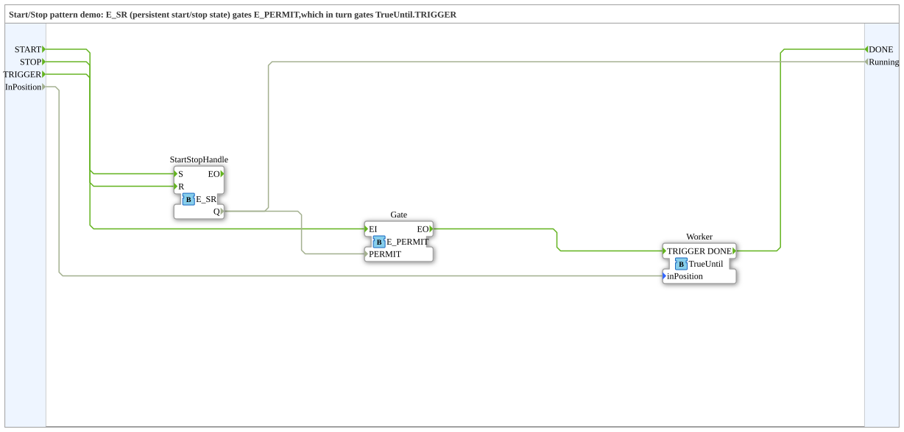

# StartStopDemo: Start/Stop-Muster

* * * * * * * * * *

## Einleitung

`StartStopDemo` zeigt das Start/Stop-Muster: ein `E_SR` hält den Start/Stop-Zustand dauerhaft und gibt über `E_PERMIT` die Weitergabe des Ereignisses an `TrueUntil.TRIGGER` frei oder sperrt sie (Kommentar im Typ).

Schnittstelle: Ereigniseingänge `START`, `STOP` und `TRIGGER`; Ereignisausgang `DONE`; Eingang `InPosition` (BOOL, simuliert die Rückmeldung der Aktorik); Ausgang `Running` (BOOL, `TRUE`, solange gestartet).

## Verwendete Funktionsbausteine (FBs)

| Instanz | Typ | Parameter | Erklärung |
|---|---|---|---|
| `StartStopHandle` | [`iec61499::events::E_SR`](https://meisterschulen-am-ostbahnhof-munchen-docs.readthedocs.io/projects/4diac-library-reference-docs/de/latest/Bibliotheken/StandardLibraries/events/E_SR/) | - | Set/Reset-Speicher: `START` → `S`, `STOP` → `R`; Ausgang `Q` ist der Start/Stop-Zustand. |
| `Gate` | [`iec61499::events::E_PERMIT`](https://meisterschulen-am-ostbahnhof-munchen-docs.readthedocs.io/projects/4diac-library-reference-docs/de/latest/Bibliotheken/StandardLibraries/events/E_PERMIT/) | - | Gibt das Ereignis `EI` nur als `EO` weiter, solange `PERMIT` = `TRUE` ist. |
| `Worker` | `Meins::DesingPatterns::ChainOfActionsPattern::TrueUntil` | - | Schritt-Baustein aus dem Chain-of-Actions-Muster. |

## Programmablauf und Verbindungen

**Ereignisverbindungen:**

1. `START` → `StartStopHandle.S`; `STOP` → `StartStopHandle.R`.
2. `TRIGGER` → `Gate.EI`; `Gate.EO` → `Worker.TRIGGER`.
3. `Worker.DONE` → `DONE`.

**Datenverbindungen:**

1. `StartStopHandle.Q` → `Gate.PERMIT`.
2. `StartStopHandle.Q` → `Running`.
3. `InPosition` → `Worker.inPosition`.

Ein `TRIGGER` erreicht `Worker` nur, wenn die Anlage zuvor gestartet wurde (laut Schnittstellenkommentar feuert `DONE` nur dann). `TrueUntil` ist ein Basis-FB im Projektordner `DesingPatterns/ChainOfActionsPattern`.

## Zusammenfassung

Das Demo trennt den dauerhaften Start/Stop-Zustand (E_SR) von der Freigabe einzelner Aufträge (E_PERMIT) und lässt den Arbeitsbaustein unverändert.

---

### 🌐 Passende Themen-Unterseiten auf ms-muc-docs.de

- [🌐 Eclipse 4diac IDE & Farb-Referenz auf ms-muc-docs.de](https://www.ms-muc-docs.de/iec-61499/eclipse-4diac/)
