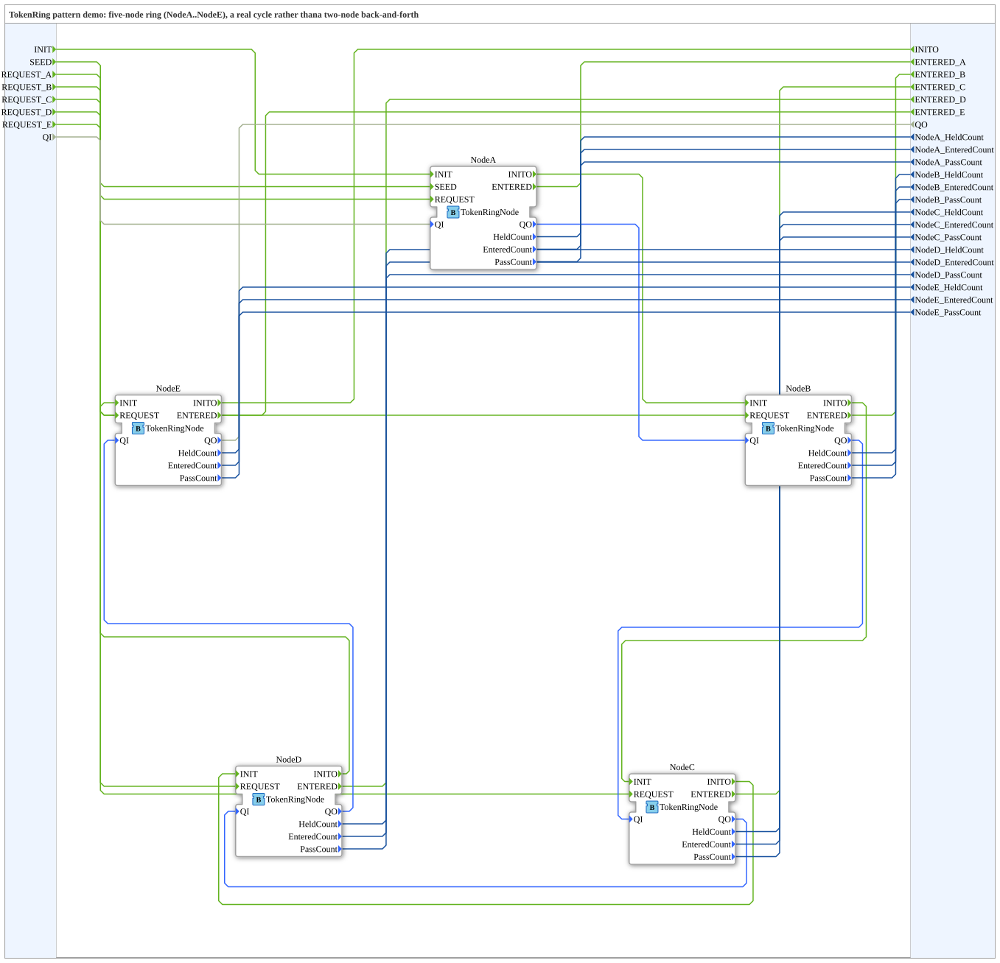

# TokenRingPatternDemo: Token-Ring-Muster mit fünf Knoten

* * * * * * * * * *

## Einleitung

`TokenRingPatternDemo` ist die Demo zum **Mutual-Exclusion-/Token-Ring-Muster** (IEC-61499-Grundkurs, Modul 6, Valeriy Vyatkin). Laut Quelle wurde sie in Version 1.1 von einem Knotenpaar auf einen **echten Ring mit fünf Knoten** (`NodeA`…`NodeE`) erweitert, weil zwei Knoten nur ein Hin-und-Her, aber keinen Ring ergeben.

### Schnittstelle der SubApp

| Name | Art | Typ | Beschreibung |
|---|---|---|---|
| `INIT` / `INITO` | Ereignis | `EInit` | Initialisierung / Bestätigung |
| `SEED` | Ereignis-Eingang | `Event` | Ring starten: Token einmalig bei `NodeA` einspeisen (nach `INIT`) |
| `REQUEST_A` … `REQUEST_E` | Ereignis-Eingänge | `Event` | Knoten fordert den kritischen Abschnitt für sein nächstes Token-Halten an |
| `ENTERED_A` … `ENTERED_E` | Ereignis-Ausgänge | `Event` | Knoten hat seinen kritischen Abschnitt betreten |
| `QI` / `QO` | Daten | `BOOL` | Ereignis-Qualifizierer |
| `NodeX_HeldCount` | Daten-Ausgang | `UINT` | Wie oft Knoten X das Token erhalten hat |
| `NodeX_EnteredCount` | Daten-Ausgang | `UINT` | Wie oft Knoten X den kritischen Abschnitt genutzt hat |
| `NodeX_PassCount` | Daten-Ausgang | `UINT` | Anzahl bestätigter Weitergaben von Knoten X |

(X = A…E)

## Verwendete Funktionsbausteine (FBs)

| Instanz | Typ | Erklärung |
|---|---|---|
| `NodeA` … `NodeE` | `Meins::DesingPatterns::TokenRingPattern::TokenRingNode` | Ein Knoten des Rings. Hat die Adapter `MTXIN` (Token vom Vorgänger empfangen, Empfang bestätigen) und `MTXOUT` (Token an den Nachfolger geben, Bestätigung abwarten) vom Typ `adapter::types::bidirectional::TokenRing::TokenRing`. Ereignisse: `REQUEST`, `SEED`, `ENTERED`, `EXITED`; Zähler `HeldCount`, `EnteredCount`, `PassCount` |

Innerhalb von `TokenRingNode` merkt `REQUEST` einen Wunsch (`Want`); beim Eintreffen des Tokens betritt der Knoten den kritischen Abschnitt nur, wenn `Want` gesetzt ist, und reicht das Token danach an den Nachfolger weiter. `SEED` schiebt das Token direkt in die Weitergabe.

## Programmablauf und Verbindungen

- **Token-Weg** (Adapter-Verbindungen `MTXOUT` → `MTXIN`): `NodeA` → `NodeB` → `NodeC` → `NodeD` → `NodeE` → zurück zu `NodeA` („closing the ring").
- **Initialisierung**: `INIT` → `NodeA.INIT`, dann die `INITO`→`INIT`-Kette über `NodeB`, `NodeC`, `NodeD` bis `NodeE.INITO` → `INITO`; `QI` wird entsprechend von Knoten zu Knoten bis `QO` durchgereicht.
- **Bedienung**: `SEED` → `NodeA.SEED`; `REQUEST_x` → `Node<x>.REQUEST`; `Node<x>.ENTERED` → `ENTERED_x`.
- **Beobachtung**: Die Zähler `HeldCount`, `EnteredCount` und `PassCount` jedes Knotens sind als Ausgänge der SubApp herausgeführt.

## Zusammenfassung

`TokenRingPatternDemo` zeigt gegenseitigen Ausschluss mit einem umlaufenden Token: Nur der Knoten, der das Token hält, darf den kritischen Abschnitt betreten; wer ihn nutzen will, merkt sich seinen Wunsch und kommt beim nächsten Token-Umlauf zum Zug.

---

### 🌐 Passende Themen-Unterseiten auf ms-muc-docs.de

- [🌐 Eclipse 4diac IDE & Farb-Referenz auf ms-muc-docs.de](https://www.ms-muc-docs.de/iec-61499/eclipse-4diac/)
