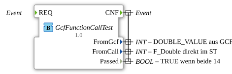
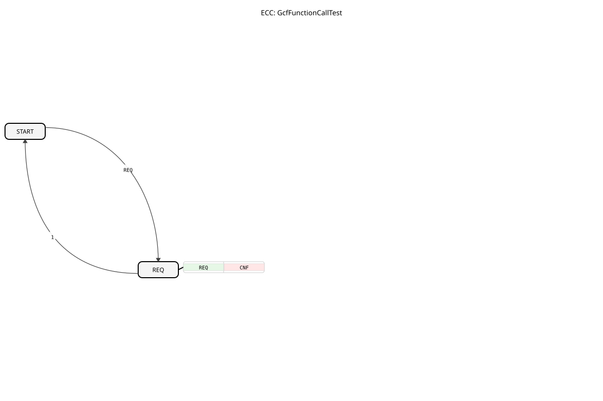

# GcfFunctionCallTest: Test für die Function aus der GCF



* * * * * * * * * *

## Einleitung

`GcfFunctionCallTest` ist ein Basic FB im Paket `Meins::GcfFunctionCall`. Er vergleicht den Wert `DOUBLE_VALUE` aus der GCF mit einem direkten Aufruf der ST-Function `F_Double`.



## Schnittstelle

| Name | Typ | Erklärung |
|---|---|---|
| `REQ` | Ereigniseingang | Startet die Berechnung |
| `CNF` | Ereignisausgang (`With` = `FromGcf`, `FromCall`, `Passed`) | Bestätigung |
| `FromGcf` | `INT` | `DOUBLE_VALUE` aus der GCF |
| `FromCall` | `INT` | `F_Double(BASE_VALUE)`, direkt im ST berechnet |
| `Passed` | `BOOL` | TRUE, wenn beide Werte 14 sind |

## Programmablauf

Der ECC hat zwei Zustände: `START` und `REQ`. Bei `REQ` läuft der Algorithmus `REQ` und sendet `CNF`:

```
FromGcf := DOUBLE_VALUE;
FromCall := Meins::GcfFunctionCall::F_Double(BASE_VALUE);
Passed := (FromGcf = 14) AND (FromCall = 14);
```

## Zusammenfassung

Der Baustein prüft, dass der Wert aus der GCF und der direkte Funktionsaufruf zum selben Ergebnis führen (14).

---

### 🌐 Passende Themen-Unterseiten auf ms-muc-docs.de

- [🌐 Eclipse 4diac IDE & Farb-Referenz auf ms-muc-docs.de](https://www.ms-muc-docs.de/iec-61499/eclipse-4diac/)
