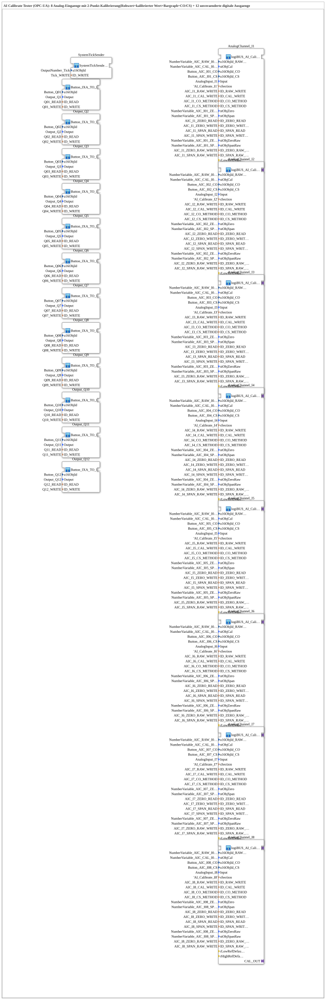

# InputOutputTesterButton_AI_Calibrate_2P_OPC_UA: AI Calibrate Tester (OPC-UA), 2-Punkt

* * * * * * * * * *

## Einleitung

`InputOutputTesterButton_AI_Calibrate_2P_OPC_UA` ist das Trainingsbeispiel für **8 analoge Eingänge mit 2-Punkt-Kalibrierung** (Nullpunkt/Spanne), bedienbar sowohl über den ISOBUS-Virtual-Terminal als auch über OPC-UA (Web-Client). Jeder Kanal zeigt Rohwert, kalibrierten Wert und Bargraph an; die Kalibrierung wird mit zwei Tasten (CO = Nullpunkt, CS = Spanne) ausgelöst. Die 12 digitalen Ausgänge sind unverändert aus dem [`InputOutputTesterButton_DIDO_OPC_UA`](../Button_DIDO_OPC_UA/InputOutputTesterButton_DIDO_OPC_UA.md)-Beispiel übernommen.

Gegenüber dem Vorgänger [`InputOutputTesterButton_AI_Calibrate_OPC_UA`](../Button_AI_Calibrate_OPC_UA/InputOutputTesterButton_AI_Calibrate_OPC_UA.md) wurde die Kalibrierlogik umgebaut: Statt `AR_CALIBRATE_SQ_REF` mit OFFSET/SCALE arbeitet der Kanalbaustein mit `AR_CALIBRATE_2P_REF`, das die beiden Rohwerte (`X_LOW`/`X_HIGH`) und die beiden Referenzwerte (`LOW_REF`/`HIGH_REF`) unabhängig voneinander speichert. Eine feste Reihenfolge CO vor CS ist daher nicht mehr nötig. Die Fernauslösung über OPC-UA erfolgt nicht mehr über Toggle-Knoten (`AX_SUBSCRIBE`/`AX_RF_TRIG`), sondern über argumentlose OPC-UA-**Methodenaufrufe** (`ID_CO_METHOD`/`ID_CS_METHOD`), die als Ereignis direkt an die Kalibrierung gehen.

## Verwendete Funktionsbausteine (FBs)

| Instanz | Typ | Parameter | Erklärung |
|---|---|---|---|
| `AnalogChannel_I1` … `AnalogChannel_I8` | [`MyLib::sys::logiBUS_AI_Calibrate_2P_IDA_OPC`](https://meisterschulen-am-ostbahnhof-munchen-docs.readthedocs.io/projects/4diac-library-reference-docs/de/latest/Bibliotheken/ExternalLibraries/MyLib_AX/sys/logiBUS_AI_Calibrate_2P_IDA_OPC/) | `Input` = `AnalogInput_I1`…`I8`; `sSection` = `'AI_Calibrate_I1'`…`'AI_Calibrate_I8'`; VT-Objekte `NumberVariable_AIC_RAW_I0n`, `NumberVariable_AIC_CAL_I0n_N`, `Button_AIC_I0n_CO`/`_CS`; OPC-UA-IDs `AIC_In_RAW_WRITE`, `AIC_In_CAL_WRITE`, `AIC_In_CO_METHOD`, `AIC_In_CS_METHOD` | Analogeingang mit 2-Punkt-Kalibrierung, VT-Anzeige (Rohwert, kalibriert, Bargraph) und OPC-UA-Anbindung |
| `Output_Q1` … `Output_Q12` | [`MyLib::sys::Button_IXA_TO_logiBUS_QXA_BG_OPC`](https://meisterschulen-am-ostbahnhof-munchen-docs.readthedocs.io/projects/4diac-library-reference-docs/de/latest/Bibliotheken/ExternalLibraries/MyLib_AX/sys/Button_IXA_TO_logiBUS_QXA_BG_OPC/) | `u16ObjId` = `Button_Q01`…`Q12`; `Output` = `Output_Q1`…`Q12`; `ID_READ`/`ID_WRITE` = `Q01_READ`/`Q01_WRITE` … | Digitaler Ausgang, unverändert aus dem DIDO-Beispiel |
| `SystemTickSender` | [`MyLib::sys::SystemTickSender_ISO_OPC`](https://meisterschulen-am-ostbahnhof-munchen-docs.readthedocs.io/projects/4diac-library-reference-docs/de/latest/Bibliotheken/ExternalLibraries/MyLib_AX/sys/SystemTickSender_ISO_OPC/) | `u16ObjId` = `OutputNumber_Tick`; `ID_WRITE` = `Tick_WRITE` | Zyklischer Zähler als Lebenszeichen, auf VT-Zahlenfeld und per OPC-UA veröffentlicht |

### Zusätzliche Parameter der Kanalbausteine

Jeder `AnalogChannel_In` erhält außerdem die Referenzwerte und Rohwert-Diagnose als VT-Objekte und OPC-UA-Knoten:

- `stObjZero` = `NumberVariable_AIC_I0n_ZERO_N`, `stObjSpan` = `NumberVariable_AIC_I0n_SPAN_N`: VT-Eingabefelder für die Referenzwerte (Sollwert am Nullpunkt bzw. an der Spanne).
- `ID_ZERO_READ`/`ID_ZERO_WRITE`, `ID_SPAN_READ`/`ID_SPAN_WRITE`: OPC-UA-Knoten zum Setzen (Subscribe) und Zurückmelden (Publish) der Referenzwerte, z. B. `AIC_I1_ZERO_READ`.
- `stObjZeroRaw` = `NumberVariable_AIC_I0n_ZERORAW_N`, `stObjSpanRaw` = `NumberVariable_AIC_I0n_SPANRAW_N` sowie `ID_ZERO_RAW_WRITE`/`ID_SPAN_RAW_WRITE`: reine Anzeige der bei CO bzw. CS gespeicherten Rohwerte (VT und OPC-UA).

### Innenleben des Kanalbausteins

Laut Bibliotheksbaustein `logiBUS_AI_Calibrate_2P_IDA_OPC` (Version 1.x) besteht ein Kanal aus:

- `InputRaw` (`logiBUS_AI_Raw_VT_AR_OPC`): liest den Analogeingang, zeigt den Rohwert an und veröffentlicht ihn.
- `CALIBRATE` (`AR_CALIBRATE_2P_REF`, `QI=TRUE`, `xClipping=FALSE`): eigentliche 2-Punkt-Kalibrierung mit den Ereigniseingängen `C_LOW`/`C_HIGH`.
- `TriggerCO`, `TriggerCS` (`Button_Method_IE`): lösen die Kalibrierung durch die lokale VT-Taste **oder** den OPC-UA-Methodenaufruf aus.
- `Y_OFFSET_LIT`, `Y_SCALE_LIT` (`NumericValue_TO_AR2_OPC`): liefern die Referenzwerte aus VT-Eingabefeld bzw. OPC-UA.
- `INI_X_LOW`, `INI_X_HIGH`, `INI_LOW_REF`, `INI_HIGH_REF` (`INI_AR2`): persistieren die vier Kalibrierwerte unter `sSection` in der INI-Datei, sodass sie einen Neustart überstehen.
- `PublishCal`, `PublishZeroRaw`, `PublishSpanRaw` (`AR_TO_Q_Publish_OPC`): VT-Anzeige und OPC-UA-Publish von kalibriertem Wert und Rohwerten an den Kalibrierpunkten.

## Programmablauf und Verbindungen

Das SubApp-Netzwerk enthält **keine** Ereignis- oder Datenverbindungen zwischen den Instanzen: Die 21 Instanzen arbeiten unabhängig voneinander und werden ausschließlich über ihre Parameter (VT-Objekt-IDs, `AnalogInput_*`/`Output_*`-Konstanten, OPC-UA-Adressen) mit der Außenwelt verbunden.

1. **8 Analogkanäle**: `AnalogChannel_I1`…`AnalogChannel_I8` lesen `AnalogInput_I1`…`AnalogInput_I8`. CO speichert den aktuellen Rohwert als Nullpunkt, CS als Spanne; ausgelöst per VT-Taste oder OPC-UA-Methode (`AIC_I*_CO_METHOD`/`AIC_I*_CS_METHOD`). Rohwert und kalibrierter Wert gehen an VT und per OPC-UA (`AIC_I*_RAW_WRITE`/`AIC_I*_CAL_WRITE`) nach außen.
2. **12 digitale Ausgänge**: `Output_Q1`…`Output_Q12`, unverändert aus dem DIDO-Beispiel.
3. **Zeitgeber**: `SystemTickSender` speist das VT-Zahlenfeld `OutputNumber_Tick` und den OPC-UA-Knoten `Tick_WRITE`.

## Zusammenfassung

`InputOutputTesterButton_AI_Calibrate_2P_OPC_UA` zeigt die 2-Punkt-Kalibrierung von 8 Analogeingängen mit `AR_CALIBRATE_2P_REF`: unabhängig gespeicherte Rohwerte und Referenzwerte (INI-persistent), Auslösung von CO/CS wahlweise lokal per VT-Taste oder per OPC-UA-Methodenaufruf, Referenzwerte und Rohwert-Diagnose über VT und OPC-UA. Das Beispiel besteht aus nur drei Bausteintypen ohne Verbindungen im Netzwerk, die Logik steckt vollständig im Kanalbaustein.

---

### 🌐 Passende Themen-Unterseiten auf ms-muc-docs.de

- [🌐 Eclipse 4diac IDE & Farb-Referenz auf ms-muc-docs.de](https://www.ms-muc-docs.de/iec-61499/eclipse-4diac/)
