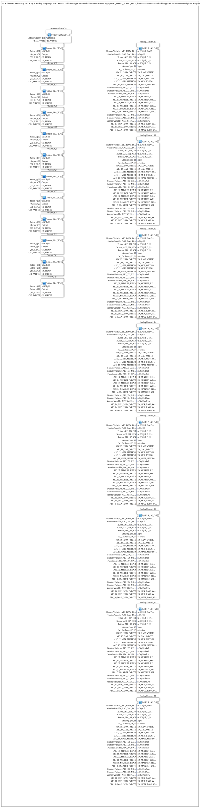

# InputOutputTesterButton_AI_Calibrate_3P_OPC_UA: AI Calibrate Tester (OPC-UA), 3-Punkt

* * * * * * * * * *

## Einleitung

`InputOutputTesterButton_AI_Calibrate_3P_OPC_UA` ist das Trainingsbeispiel für **8 analoge Eingänge mit 3-Punkt-Kalibrierung** (Minimum/Mitte/Maximum), gedacht für Sensoren mit Mittelstellung, z. B. einen Lenkwinkelsensor (links/geradeaus/rechts). Bedienung über den ISOBUS-Virtual-Terminal und über OPC-UA (Web-Client). Jeder Kanal zeigt Rohwert, kalibrierten Wert und Bargraph; kalibriert wird mit drei Tasten (C_MIN, C_MID, C_MAX). Die 12 digitalen Ausgänge sind unverändert aus dem [`InputOutputTesterButton_DIDO_OPC_UA`](../Button_DIDO_OPC_UA/InputOutputTesterButton_DIDO_OPC_UA.md)-Beispiel übernommen.

Das Beispiel ist das 3-Punkt-Pendant zu [`InputOutputTesterButton_AI_Calibrate_2P_OPC_UA`](../Button_AI_Calibrate_2P_OPC_UA/InputOutputTesterButton_AI_Calibrate_2P_OPC_UA.md) (Vorgänger: [`InputOutputTesterButton_AI_Calibrate_OPC_UA`](../Button_AI_Calibrate_OPC_UA/InputOutputTesterButton_AI_Calibrate_OPC_UA.md)): Der Kanalbaustein nutzt `AR_CALIBRATE_3P_REF` mit drei unabhängig gespeicherten Rohwerten (`X_MIN`/`X_MID`/`X_MAX`) und drei Referenzwerten (`MIN_REF`/`MID_REF`/`MAX_REF`). Alle drei Tasten sind auch als argumentlose OPC-UA-**Methodenaufrufe** (`ID_MIN_METHOD`/`ID_MID_TRIGGER_METHOD`/`ID_MAX_METHOD`) auslösbar.

## Verwendete Funktionsbausteine (FBs)

| Instanz | Typ | Parameter | Erklärung |
|---|---|---|---|
| `AnalogChannel_I1` … `AnalogChannel_I8` | [`MyLib::sys::logiBUS_AI_Calibrate_3P_IDA_OPC`](https://meisterschulen-am-ostbahnhof-munchen-docs.readthedocs.io/projects/4diac-library-reference-docs/de/latest/Bibliotheken/ExternalLibraries/MyLib_AX/sys/logiBUS_AI_Calibrate_3P_IDA_OPC/) | `Input` = `AnalogInput_I1`…`I8`; `sSection` = `'AI_Calibrate_3P_I1'`…`'AI_Calibrate_3P_I8'`; VT-Objekte `NumberVariable_AIC_RAW_I0n`, `NumberVariable_AIC_CAL_I0n_N`; Tasten `u16ObjId_C_MIN` = `Button_AIC_I0n_CO`, `u16ObjId_C_MID` = `Button_AIC_I0n_MID`, `u16ObjId_C_MAX` = `Button_AIC_I0n_CS`; OPC-UA-IDs `AIC_In_RAW_WRITE`, `AIC_In_CAL_WRITE`, `AIC_In_MIN_METHOD`, `AIC_In_MID_METHOD`, `AIC_In_MAX_METHOD` | Analogeingang mit 3-Punkt-Kalibrierung, VT-Anzeige (Rohwert, kalibriert, Bargraph) und OPC-UA-Anbindung |
| `Output_Q1` … `Output_Q12` | [`MyLib::sys::Button_IXA_TO_logiBUS_QXA_BG_OPC`](https://meisterschulen-am-ostbahnhof-munchen-docs.readthedocs.io/projects/4diac-library-reference-docs/de/latest/Bibliotheken/ExternalLibraries/MyLib_AX/sys/Button_IXA_TO_logiBUS_QXA_BG_OPC/) | `u16ObjId` = `Button_Q01`…`Q12`; `Output` = `Output_Q1`…`Q12`; `ID_READ`/`ID_WRITE` = `Q01_READ`/`Q01_WRITE` … | Digitaler Ausgang, unverändert aus dem DIDO-Beispiel |
| `SystemTickSender` | [`MyLib::sys::SystemTickSender_ISO_OPC`](https://meisterschulen-am-ostbahnhof-munchen-docs.readthedocs.io/projects/4diac-library-reference-docs/de/latest/Bibliotheken/ExternalLibraries/MyLib_AX/sys/SystemTickSender_ISO_OPC/) | `u16ObjId` = `OutputNumber_Tick`; `ID_WRITE` = `Tick_WRITE` | Zyklischer Zähler als Lebenszeichen, auf VT-Zahlenfeld und per OPC-UA veröffentlicht |

### Zusätzliche Parameter der Kanalbausteine

- `stObjMinRef` = `NumberVariable_AIC_I0n_ZERO_N`, `stObjMidRef` = `NumberVariable_AIC_I0n_MID_N`, `stObjMaxRef` = `NumberVariable_AIC_I0n_SPAN_N`: VT-Eingabefelder für die drei Referenzwerte.
- `ID_MINREF_READ`/`_WRITE`, `ID_MIDREF_READ`/`_WRITE`, `ID_MAXREF_READ`/`_WRITE` (z. B. `AIC_I1_MINREF_READ`): OPC-UA-Knoten zum Setzen (Subscribe) und Zurückmelden (Publish) der Referenzwerte.
- `stObjMinRaw`/`stObjMidRaw`/`stObjMaxRaw` = `NumberVariable_AIC_I0n_MINRAW_N`/`_MIDRAW_N`/`_MAXRAW_N` (plus je ein `ID_*_RAW_WRITE`-Knoten): reine Anzeige der an den drei Kalibrierpunkten gespeicherten Rohwerte.

### Innenleben des Kanalbausteins

Laut Bibliotheksbaustein `logiBUS_AI_Calibrate_3P_IDA_OPC`:

- `InputRaw` (`logiBUS_AI_Raw_VT_AR_OPC`): liest den Analogeingang, zeigt den Rohwert an und veröffentlicht ihn.
- `CALIBRATE` (`AR_CALIBRATE_3P_REF`, `QI=TRUE`, `xClipping=FALSE`): 3-Punkt-Kalibrierung mit den Ereigniseingängen `C_MIN`/`C_MID`/`C_MAX`.
- `TriggerMIN`, `TriggerMID`, `TriggerMAX` (`Button_Method_IE`): lösen per lokaler VT-Taste **oder** OPC-UA-Methodenaufruf aus; alle drei sind baugleich.
- `MIN_REF_LIT`, `MID_REF_LIT`, `MAX_REF_LIT` (`NumericValue_TO_AR2_OPC`): Referenzwerte aus VT-Eingabefeld bzw. OPC-UA.
- `INI_X_MIN`/`INI_X_MID`/`INI_X_MAX` (Vorgabe `0.0`) und `INI_MIN_REF`/`INI_MID_REF`/`INI_MAX_REF` (Vorgaben `-100.0`/`0.0`/`100.0`), alle `INI_AR2`: persistieren die sechs Eckwerte unter `sSection`.
- `PublishCal`, `PublishMinRaw`, `PublishMidRaw`, `PublishMaxRaw` (`AR_TO_Q_Publish_OPC`): VT-Anzeige und OPC-UA-Publish.

## Programmablauf und Verbindungen

Das SubApp-Netzwerk enthält **keine** Ereignis- oder Datenverbindungen zwischen den Instanzen: Die 21 Instanzen arbeiten unabhängig voneinander und werden ausschließlich über ihre Parameter (VT-Objekt-IDs, `AnalogInput_*`/`Output_*`-Konstanten, OPC-UA-Adressen) mit der Außenwelt verbunden.

1. **8 Analogkanäle**: `AnalogChannel_I1`…`AnalogChannel_I8` lesen `AnalogInput_I1`…`AnalogInput_I8`. Der Anwender fährt Minimum, Mitte und Maximum an und drückt jeweils C_MIN, C_MID bzw. C_MAX (VT-Taste oder OPC-UA-Methode `AIC_I*_MIN_METHOD`/`_MID_METHOD`/`_MAX_METHOD`). Rohwert und kalibrierter Wert gehen an VT und per OPC-UA (`AIC_I*_RAW_WRITE`/`AIC_I*_CAL_WRITE`) nach außen.
2. **12 digitale Ausgänge**: `Output_Q1`…`Output_Q12`, unverändert aus dem DIDO-Beispiel.
3. **Zeitgeber**: `SystemTickSender` speist das VT-Zahlenfeld `OutputNumber_Tick` und den OPC-UA-Knoten `Tick_WRITE`.

## Zusammenfassung

`InputOutputTesterButton_AI_Calibrate_3P_OPC_UA` zeigt die 3-Punkt-Kalibrierung von 8 Analogeingängen mit `AR_CALIBRATE_3P_REF` für Sensoren mit Mittelstellung: drei unabhängig gespeicherte Rohwerte und Referenzwerte (INI-persistent), Auslösung wahlweise per VT-Taste oder OPC-UA-Methodenaufruf, Referenzwerte und Rohwert-Diagnose über VT und OPC-UA. Das Netzwerk enthält keine Verbindungen, die Logik steckt vollständig im Kanalbaustein.

---

### 🌐 Passende Themen-Unterseiten auf ms-muc-docs.de

- [🌐 Eclipse 4diac IDE & Farb-Referenz auf ms-muc-docs.de](https://www.ms-muc-docs.de/iec-61499/eclipse-4diac/)
