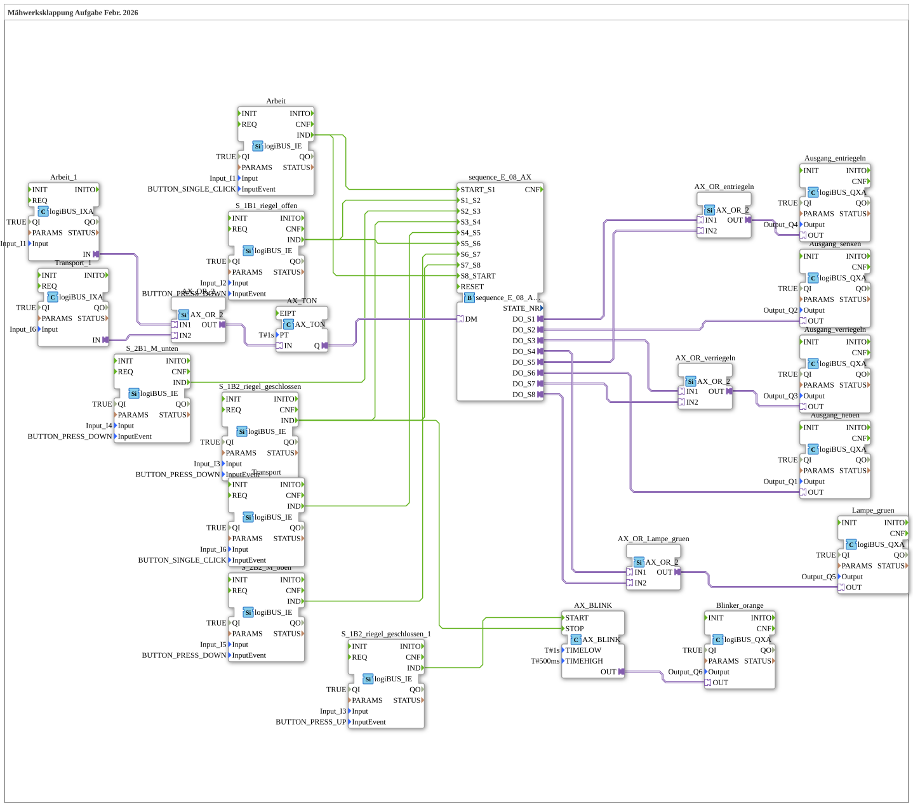

# Maehwerksklappung_DM: Mähwerksklappung mit Totmann

* * * * * * * * * *

## Einleitung

`Maehwerksklappung_DM` ist die Aufgabe "Mähwerksklappung" vom Februar 2026 (Kommentar im Typ) in der Variante mit Totmannschalter (`DM`). Eine achtstufige Ablaufsteuerung `sequence_E_08_AX_DM` schaltet über sechs Eingänge (`Input_I1`…`Input_I6`) die Ausgänge `Output_Q1`…`Output_Q6` für Heben, Senken, Verriegeln, Entriegeln, grüne Lampe und orange Blinklampe. Die SubApp hat keine eigene Schnittstelle.

## Verwendete Funktionsbausteine (FBs)

| Instanz | Typ | Parameter | Erklärung |
|---|---|---|---|
| `Arbeit` | [`logiBUS::io::DI::logiBUS_IE`](https://meisterschulen-am-ostbahnhof-munchen-docs.readthedocs.io/projects/4diac-library-reference-docs/de/latest/Bibliotheken/ExternalLibraries/logiBUS/io/DI/logiBUS_IE/) | `Input` = `Input_I1`, `InputEvent` = `BUTTON_SINGLE_CLICK` | Taster Arbeit: startet bzw. beendet die Sequenz. |
| `S_1B1_riegel_offen` | [`logiBUS::io::DI::logiBUS_IE`](https://meisterschulen-am-ostbahnhof-munchen-docs.readthedocs.io/projects/4diac-library-reference-docs/de/latest/Bibliotheken/ExternalLibraries/logiBUS/io/DI/logiBUS_IE/) | `Input` = `Input_I2`, `InputEvent` = `BUTTON_PRESS_DOWN` | Meldung Riegel offen. |
| `S_1B2_riegel_geschlossen` | [`logiBUS::io::DI::logiBUS_IE`](https://meisterschulen-am-ostbahnhof-munchen-docs.readthedocs.io/projects/4diac-library-reference-docs/de/latest/Bibliotheken/ExternalLibraries/logiBUS/io/DI/logiBUS_IE/) | `Input` = `Input_I3`, `InputEvent` = `BUTTON_PRESS_DOWN` | Meldung Riegel geschlossen. |
| `S_1B2_riegel_geschlossen_1` | [`logiBUS::io::DI::logiBUS_IE`](https://meisterschulen-am-ostbahnhof-munchen-docs.readthedocs.io/projects/4diac-library-reference-docs/de/latest/Bibliotheken/ExternalLibraries/logiBUS/io/DI/logiBUS_IE/) | `Input` = `Input_I3`, `InputEvent` = `BUTTON_PRESS_UP` | Gleicher Eingang I3, aber Ereignis beim Loslassen. |
| `S_2B1_M_unten` | [`logiBUS::io::DI::logiBUS_IE`](https://meisterschulen-am-ostbahnhof-munchen-docs.readthedocs.io/projects/4diac-library-reference-docs/de/latest/Bibliotheken/ExternalLibraries/logiBUS/io/DI/logiBUS_IE/) | `Input` = `Input_I4`, `InputEvent` = `BUTTON_PRESS_DOWN` | Meldung Mähwerk unten. |
| `S_2B2_M_oben` | [`logiBUS::io::DI::logiBUS_IE`](https://meisterschulen-am-ostbahnhof-munchen-docs.readthedocs.io/projects/4diac-library-reference-docs/de/latest/Bibliotheken/ExternalLibraries/logiBUS/io/DI/logiBUS_IE/) | `Input` = `Input_I5`, `InputEvent` = `BUTTON_PRESS_DOWN` | Meldung Mähwerk oben. |
| `Transport` | [`logiBUS::io::DI::logiBUS_IE`](https://meisterschulen-am-ostbahnhof-munchen-docs.readthedocs.io/projects/4diac-library-reference-docs/de/latest/Bibliotheken/ExternalLibraries/logiBUS/io/DI/logiBUS_IE/) | `Input` = `Input_I6`, `InputEvent` = `BUTTON_SINGLE_CLICK` | Taster Transport. |
| `Arbeit_1` | [`logiBUS::io::DI::logiBUS_IXA`](https://meisterschulen-am-ostbahnhof-munchen-docs.readthedocs.io/projects/4diac-library-reference-docs/de/latest/Bibliotheken/ExternalLibraries/logiBUS/io/DI/logiBUS_IXA/) | `Input` = `Input_I1` | Pegel von I1 als Adapter (für den Totmann-Zweig). |
| `Transport_1` | [`logiBUS::io::DI::logiBUS_IXA`](https://meisterschulen-am-ostbahnhof-munchen-docs.readthedocs.io/projects/4diac-library-reference-docs/de/latest/Bibliotheken/ExternalLibraries/logiBUS/io/DI/logiBUS_IXA/) | `Input` = `Input_I6` | Pegel von I6 als Adapter (für den Totmann-Zweig). |
| `AX_OR_2` | [`adapter::booleanOperators::AX_OR_2`](https://meisterschulen-am-ostbahnhof-munchen-docs.readthedocs.io/projects/4diac-library-reference-docs/de/latest/Bibliotheken/ExternalLibraries/adapter/booleanOperators/AX_OR_2/) | - | Verknüpft `Arbeit_1` und `Transport_1`. |
| `AX_TON` | [`adapter::events::unidirectional::timers::AX_TON`](https://meisterschulen-am-ostbahnhof-munchen-docs.readthedocs.io/projects/4diac-library-reference-docs/de/latest/Bibliotheken/ExternalLibraries/adapter/events/unidirectional/BOOL/timers/AX_TON/) | `PT` = `T#1s` | Einschaltverzögerung 1 s; Ausgang `Q` speist den Eingang `DM` der Sequenz. |
| `sequence_E_08_AX` | [`logiBUS::utils::sequence::event::sequence_E_08_AX_DM`](https://meisterschulen-am-ostbahnhof-munchen-docs.readthedocs.io/projects/4diac-library-reference-docs/de/latest/Bibliotheken/ExternalLibraries/logiBUS/utils/sequence/event/sequence_E_08_AX_DM/) | - | Achtstufige ereignisgesteuerte Ablaufsteuerung mit Totmann-Eingang (`DM`); Ausgänge `DO_S1`…`DO_S8`. |
| `AX_OR_entriegeln` | [`adapter::booleanOperators::AX_OR_2`](https://meisterschulen-am-ostbahnhof-munchen-docs.readthedocs.io/projects/4diac-library-reference-docs/de/latest/Bibliotheken/ExternalLibraries/adapter/booleanOperators/AX_OR_2/) | - | `DO_S1` oder `DO_S5` → Ausgang entriegeln. |
| `AX_OR_verriegeln` | [`adapter::booleanOperators::AX_OR_2`](https://meisterschulen-am-ostbahnhof-munchen-docs.readthedocs.io/projects/4diac-library-reference-docs/de/latest/Bibliotheken/ExternalLibraries/adapter/booleanOperators/AX_OR_2/) | - | `DO_S3` oder `DO_S7` → Ausgang verriegeln. |
| `AX_OR_Lampe_gruen` | [`adapter::booleanOperators::AX_OR_2`](https://meisterschulen-am-ostbahnhof-munchen-docs.readthedocs.io/projects/4diac-library-reference-docs/de/latest/Bibliotheken/ExternalLibraries/adapter/booleanOperators/AX_OR_2/) | - | `DO_S4` oder `DO_S8` → grüne Lampe. |
| `AX_BLINK` | [`adapter::events::unidirectional::signals::AX_BLINK`](https://meisterschulen-am-ostbahnhof-munchen-docs.readthedocs.io/projects/4diac-library-reference-docs/de/latest/Bibliotheken/ExternalLibraries/adapter/events/unidirectional/BOOL/signals/AX_BLINK/) | `TIMELOW` = `T#1s`, `TIMEHIGH` = `T#500ms` | Blinkgenerator für die orange Lampe. |
| `Ausgang_heben` | [`logiBUS::io::DQ::logiBUS_QXA`](https://meisterschulen-am-ostbahnhof-munchen-docs.readthedocs.io/projects/4diac-library-reference-docs/de/latest/Bibliotheken/ExternalLibraries/logiBUS/io/DO/logiBUS_QXA/) | `Output` = `Output_Q1` | Mähwerk heben. |
| `Ausgang_senken` | [`logiBUS::io::DQ::logiBUS_QXA`](https://meisterschulen-am-ostbahnhof-munchen-docs.readthedocs.io/projects/4diac-library-reference-docs/de/latest/Bibliotheken/ExternalLibraries/logiBUS/io/DO/logiBUS_QXA/) | `Output` = `Output_Q2` | Mähwerk senken. |
| `Ausgang_verriegeln` | [`logiBUS::io::DQ::logiBUS_QXA`](https://meisterschulen-am-ostbahnhof-munchen-docs.readthedocs.io/projects/4diac-library-reference-docs/de/latest/Bibliotheken/ExternalLibraries/logiBUS/io/DO/logiBUS_QXA/) | `Output` = `Output_Q3` | Verriegeln. |
| `Ausgang_entriegeln` | [`logiBUS::io::DQ::logiBUS_QXA`](https://meisterschulen-am-ostbahnhof-munchen-docs.readthedocs.io/projects/4diac-library-reference-docs/de/latest/Bibliotheken/ExternalLibraries/logiBUS/io/DO/logiBUS_QXA/) | `Output` = `Output_Q4` | Entriegeln. |
| `Lampe_gruen` | [`logiBUS::io::DQ::logiBUS_QXA`](https://meisterschulen-am-ostbahnhof-munchen-docs.readthedocs.io/projects/4diac-library-reference-docs/de/latest/Bibliotheken/ExternalLibraries/logiBUS/io/DO/logiBUS_QXA/) | `Output` = `Output_Q5` | Grüne Lampe. |
| `Blinker_orange` | [`logiBUS::io::DQ::logiBUS_QXA`](https://meisterschulen-am-ostbahnhof-munchen-docs.readthedocs.io/projects/4diac-library-reference-docs/de/latest/Bibliotheken/ExternalLibraries/logiBUS/io/DO/logiBUS_QXA/) | `Output` = `Output_Q6` | Orange Blinklampe. |

## Programmablauf und Verbindungen

**Schrittkette (Ereignisse → `sequence_E_08_AX`):**

| Übergang | Auslösendes Ereignis |
|---|---|
| `START_S1` | `Arbeit.IND` |
| `S1_S2` | `S_1B1_riegel_offen.IND` |
| `S2_S3` | `S_2B1_M_unten.IND` |
| `S3_S4` | `S_1B2_riegel_geschlossen.IND` |
| `S4_S5` | `Transport.IND` |
| `S5_S6` | `S_1B1_riegel_offen.IND` |
| `S6_S7` | `S_2B2_M_oben.IND` |
| `S7_S8` | `S_1B2_riegel_geschlossen.IND` |
| `S8_START` | `Arbeit.IND` |

Die Kommentare im Netzwerk benennen S4 als Zustand "Arbeit" und S8 als Zustand "Transport".

**Zuordnung der Zustandsausgänge:**

1. `DO_S1` und `DO_S5` → `AX_OR_entriegeln` → `Ausgang_entriegeln` (Q4).
2. `DO_S2` → `Ausgang_senken` (Q2).
3. `DO_S3` und `DO_S7` → `AX_OR_verriegeln` → `Ausgang_verriegeln` (Q3).
4. `DO_S4` und `DO_S8` → `AX_OR_Lampe_gruen` → `Lampe_gruen` (Q5).
5. `DO_S6` → `Ausgang_heben` (Q1).

**Blinker:** `S_1B2_riegel_geschlossen.IND` (I3 gedrückt) → `AX_BLINK.STOP`; `S_1B2_riegel_geschlossen_1.IND` (I3 losgelassen) → `AX_BLINK.START`; `AX_BLINK.OUT` → `Blinker_orange` (Q6).

**Totmann:** `Arbeit_1.IN` und `Transport_1.IN` → `AX_OR_2` → `AX_TON` (1 s) → `sequence_E_08_AX.DM`.

## Zusammenfassung

`Maehwerksklappung_DM` zeigt eine vollständig ereignisgesteuerte achtstufige Sequenz (Entriegeln, Senken, Verriegeln, Arbeit, Entriegeln, Heben, Verriegeln, Transport) mit Totmann-Freigabe über eine 1-s-Einschaltverzögerung sowie einer Blinkanzeige.

---

### 🌐 Passende Themen-Unterseiten auf ms-muc-docs.de

- [🌐 Eclipse 4diac IDE & Farb-Referenz auf ms-muc-docs.de](https://www.ms-muc-docs.de/iec-61499/eclipse-4diac/)
