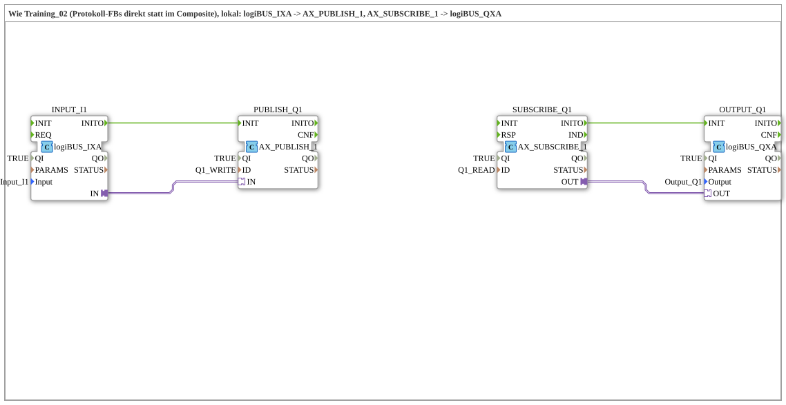

# Uebung_OPC_L02_AX: Lokales I1→Q1 mit Protokoll-FBs direkt

* * * * * * * * * *

## Einleitung

`Uebung_OPC_L02_AX` entspricht [`Training_02_OPC_UA_RES`](../../../test_VV/03_OPC_UA/Training_02_OPC_UA_RES/Training_02_OPC_UA_RES.md) (test_VV), aber lokal: Die Protokollbausteine [`AX_PUBLISH_1`](https://meisterschulen-am-ostbahnhof-munchen-docs.readthedocs.io/projects/4diac-library-reference-docs/de/latest/Bibliotheken/ExternalLibraries/adapter/net/AX_PUBLISH_1/) und [`AX_SUBSCRIBE_1`](https://meisterschulen-am-ostbahnhof-munchen-docs.readthedocs.io/projects/4diac-library-reference-docs/de/latest/Bibliotheken/ExternalLibraries/adapter/net/AX_SUBSCRIBE_1/) stehen direkt im Netzwerk statt in einem Composite. `logiBUS_IXA` → `AX_PUBLISH_1` schreibt den Eingang lokal in den Knoten, `AX_SUBSCRIBE_1` → `logiBUS_QXA` liest ihn lokal und schaltet den Ausgang. Die Schnittstelle der SubApp ist leer.

## Verwendete Funktionsbausteine (FBs)

| Instanz | Typ | Parameter | Erklärung |
|---|---|---|---|
| `INPUT_I1` | [`logiBUS_IXA`](https://meisterschulen-am-ostbahnhof-munchen-docs.readthedocs.io/projects/4diac-library-reference-docs/de/latest/Bibliotheken/ExternalLibraries/logiBUS/io/DI/logiBUS_IXA/) | `QI` = `TRUE`, `Input` = `Input_I1` | Liest `Input_I1` und stellt den Zustand als AX-Adapter-Plug bereit |
| `PUBLISH_Q1` | [`AX_PUBLISH_1`](https://meisterschulen-am-ostbahnhof-munchen-docs.readthedocs.io/projects/4diac-library-reference-docs/de/latest/Bibliotheken/ExternalLibraries/adapter/net/AX_PUBLISH_1/) | `QI` = `TRUE`, `ID` = `Q1_WRITE` | Schreibt den Zustand lokal in den OPC-UA-Knoten (`WRITE` ohne Endpunkt) |
| `SUBSCRIBE_Q1` | [`AX_SUBSCRIBE_1`](https://meisterschulen-am-ostbahnhof-munchen-docs.readthedocs.io/projects/4diac-library-reference-docs/de/latest/Bibliotheken/ExternalLibraries/adapter/net/AX_SUBSCRIBE_1/) | `QI` = `TRUE`, `ID` = `Q1_READ` | Liest denselben Knoten lokal (`READ` ohne Endpunkt) |
| `OUTPUT_Q1` | [`logiBUS_QXA`](https://meisterschulen-am-ostbahnhof-munchen-docs.readthedocs.io/projects/4diac-library-reference-docs/de/latest/Bibliotheken/ExternalLibraries/logiBUS/io/DO/logiBUS_QXA/) | `QI` = `TRUE`, `Output` = `Output_Q1` | Schaltet `Output_Q1`, nimmt den Zustand über den AX-Adapter-Socket entgegen |

## OPC-UA-Adressraum

Alle Konstanten stehen in `const/OpcUaLokal.gcf` (Paket `Meins::OPC_UA_Lokal::const`). Die IDs werden mit [`F_OPC_LOCAL`](https://meisterschulen-am-ostbahnhof-munchen-docs.readthedocs.io/projects/4diac-library-reference-docs/de/latest/Bibliotheken/ExternalLibraries/MyLib_OPC/F_OPC_LOCAL/) (ohne Endpunkt) und [`F_OPC_REMOTE`](https://meisterschulen-am-ostbahnhof-munchen-docs.readthedocs.io/projects/4diac-library-reference-docs/de/latest/Bibliotheken/ExternalLibraries/MyLib_OPC/F_OPC_REMOTE/) (mit Endpunkt) aus je einem `*_NODE` berechnet.

| Konstante | Wert | Verwendet von |
|---|---|---|
| `Q1_NODE` | `"/Objects/DigitalOutput/Q1,1:s=Output_Q1"` | Knoten (wie in test_VV) |
| `Q1_WRITE` | `MyLib_OPC::F_OPC_LOCAL("WRITE", Q1_NODE)` | `PUBLISH_Q1` (`ID`) |
| `Q1_READ` | `MyLib_OPC::F_OPC_LOCAL("READ", Q1_NODE)` | `SUBSCRIBE_Q1` (`ID`) |

## Programmablauf und Verbindungen

1. `INPUT_I1.INITO` → `PUBLISH_Q1.INIT` (Ereignisverbindung).
2. `SUBSCRIBE_Q1.INITO` → `OUTPUT_Q1.INIT` (Ereignisverbindung).
3. `INPUT_I1.IN` → `PUBLISH_Q1.IN` (Adapterverbindung).
4. `SUBSCRIBE_Q1.OUT` → `OUTPUT_Q1.OUT` (Adapterverbindung).
5. Zwischen `PUBLISH_Q1` und `SUBSCRIBE_Q1` gibt es keine Modellverbindung; sie sind nur über den OPC-UA-Knoten `Q1_NODE` gekoppelt.

## Ergebnis

Nicht auf dem Gerät getestet.

## Lernziele

- Protokollbausteine `AX_PUBLISH_1`/`AX_SUBSCRIBE_1` direkt verdrahten, statt sie in einem Composite zu kapseln.
- Zuordnung der Aktionen: lokales `WRITE` (PUBLISH) und lokales `READ` (SUBSCRIBE).
- Initialisierungsreihenfolge über `INITO` → `INIT`.

**Empfohlene Reihenfolge**: `Uebung_OPC_L01_AX`, [`Training_02_OPC_UA_RES`](../../../test_VV/03_OPC_UA/Training_02_OPC_UA_RES/Training_02_OPC_UA_RES.md)

## Zusammenfassung

`Uebung_OPC_L02_AX` zeigt dasselbe I1→Q1-Muster wie L01, aber mit direkt im Netzwerk verdrahteten Protokollbausteinen `AX_PUBLISH_1` und `AX_SUBSCRIBE_1`.

---

### 🌐 Passende Themen-Unterseiten auf ms-muc-docs.de

- [🌐 Eclipse 4diac IDE & Farb-Referenz auf ms-muc-docs.de](https://www.ms-muc-docs.de/iec-61499/eclipse-4diac/)
