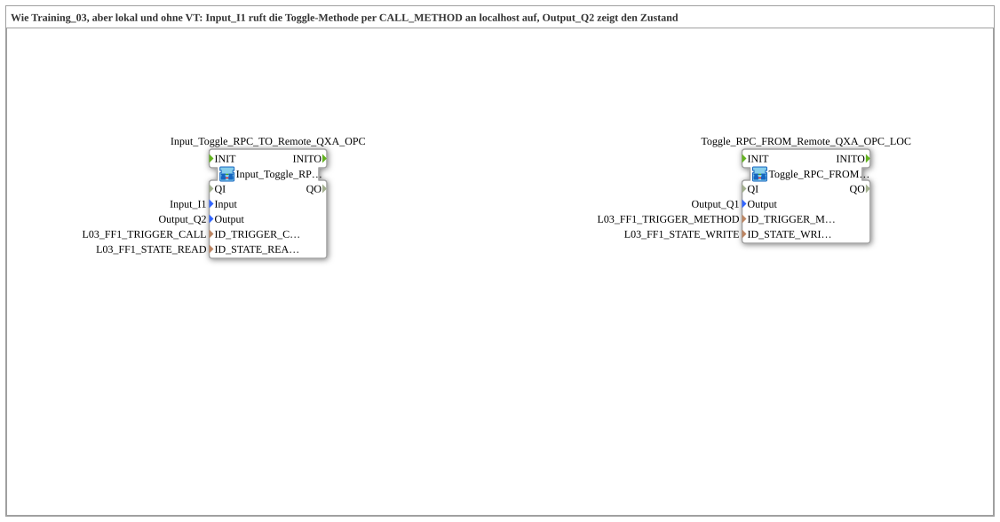

# Uebung_OPC_L03_AX: Toggle-Flipflop per OPC-UA-Methode lokal (ohne VT)

* * * * * * * * * *

## Einleitung

`Uebung_OPC_L03_AX` entspricht [`Training_03_OPC_UA_RES`](../../../test_VV/03_OPC_UA/Training_03_OPC_UA_RES/Training_03_OPC_UA_RES.md) (test_VV), aber lokal und **ohne VT**: Statt eines SoftKeys löst ein Tastendruck an `Input_I1` den Methodenaufruf aus. `Toggle_RPC_FROM_Remote_QXA_OPC_LOC` legt die Toggle-Methode lokal an (`SERVER_0`), taktet ein Toggle-Flipflop und schaltet `Output_Q1`. Der Zustand kommt lokal per `PUBLISH`/`SUBSCRIBE` zurück und wird auf `Output_Q2` angezeigt. Die Schnittstelle der SubApp ist leer.

`LOCAL_OPC` ist `"opc.tcp://localhost:4840"` (eigener Server) und wird nur für `CALL_METHOD` benötigt: Ein `CALL_METHOD` ist lokal nicht erlaubt und läuft deshalb als Remote-Aufruf mit Endpunkt an die eigene Station (localhost oder eigene IP; beides zählt als remote).

## Verwendete Funktionsbausteine (FBs)

| Instanz | Typ | Parameter | Erklärung |
|---|---|---|---|
| `Input_Toggle_RPC_TO_Remote_QXA_OPC` | [`Input_Toggle_RPC_TO_Remote_QXA_OPC`](https://meisterschulen-am-ostbahnhof-munchen-docs.readthedocs.io/projects/4diac-library-reference-docs/de/latest/Bibliotheken/ExternalLibraries/MyLib_AX/sys/Input_Toggle_RPC_TO_Remote_QXA_OPC/) | `Input` = `Input_I1`, `Output` = `Output_Q2`, `ID_TRIGGER_CALL` = `L03_FF1_TRIGGER_CALL`, `ID_STATE_READ` = `L03_FF1_STATE_READ` | [`logiBUS_IE`](https://meisterschulen-am-ostbahnhof-munchen-docs.readthedocs.io/projects/4diac-library-reference-docs/de/latest/Bibliotheken/ExternalLibraries/logiBUS/io/DI/logiBUS_IE/) (`BUTTON_PRESS_DOWN`) ruft per [`CLIENT_0`](https://meisterschulen-am-ostbahnhof-munchen-docs.readthedocs.io/projects/4diac-library-reference-docs/de/latest/Bibliotheken/StandardLibraries/net/CLIENT_0/) die Methode auf; [`AX_SUBSCRIBE_1`](https://meisterschulen-am-ostbahnhof-munchen-docs.readthedocs.io/projects/4diac-library-reference-docs/de/latest/Bibliotheken/ExternalLibraries/adapter/net/AX_SUBSCRIBE_1/) liest den Zustand lokal, [`logiBUS_QXA`](https://meisterschulen-am-ostbahnhof-munchen-docs.readthedocs.io/projects/4diac-library-reference-docs/de/latest/Bibliotheken/ExternalLibraries/logiBUS/io/DO/logiBUS_QXA/) zeigt ihn auf `Output_Q2` |
| `Toggle_RPC_FROM_Remote_QXA_OPC_LOC` | [`Toggle_RPC_FROM_Remote_QXA_OPC_LOC`](https://meisterschulen-am-ostbahnhof-munchen-docs.readthedocs.io/projects/4diac-library-reference-docs/de/latest/Bibliotheken/ExternalLibraries/MyLib_AX/sys/Toggle_RPC_FROM_Remote_QXA_OPC_LOC/) | `Output` = `Output_Q1`, `ID_TRIGGER_METHOD` = `L03_FF1_TRIGGER_METHOD`, `ID_STATE_WRITE` = `L03_FF1_STATE_WRITE` | [`SERVER_0`](https://meisterschulen-am-ostbahnhof-munchen-docs.readthedocs.io/projects/4diac-library-reference-docs/de/latest/Bibliotheken/StandardLibraries/net/SERVER_0/) legt die Methode lokal an und taktet [`AX_T_FF`](https://meisterschulen-am-ostbahnhof-munchen-docs.readthedocs.io/projects/4diac-library-reference-docs/de/latest/Bibliotheken/ExternalLibraries/adapter/events/unidirectional/BOOL/AX_T_FF/); [`AX_SPLIT_2`](https://meisterschulen-am-ostbahnhof-munchen-docs.readthedocs.io/projects/4diac-library-reference-docs/de/latest/Bibliotheken/ExternalLibraries/adapter/events/unidirectional/BOOL/AX_SPLIT_2/) verteilt den Zustand an [`logiBUS_QXA`](https://meisterschulen-am-ostbahnhof-munchen-docs.readthedocs.io/projects/4diac-library-reference-docs/de/latest/Bibliotheken/ExternalLibraries/logiBUS/io/DO/logiBUS_QXA/) (`Output_Q1`) und [`AX_PUBLISH_1`](https://meisterschulen-am-ostbahnhof-munchen-docs.readthedocs.io/projects/4diac-library-reference-docs/de/latest/Bibliotheken/ExternalLibraries/adapter/net/AX_PUBLISH_1/) (lokales `PUBLISH`) |

## OPC-UA-Adressraum

Alle Konstanten stehen in `const/OpcUaLokal.gcf` (Paket `Meins::OPC_UA_Lokal::const`). Die IDs werden mit [`F_OPC_LOCAL`](https://meisterschulen-am-ostbahnhof-munchen-docs.readthedocs.io/projects/4diac-library-reference-docs/de/latest/Bibliotheken/ExternalLibraries/MyLib_OPC/F_OPC_LOCAL/) (ohne Endpunkt) und [`F_OPC_REMOTE`](https://meisterschulen-am-ostbahnhof-munchen-docs.readthedocs.io/projects/4diac-library-reference-docs/de/latest/Bibliotheken/ExternalLibraries/MyLib_OPC/F_OPC_REMOTE/) (mit Endpunkt) aus je einem `*_NODE` berechnet.

`LOCAL_OPC` ist `"opc.tcp://localhost:4840"` (eigener Server) und wird nur für `CALL_METHOD` benötigt: Ein `CALL_METHOD` ist lokal nicht erlaubt und läuft deshalb als Remote-Aufruf mit Endpunkt an die eigene Station (localhost oder eigene IP; beides zählt als remote).

| Konstante | Wert | Verwendet von |
|---|---|---|
| `L03_FF1_TRIGGER_NODE` | `"/Objects/Lokal/L03/FF1_Trigger"` | Methodenknoten |
| `L03_FF1_TRIGGER_METHOD` | `MyLib_OPC::F_OPC_LOCAL("CREATE_METHOD", L03_FF1_TRIGGER_NODE)` | `Toggle_RPC_FROM_Remote_QXA_OPC_LOC` (`ID_TRIGGER_METHOD`, `SERVER_0`) |
| `L03_FF1_TRIGGER_CALL` | `MyLib_OPC::F_OPC_REMOTE("CALL_METHOD", LOCAL_OPC, L03_FF1_TRIGGER_NODE)` | `Input_Toggle_RPC_TO_Remote_QXA_OPC` (`ID_TRIGGER_CALL`, `CLIENT_0`) |
| `L03_FF1_STATE_NODE` | `"/Objects/Lokal/L03/FF1_State,1:s=L03_FF1_State"` | Knoten Flipflop-Zustand |
| `L03_FF1_STATE_WRITE` | `MyLib_OPC::F_OPC_LOCAL("WRITE", L03_FF1_STATE_NODE)` | `Toggle_RPC_FROM_Remote_QXA_OPC_LOC` (`ID_STATE_WRITE`) |
| `L03_FF1_STATE_READ` | `MyLib_OPC::F_OPC_LOCAL("READ", L03_FF1_STATE_NODE)` | `Input_Toggle_RPC_TO_Remote_QXA_OPC` (`ID_STATE_READ`) |

## Programmablauf und Verbindungen

1. **Zwei SubApps ohne Modellverbindung**: Die `.SUB` enthält `Input_Toggle_RPC_TO_Remote_QXA_OPC` (`x=0`) und `Toggle_RPC_FROM_Remote_QXA_OPC_LOC` (`x=4000`) und keine Verbindungen; die Kopplung läuft über OPC-UA.
2. **`Input_Toggle_RPC_TO_Remote_QXA_OPC`**: `TRIGGER_INPUT.IND` (Taster gedrückt) löst `TRIGGER_CLIENT.REQ` aus; `CLIENT_0` ruft `L03_FF1_TRIGGER_CALL` an localhost auf. Parallel liefert `STATE_SUBSCRIBE` (`AX_SUBSCRIBE_1`) den Zustand per Adapterverbindung an `STATE_OUTPUT.OUT` (`Output_Q2`).
3. **`Toggle_RPC_FROM_Remote_QXA_OPC_LOC`**: `TRIGGER_SERVER.IND` (Methode aufgerufen) taktet `AX_T_FF.CLK` und wird mit `TRIGGER_SERVER.RSP` beantwortet. `AX_T_FF.Q` geht an `AX_SPLIT_2.IN`; `OUT1` schaltet `DigitalOutput_Q1` (`Output_Q1`), `OUT2` speist `STATE_PUBLISH.IN` (`AX_PUBLISH_1`, lokales `WRITE`).
4. **Laufzeit**: Jeder Tastendruck an `Input_I1` kippt den Flipflop. `Output_Q1` folgt dem Flipflop direkt, `Output_Q2` zeigt den über OPC-UA zurückgelesenen Zustand.

## Ergebnis

Getestet auf FORTE_PC_AX (2026-10-18).
Hinweis: Jeder `SERVER_0` braucht `IND` → `RSP` direkt am eigenen Baustein, sonst stocken bis zu 4 s lang alle OPC-UA-Publishes der Station (Regel siehe [Übersicht](OPC_UA_Lokal.md)).

## Lernziele

- `CALL_METHOD` läuft nicht lokal, sondern als Remote-Aufruf mit Endpunkt an die eigene Station (`LOCAL_OPC`).
- Methode lokal anlegen (`CREATE_METHOD`/`SERVER_0`) und aufrufen (`CALL_METHOD`/`CLIENT_0`).
- Zustandsrückweg lokal über `PUBLISH`/`SUBSCRIBE`.

**Empfohlene Reihenfolge**: `Uebung_OPC_L01_AX`, [`Training_03_OPC_UA_RES`](../../../test_VV/03_OPC_UA/Training_03_OPC_UA_RES/Training_03_OPC_UA_RES.md)

## Zusammenfassung

`Uebung_OPC_L03_AX` zeigt das Toggle-Flipflop-Muster von Training_03 auf einem Gerät und ohne VT: `Input_I1` ruft die Methode per localhost auf, `Output_Q1` schaltet, `Output_Q2` zeigt den Zustand.

---

### 🌐 Passende Themen-Unterseiten auf ms-muc-docs.de

- [🌐 Eclipse 4diac IDE & Farb-Referenz auf ms-muc-docs.de](https://www.ms-muc-docs.de/iec-61499/eclipse-4diac/)
