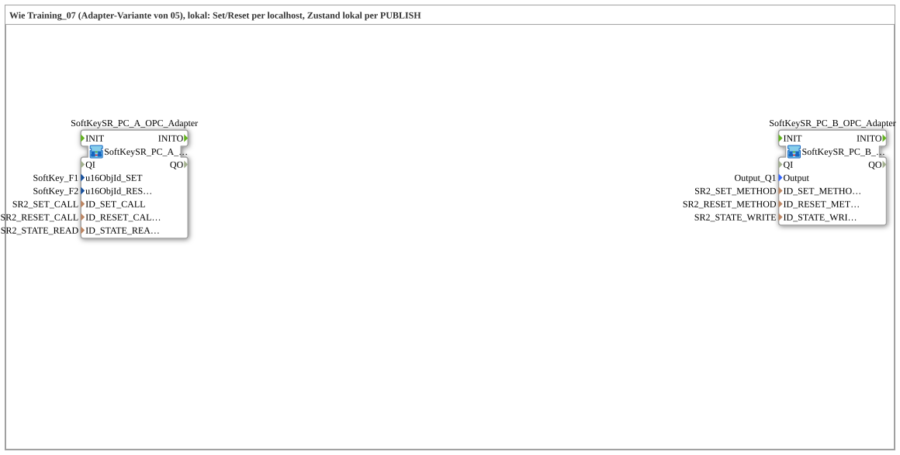

# Uebung_OPC_L07_AX: Set/Reset-Flipflop lokal per Methodenaufruf (Adapter-Variante)

* * * * * * * * * *

## Einleitung

`Uebung_OPC_L07_AX` ist die lokale Variante von `Training_07_OPC_UA_RES` (Adapter-Variante von Training_05): Zwei SoftKeys setzen (`SoftKey_F1`) und löschen (`SoftKey_F2`) einen Set/Reset-Zustand, der `Output_Q1` schaltet. Die beiden Hälften der Vorlage (Gerät A und Gerät B) laufen hier auf **einem** Gerät: Die Methodenaufrufe gehen per `localhost` an die eigene Station, der Zustand wird lokal per `PUBLISH` geschrieben und lokal per `SUBSCRIBE` gelesen, um den SoftKey-Hintergrund zu färben.

Das Netzwerk besteht aus zwei SubApps ohne Verbindungen untereinander; die Kopplung läuft ausschließlich über die OPC-UA-Adressen (siehe unten).

Übersicht aller lokalen Übungen: [`OPC_UA_Lokal.md`](./OPC_UA_Lokal.md).

## Verwendete Funktionsbausteine (FBs)

| Name | Typ | Parameter | Erklärung |
|---|---|---|---|
| `SoftKeySR_PC_A_OPC_Adapter` | [`SoftKeySR_PC_A_OPC_Adapter`](https://meisterschulen-am-ostbahnhof-munchen-docs.readthedocs.io/projects/4diac-library-reference-docs/de/latest/Bibliotheken/ExternalLibraries/MyLib_AX/sys/SoftKeySR_PC_A_OPC_Adapter/) | `u16ObjId_SET` = `SoftKey_F1`, `u16ObjId_RESET` = `SoftKey_F2`, `ID_SET_CALL` = `SR2_SET_CALL`, `ID_RESET_CALL` = `SR2_RESET_CALL`, `ID_STATE_READ` = `SR2_STATE_READ` | Clientseite (HMI): `SoftKeySR_ASR_AX` bündelt die beiden SoftKeys und den `GreenWhiteBackground` hinter einem `ASR_AX`-Plug; `ASR_AX_CLIENT_0_SUBSCRIBE_1` (`TRIGGER`) ruft die Set-/Reset-Methode per `CALL_METHOD` auf und liest den Zustand per `SUBSCRIBE`. |
| `SoftKeySR_PC_B_OPC_Adapter` | [`SoftKeySR_PC_B_OPC_Adapter_LOC`](https://meisterschulen-am-ostbahnhof-munchen-docs.readthedocs.io/projects/4diac-library-reference-docs/de/latest/Bibliotheken/ExternalLibraries/MyLib_AX/sys/SoftKeySR_PC_B_OPC_Adapter_LOC/) | `Output` = `Output_Q1`, `ID_SET_METHOD` = `SR2_SET_METHOD`, `ID_RESET_METHOD` = `SR2_RESET_METHOD`, `ID_STATE_WRITE` = `SR2_STATE_WRITE` | Serverseite (lokale Variante `_LOC`): `ASR_AX_SERVER_0_PUBLISH_1` legt die beiden Methoden lokal an (`CREATE_METHOD`) und schreibt den Zustand lokal per `PUBLISH`; `ASR_AX_AX_SPLIT` verteilt an `ASR_AX_SR_2` (`FLIPFLOP`) und an `DigitalOutput_Q1`. |

## OPC-UA-Adressraum

Die IDs stammen aus `const\OpcUaLokal.gcf` (Paket `Meins::OPC_UA_Lokal::const`) und werden mit den Functions der Lib `MyLib_OPC` berechnet (`F_OPC_LOCAL`, `F_OPC_REMOTE`).

| Konstante | Aktion | Knoten / Methode | Bedeutung |
|---|---|---|---|
| `SR2_SET_METHOD` | `CREATE_METHOD` | `/Objects/SRFlipflop/SR2_Set` | Set-Methode lokal anlegen |
| `SR2_SET_CALL` | `CALL_METHOD` | `/Objects/SRFlipflop/SR2_Set` @ `opc.tcp://localhost:4840` | Set-Methode per localhost aufrufen |
| `SR2_RESET_METHOD` | `CREATE_METHOD` | `/Objects/SRFlipflop/SR2_Reset` | Reset-Methode lokal anlegen |
| `SR2_RESET_CALL` | `CALL_METHOD` | `/Objects/SRFlipflop/SR2_Reset` @ `opc.tcp://localhost:4840` | Reset-Methode per localhost aufrufen |
| `SR2_STATE_WRITE` | `WRITE` | `/Objects/SRFlipflop/SR2_State,1:s=SR2_State` | Zustand lokal schreiben (PUBLISH) |
| `SR2_STATE_READ` | `READ` | `/Objects/SRFlipflop/SR2_State,1:s=SR2_State` | Zustand lokal lesen (SUBSCRIBE) |

## Programmablauf und Verbindungen

1. **`SoftKeySR_PC_A_OPC_Adapter`**: keine Verbindungen im Netzwerk der Übung (die Verdrahtung steckt im Composite).
2. **`SoftKeySR_PC_B_OPC_Adapter`**: keine Verbindungen im Netzwerk der Übung (die Verdrahtung steckt im Composite).

## Technische Besonderheiten

- **Kein Netzwerk zwischen A und B**: Die Verbindung zwischen Client- und Serverhälfte läuft nur über die OPC-UA-Knoten; `SR2_SET_CALL`/`SR2_RESET_CALL` zielen per `LOCAL_OPC` (`opc.tcp://localhost:4840`) auf die eigene Station.
- **Gleicher Zustandsknoten, zwei Rollen**: `SR2_STATE_WRITE` (B, `PUBLISH`) und `SR2_STATE_READ` (A, `SUBSCRIBE`) verweisen auf denselben Knoten `SR2_State`.

## Lernziele

- Zwei Hälften einer Client/Server-Übung auf einem Gerät zusammenführen.
- Lokale Bausteinvarianten (`_LOC`) neben dem Client-Baustein mit Endpunkt verwenden.
- Methodenaufruf per `localhost` und lokales `PUBLISH`/`SUBSCRIBE` für den Zustand unterscheiden.

**Schwierigkeitsgrad**: Fortgeschritten  
**Empfohlene Reihenfolge**: `Training_07_OPC_UA_RES` (Vorlage, zwei Geräte)

## Hinweis / Ergebnis

- **Nicht auf dem Gerät getestet.** Auf `FORTE_PC_AX` getestet sind bisher nur L01, L03 und L19; `Uebung_OPC_L07_AX` wurde noch nicht auf dem Gerät ausgeführt.
- Lokal (ohne Endpunkt) laufen `READ`/`SUBSCRIBE`, `WRITE`/`PUBLISH`, `CREATE_METHOD`/`SERVER` und `PUBLISH_0`. `CALL_METHOD` und die Client-Subscription laufen dagegen mit Endpunkt an die eigene Station (`localhost` oder eigene IP; beides zählt als remote).
Hinweis: Jeder `SERVER_0` braucht `IND` → `RSP` direkt am eigenen Baustein, sonst stocken bis zu 4 s lang alle OPC-UA-Publishes der Station (Regel siehe [Übersicht](OPC_UA_Lokal.md)). Die SubApp `MyLib::net::ASR_AX_SERVER_0_PUBLISH_1` enthält die Selbstschleife.

## Zusammenfassung

`Uebung_OPC_L07_AX` führt die beiden Geräte von `Training_07_OPC_UA_RES` auf einem Gerät zusammen: Set/Reset per Methodenaufruf über `localhost`, Zustand lokal per `PUBLISH`/`SUBSCRIBE`.

---

### 🌐 Passende Themen-Unterseiten auf ms-muc-docs.de

- [🌐 Eclipse 4diac IDE & Farb-Referenz auf ms-muc-docs.de](https://www.ms-muc-docs.de/iec-61499/eclipse-4diac/)
