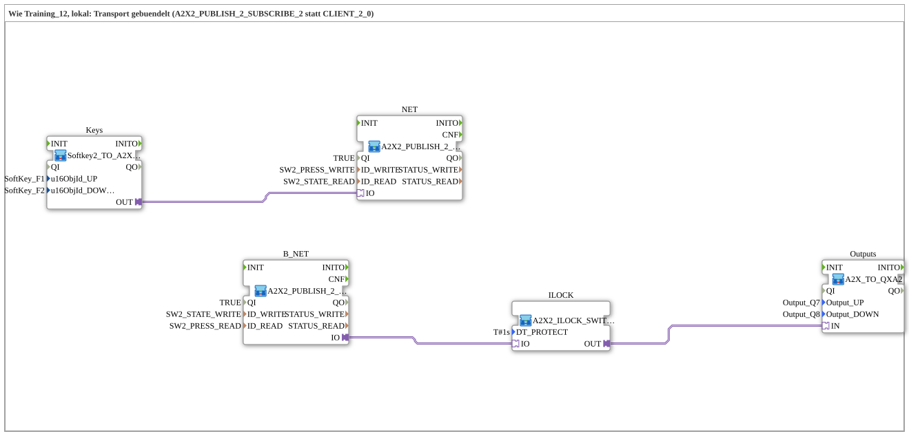

# Uebung_OPC_L12_AX: Hoch/Runter-Schalter lokal — gebündelte A2X-Transportschicht

* * * * * * * * * *

## Einleitung

`Uebung_OPC_L12_AX` entspricht funktional `Uebung_OPC_L11_AX`, bündelt aber die Transportschicht (lokale Variante von `Training_12_OPC_UA_RES`): Statt je 2x `AX_PUBLISH_1`/`AX_SUBSCRIBE_1` übernimmt **ein** Baustein den kompletten lokalen Roundtrip für Hoch und Runter (je ein `PUBLISH_2`/`SUBSCRIBE_2`, 2 Werte pro Aufruf, 2 Konstanten). `A2X2_PUBLISH_2_SUBSCRIBE_2` und `A2X2_PUBLISH_2_SUBSCRIBE_2_PLUG` ersetzen die Remote-Bausteine `CLIENT_2_0` der Vorlage. Alles läuft auf **einem** Gerät ohne Endpunkt.

- Die 4 lokalen Bausteine (2 SoftKeys + 2 `GreenWhiteBackground`) stecken gebündelt in `Keys` (`Softkey2_TO_A2X2_BG`), das nach außen nur einen `A2X2`-Plug zeigt; dieser wird direkt in `NET` gesteckt.
- `B_NET` (Plug-Variante) übernimmt den Rückweg; `ILOCK` kapselt Bridge, Interlock und Split; `Outputs` entbündelt auf die 2 physischen Ausgänge.

Übersicht aller lokalen Übungen: [`OPC_UA_Lokal.md`](./OPC_UA_Lokal.md).

## Verwendete Funktionsbausteine (FBs)

| Name | Typ | Parameter | Erklärung |
|---|---|---|---|
| `Keys` | [`Softkey2_TO_A2X2_BG`](https://meisterschulen-am-ostbahnhof-munchen-docs.readthedocs.io/projects/4diac-library-reference-docs/de/latest/Bibliotheken/ExternalLibraries/MyLib_AX/sys/Softkey2_TO_A2X2_BG/) | `u16ObjId_UP` = `SoftKey_F1`, `u16ObjId_DOWN` = `SoftKey_F2` | 2 SoftKeys und 2 `GreenWhiteBackground` gebündelt auf einen bidirektionalen `A2X2`-Adapterausgang. |
| `NET` | [`A2X2_PUBLISH_2_SUBSCRIBE_2`](https://meisterschulen-am-ostbahnhof-munchen-docs.readthedocs.io/projects/4diac-library-reference-docs/de/latest/Bibliotheken/ExternalLibraries/MyLib_AX/net/A2X2_PUBLISH_2_SUBSCRIBE_2/) | `QI` = `TRUE`, `ID_WRITE` = `SW2_PRESS_WRITE`, `ID_READ` = `SW2_STATE_READ` | Socket-Variante: schreibt beide Betätigungen lokal per `PUBLISH_2` und liest beide Zustände lokal per `SUBSCRIBE_2`. |
| `B_NET` | [`A2X2_PUBLISH_2_SUBSCRIBE_2_PLUG`](https://meisterschulen-am-ostbahnhof-munchen-docs.readthedocs.io/projects/4diac-library-reference-docs/de/latest/Bibliotheken/ExternalLibraries/MyLib_AX/net/A2X2_PUBLISH_2_SUBSCRIBE_2_PLUG/) | `QI` = `TRUE`, `ID_WRITE` = `SW2_STATE_WRITE`, `ID_READ` = `SW2_PRESS_READ` | Plug-Variante: liest beide Betätigungen lokal per `SUBSCRIBE_2` und schreibt beide Zustände lokal per `PUBLISH_2`. |
| `ILOCK` | [`A2X2_ILOCK_SWITCH_PROTECT`](https://meisterschulen-am-ostbahnhof-munchen-docs.readthedocs.io/projects/4diac-library-reference-docs/de/latest/Bibliotheken/ExternalLibraries/MyLib_AX/sys/A2X2_ILOCK_SWITCH_PROTECT/) | `DT_PROTECT` = `T#1s` | Kapselt Bridge (`A2X2_TO_A2X`), Interlock (`ILOCK_SWITCH_PROTECT_A2X`) und Split (`A2X_SPLIT_2`) mit Schutz-Totzeit; liefert den interlockten Zustand als `A2X`-Plug. |
| `Outputs` | [`A2X_TO_QXA2`](https://meisterschulen-am-ostbahnhof-munchen-docs.readthedocs.io/projects/4diac-library-reference-docs/de/latest/Bibliotheken/ExternalLibraries/MyLib_AX/sys/A2X_TO_QXA2/) | `Output_UP` = `Output_Q7`, `Output_DOWN` = `Output_Q8` | Entbündelt das `A2X`-Paar auf die 2 physischen `logiBUS_QXA`-Ausgänge. |

## OPC-UA-Adressraum

Die IDs stammen aus `const\OpcUaLokal.gcf` (Paket `Meins::OPC_UA_Lokal::const`) und werden mit den Functions der Lib `MyLib_OPC` berechnet (`F_OPC_LOCAL`, `F_OPC_REMOTE`).

| Konstante | Aktion | Knoten / Methode | Bedeutung |
|---|---|---|---|
| `SW2_PRESS_WRITE` / `SW2_PRESS_READ` | `WRITE` / `READ` | `/Objects/Switch2/Up,1:s=Switch2_Up;/Objects/Switch2/Down,1:s=Switch2_Down` | Zwei Knoten in einem String (`;`): Betätigung Hoch/Runter |
| `SW2_STATE_WRITE` / `SW2_STATE_READ` | `WRITE` / `READ` | `/Objects/Switch2/UpState,1:s=Switch2_UpState;/Objects/Switch2/DownState,1:s=Switch2_DownState` | Zwei Knoten in einem String (`;`): erreicht Hoch/Runter |

## Programmablauf und Verbindungen

Adapterverbindungen:

1. `Keys.OUT` → `NET.IO`
2. `B_NET.IO` → `ILOCK.IO`
3. `ILOCK.OUT` → `Outputs.IN`

## Technische Besonderheiten

- **Zwei Konstanten statt vier**: `SW2_*` bündelt zwei Knoten in einem String (mit `;` getrennt) für `SUBSCRIBE_2`/`PUBLISH_2`.
- **A2X-Bündelung bis zur Hardware**: Die Kette Bridge → Interlock → Split bleibt in `A2X2_ILOCK_SWITCH_PROTECT` gekapselt; erst `A2X_TO_QXA2` entbündelt auf die physischen Ausgänge.
- **Plug und Socket**: `NET` ist die Socket-Variante, `B_NET` die Plug-Variante des Netzwerkbausteins.

## Lernziele

- Mehrere Werte pro OPC-UA-Aufruf bündeln (`A2X2_PUBLISH_2_SUBSCRIBE_2`, 2 Konstanten statt 4).
- Bündelnde Composites (`Softkey2_TO_A2X2_BG`, `A2X2_ILOCK_SWITCH_PROTECT`, `A2X_TO_QXA2`) einsetzen.
- Unterschied Plug-/Socket-Variante des Netzwerkbausteins verstehen.

**Schwierigkeitsgrad**: Fortgeschritten  
**Empfohlene Reihenfolge**: `Uebung_OPC_L11_AX`, `Training_12_OPC_UA_RES` (Vorlage, zwei Geräte)

## Hinweis / Ergebnis

- **Nicht auf dem Gerät getestet.** Auf `FORTE_PC_AX` getestet sind bisher nur L01, L03 und L19; `Uebung_OPC_L12_AX` wurde noch nicht auf dem Gerät ausgeführt.
- Lokal (ohne Endpunkt) laufen `READ`/`SUBSCRIBE`, `WRITE`/`PUBLISH`, `CREATE_METHOD`/`SERVER` und `PUBLISH_0`. `CALL_METHOD` und die Client-Subscription laufen dagegen mit Endpunkt an die eigene Station (`localhost` oder eigene IP; beides zählt als remote).

## Zusammenfassung

`Uebung_OPC_L12_AX` ist die gebündelte Variante von L11: dieselbe Funktion, aber ein einziger `A2X2`-Roundtrip (lokal per `PUBLISH_2`/`SUBSCRIBE_2`), `A2X`-gebündelt bis unmittelbar vor SoftKeys bzw. physischen Ausgängen.

---

### 🌐 Passende Themen-Unterseiten auf ms-muc-docs.de

- [🌐 Eclipse 4diac IDE & Farb-Referenz auf ms-muc-docs.de](https://www.ms-muc-docs.de/iec-61499/eclipse-4diac/)
