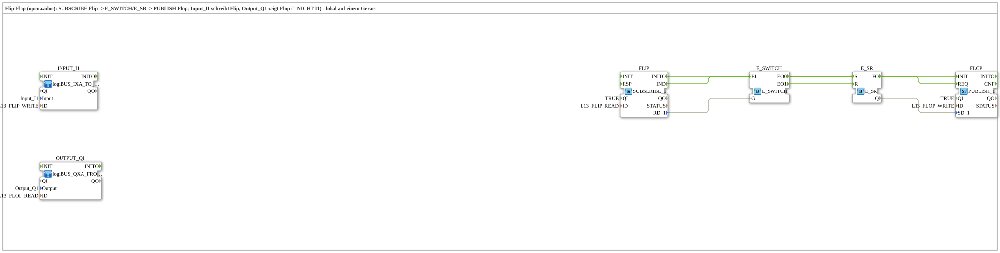

# Uebung_OPC_L13_AX: Flip-Flop (opcua.adoc) lokal auf einem Gerät

* * * * * * * * * *

## Einleitung

`Uebung_OPC_L13_AX` setzt das Flip-Flop-Beispiel aus `opcua.adoc` lokal auf einem Gerät um: `Input_I1` schreibt den OPC-UA-Knoten `Flip`, ein `SUBSCRIBE` liest ihn, `E_SWITCH` und `E_SR` bilden das Flip-Flop und ein `PUBLISH` schreibt den Knoten `Flop`, den `Output_Q1` per `SUBSCRIBE` liest. Damit gilt **Q1 = NICHT I1**.

Es werden nur lokale Aktionen (`WRITE`/`READ` ohne Endpunkt) verwendet.

Übersicht aller lokalen Übungen: [`OPC_UA_Lokal.md`](./OPC_UA_Lokal.md).

## Verwendete Funktionsbausteine (FBs)

| Name | Typ | Parameter | Erklärung |
|---|---|---|---|
| `INPUT_I1` | [`logiBUS_IXA_TO_PUBLISH_OPC`](https://meisterschulen-am-ostbahnhof-munchen-docs.readthedocs.io/projects/4diac-library-reference-docs/de/latest/Bibliotheken/ExternalLibraries/MyLib_AX/sys/logiBUS_IXA_TO_PUBLISH_OPC/) | `Input` = `Input_I1`, `ID` = `L13_FLIP_WRITE` | Liest `Input_I1` und schreibt den Wert lokal per `PUBLISH` auf den Knoten `Flip`. |
| `OUTPUT_Q1` | [`logiBUS_QXA_FROM_SUBSCRIBE_OPC`](https://meisterschulen-am-ostbahnhof-munchen-docs.readthedocs.io/projects/4diac-library-reference-docs/de/latest/Bibliotheken/ExternalLibraries/MyLib_AX/sys/logiBUS_QXA_FROM_SUBSCRIBE_OPC/) | `Output` = `Output_Q1`, `ID` = `L13_FLOP_READ` | Liest den Knoten `Flop` lokal per `SUBSCRIBE` und schaltet `Output_Q1`. |
| `FLIP` | [`iec61499::net::SUBSCRIBE_1`](https://meisterschulen-am-ostbahnhof-munchen-docs.readthedocs.io/projects/4diac-library-reference-docs/de/latest/Bibliotheken/StandardLibraries/net/SUBSCRIBE_1/) | `QI` = `TRUE`, `ID` = `L13_FLIP_READ` | Liest `Flip` lokal; `IND` meldet jede Aktualisierung, `RD_1` liefert den Wert. |
| `E_SWITCH` | [`iec61499::events::E_SWITCH`](https://meisterschulen-am-ostbahnhof-munchen-docs.readthedocs.io/projects/4diac-library-reference-docs/de/latest/Bibliotheken/StandardLibraries/events/E_SWITCH/) | - | Leitet das Ereignis je nach Wert an `G` an `EO0` (FALSE) oder `EO1` (TRUE) weiter. |
| `E_SR` | [`iec61499::events::E_SR`](https://meisterschulen-am-ostbahnhof-munchen-docs.readthedocs.io/projects/4diac-library-reference-docs/de/latest/Bibliotheken/StandardLibraries/events/E_SR/) | - | Set/Reset-Speicher: `S` setzt `Q`, `R` löscht `Q`; `EO` meldet jede Änderung. |
| `FLOP` | [`iec61499::net::PUBLISH_1`](https://meisterschulen-am-ostbahnhof-munchen-docs.readthedocs.io/projects/4diac-library-reference-docs/de/latest/Bibliotheken/StandardLibraries/net/PUBLISH_1/) | `QI` = `TRUE`, `ID` = `L13_FLOP_WRITE` | Schreibt `Q` des Flip-Flops lokal auf den Knoten `Flop`. |

## OPC-UA-Adressraum

Die IDs stammen aus `const\OpcUaLokal.gcf` (Paket `Meins::OPC_UA_Lokal::const`) und werden mit den Functions der Lib `MyLib_OPC` berechnet (`F_OPC_LOCAL`, `F_OPC_REMOTE`).

| Konstante | Aktion | Knoten / Methode | Bedeutung |
|---|---|---|---|
| `L13_FLIP_WRITE` | `WRITE` | `/Objects/Lokal/L13/Flip,1:s=L13_Flip` | Input_I1 schreibt Flip lokal (PUBLISH) |
| `L13_FLIP_READ` | `READ` | `/Objects/Lokal/L13/Flip,1:s=L13_Flip` | Flip lokal lesen (SUBSCRIBE) |
| `L13_FLOP_WRITE` | `WRITE` | `/Objects/Lokal/L13/Flop,1:s=L13_Flop` | Flop lokal schreiben (PUBLISH) |
| `L13_FLOP_READ` | `READ` | `/Objects/Lokal/L13/Flop,1:s=L13_Flop` | Output_Q1 liest Flop lokal (SUBSCRIBE) |

## Programmablauf und Verbindungen

Die SubApps `INPUT_I1` und `OUTPUT_Q1` sind nicht verdrahtet; sie sind nur über die OPC-UA-Knoten `Flip` und `Flop` mit dem Rest verbunden.

Ereignisverbindungen:

1. `FLIP.IND` → `E_SWITCH.EI`
2. `E_SWITCH.EO0` → `E_SR.S`
3. `E_SWITCH.EO1` → `E_SR.R`
4. `E_SR.EO` → `FLOP.REQ`
5. `FLIP.INITO` → `FLOP.INIT`

Datenverbindungen:

1. `FLIP.RD_1` → `E_SWITCH.G`
2. `E_SR.Q` → `FLOP.SD_1`

## Technische Besonderheiten

- **Invertierung durch Verdrahtung**: `FLIP.RD_1` steuert `E_SWITCH.G`; bei TRUE geht `EO1` an `E_SR.R` (Flop = FALSE), bei FALSE geht `EO0` an `E_SR.S` (Flop = TRUE). Daher gilt Flop = NICHT Flip.
- **Standardbausteine statt Adapter**: `FLIP`/`FLOP` sind die Standardbausteine `SUBSCRIBE_1`/`PUBLISH_1` mit Event- und Datenverbindungen.
- **Initialisierung**: `FLIP.INITO` stößt `FLOP.INIT` an.

## Lernziele

- Das Flip-Flop-Beispiel aus `opcua.adoc` lokal mit `SUBSCRIBE_1`, `E_SWITCH`, `E_SR` und `PUBLISH_1` aufbauen.
- Eine Invertierung (Q1 = NICHT I1) allein über Ereignisverdrahtung erreichen.
- Eingang und Ausgang über zwei lokale OPC-UA-Knoten entkoppeln.

**Schwierigkeitsgrad**: Fortgeschritten  
**Empfohlene Reihenfolge**: `Uebung_OPC_L01_AX`

## Hinweis / Ergebnis

- **Nicht auf dem Gerät getestet.** Auf `FORTE_PC_AX` getestet sind bisher nur L01, L03 und L19; `Uebung_OPC_L13_AX` wurde noch nicht auf dem Gerät ausgeführt.
- Lokal (ohne Endpunkt) laufen `READ`/`SUBSCRIBE`, `WRITE`/`PUBLISH`, `CREATE_METHOD`/`SERVER` und `PUBLISH_0`. `CALL_METHOD` und die Client-Subscription laufen dagegen mit Endpunkt an die eigene Station (`localhost` oder eigene IP; beides zählt als remote).

## Zusammenfassung

`Uebung_OPC_L13_AX` zeigt das Flip-Flop-Beispiel aus `opcua.adoc` lokal: `Input_I1` → Knoten `Flip` → `E_SWITCH`/`E_SR` → Knoten `Flop` → `Output_Q1`, also Q1 = NICHT I1.

---

### 🌐 Passende Themen-Unterseiten auf ms-muc-docs.de

- [🌐 Eclipse 4diac IDE & Farb-Referenz auf ms-muc-docs.de](https://www.ms-muc-docs.de/iec-61499/eclipse-4diac/)
