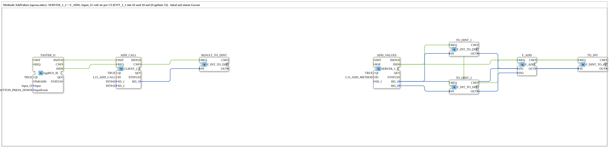

# Uebung_OPC_L15_AX: Methode AddValues lokal: SERVER_1_2 und CLIENT_2_1

* * * * * * * * * *

## Einleitung

`Uebung_OPC_L15_AX` legt die Methode AddValues aus `opcua.adoc` lokal an (`SERVER_1_2` + `F_ADD`) und ruft sie per Taster `Input_I1` mit `CLIENT_2_1` mit den Werten 43 und 10 auf (Ergebnis 53). Das Anlegen der Methode ist lokal (`CREATE_METHOD` ohne Endpunkt), der Aufruf (`CALL_METHOD`) braucht einen Endpunkt und geht deshalb an die eigene Station (`LOCAL_OPC`, localhost; zählt als remote).

Übersicht der Serie: [`OPC_UA_Lokal.md`](./OPC_UA_Lokal.md).

Kommentar im `.SUB`: „Methode AddValues (opcua.adoc): SERVER_1_2 + F_ADD; Input_I1 ruft sie per CLIENT_2_1 mit 43 und 10 auf (Ergebnis 53) - lokal auf einem Geraet“

## Verwendete Funktionsbausteine (FBs)

### `TASTER_I1`

- Typ: [`logiBUS::io::DI::logiBUS_IE`](https://meisterschulen-am-ostbahnhof-munchen-docs.readthedocs.io/projects/4diac-library-reference-docs/de/latest/Bibliotheken/ExternalLibraries/logiBUS/io/DI/logiBUS_IE/)
- Parameter:

    - `QI` = `TRUE`
    - `Input` = `Input_I1`
    - `InputEvent` = `BUTTON_PRESS_DOWN`

- Erklärung: Taster `Input_I1` (Ereignis `BUTTON_PRESS_DOWN`, also beim Drücken). Löst den Methodenaufruf aus.

### `ADD_CALL`

- Typ: `iec61499::net::CLIENT_2_1`
- Parameter:

    - `QI` = `TRUE`
    - `ID` = `L15_ADD_CALL`
    - `SD_1` = `INT#43`
    - `SD_2` = `INT#10`

- Erklärung: Ruft die Methode AddValues per Endpunkt (`LOCAL_OPC` = `opc.tcp://localhost:4840`, die eigene Station) auf, mit `SD_1` = `INT#43` und `SD_2` = `INT#10`. Das Ergebnis (53) kommt an `RD_1`.

### `RESULT_TO_DINT`

- Typ: `iec61131::conversion::F_INT_TO_DINT`
- Parameter: keine gesetzt

- Erklärung: Wandelt das Ergebnis des Aufrufs von INT in DINT.

### `ADD_VALUES`

- Typ: `iec61499::net::SERVER_1_2`
- Parameter:

    - `QI` = `TRUE`
    - `ID` = `L15_ADD_METHOD`

- Erklärung: Legt lokal (ohne Endpunkt, `CREATE_METHOD`) die Methode AddValues mit zwei Eingangs- (`RD_1`, `RD_2`) und einem Ausgangsargument (`SD_1`) an. `IND` meldet einen Aufruf, `RSP` sendet die Antwort.

### `TO_DINT_1`

- Typ: `iec61131::conversion::F_INT_TO_DINT`
- Parameter: keine gesetzt

- Erklärung: Wandelt das erste Argument (`RD_1`) in DINT.

### `TO_DINT_2`

- Typ: `iec61131::conversion::F_INT_TO_DINT`
- Parameter: keine gesetzt

- Erklärung: Wandelt das zweite Argument (`RD_2`) in DINT.

### `F_ADD`

- Typ: `iec61131::arithmetic::F_ADD`
- Parameter: keine gesetzt

- Erklärung: Addiert beide Argumente (`IN1` + `IN2`).

### `TO_INT`

- Typ: `iec61131::conversion::F_DINT_TO_INT`
- Parameter: keine gesetzt

- Erklärung: Wandelt die Summe zurück in INT für `SD_1` der Methode.

## OPC-UA-Adressen (`OpcUaLokal.gcf`)

Die IDs stammen aus `const/OpcUaLokal.gcf` (Paket `Meins::OPC_UA_Lokal::const`).

| Konstante | Aktion | Knoten / ID |
|---|---|---|
| `L15_ADD_METHOD` | CREATE_METHOD | `/Objects/Lokal/L15/AddValues` |
| `L15_ADD_CALL` | CALL_METHOD (Endpunkt `LOCAL_OPC`) | `/Objects/Lokal/L15/AddValues` |

## Programmablauf und Verbindungen

### Ereignisverbindungen

1. `TASTER_I1.IND` → `ADD_CALL.REQ`
2. `TASTER_I1.INITO` → `ADD_CALL.INIT`
3. `ADD_CALL.CNF` → `RESULT_TO_DINT.REQ`
4. `ADD_VALUES.IND` → `TO_DINT_1.REQ`
5. `TO_DINT_1.CNF` → `TO_DINT_2.REQ`
6. `TO_DINT_2.CNF` → `F_ADD.REQ`
7. `F_ADD.CNF` → `TO_INT.REQ`
8. `TO_INT.CNF` → `ADD_VALUES.RSP`

### Datenverbindungen

1. `ADD_CALL.RD_1` → `RESULT_TO_DINT.IN`
2. `ADD_VALUES.RD_1` → `TO_DINT_1.IN`
3. `ADD_VALUES.RD_2` → `TO_DINT_2.IN`
4. `TO_DINT_1.OUT` → `F_ADD.IN1`
5. `TO_DINT_2.OUT` → `F_ADD.IN2`
6. `F_ADD.OUT` → `TO_INT.IN`
7. `TO_INT.OUT` → `ADD_VALUES.SD_1`

## Hinweis / Ergebnis

Nicht auf dem Gerät getestet. Erwartet: Der Aufruf mit 43 und 10 liefert 53.

Dasselbe Beispiel auf zwei Geräten: [Training_15_OPC_UA_RES](https://meisterschulen-am-ostbahnhof-munchen-docs.readthedocs.io/projects/4diac-exercises-docs/de/latest/Uebungen/test_VV/03_OPC_UA/Training_15_OPC_UA_RES/Training_15_OPC_UA_RES/).
Hinweis: Jeder `SERVER_0` braucht `IND` → `RSP` direkt am eigenen Baustein, sonst stocken bis zu 4 s lang alle OPC-UA-Publishes der Station (Regel siehe [Übersicht](OPC_UA_Lokal.md)). Bei Methoden mit Rückgabewert (`SERVER_1_2`) kommt `RSP` erst nach der sofortigen Berechnung.

## Lernziele

- Eine Methode lokal mit `SERVER_1_2` anlegen und mit `RSP` beantworten
- Eine Methode mit `CLIENT_2_1` aufrufen (Endpunkt nötig, hier die eigene Station)
- Unterschied lokal (ohne Endpunkt) und remote (mit Endpunkt) bei `CREATE_METHOD` und `CALL_METHOD`

## Zusammenfassung

Die Übung zeigt Methodenanlage und Methodenaufruf im selben Gerät: der Server-Teil lokal, der Client-Teil über den Endpunkt der eigenen Station.

---

### 🌐 Passende Themen-Unterseiten auf ms-muc-docs.de

- [🌐 Eclipse 4diac IDE & Farb-Referenz auf ms-muc-docs.de](https://www.ms-muc-docs.de/iec-61499/eclipse-4diac/)
