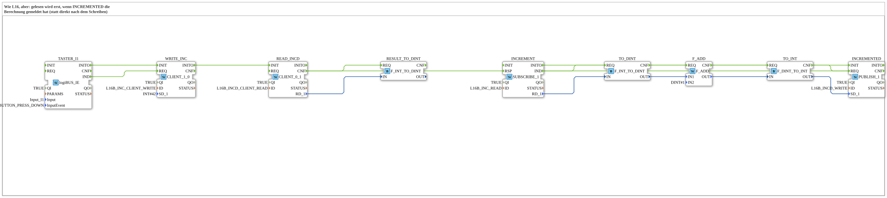

# Uebung_OPC_L16b_AX: Variablen per CLIENT lesen und schreiben (Increment/Incremented)

* * * * * * * * * *

## Einleitung

`Uebung_OPC_L16b_AX` ist das Variablen-Beispiel aus `opcua.adoc` lokal auf einem Gerät: `Input_I1` schreibt per `CLIENT_1_0` den Wert 42 auf die Variable Increment und liest danach mit `CLIENT_0_1` die Variable Incremented, die 43 enthalten soll. Lokal abonniert `SUBSCRIBE_1` die Variable Increment, addiert 1 und schreibt per `PUBLISH_1` das Ergebnis auf Incremented. Die CLIENT-Bausteine nutzen den Endpunkt der eigenen Station (`LOCAL_OPC`), die SUBSCRIBE/PUBLISH-Bausteine laufen lokal ohne Endpunkt.

**B-Version von `Uebung_OPC_L16_AX`:** `READ_INCD.REQ` kommt nicht mehr von `WRITE_INC.CNF` (das bestätigt nur das Schreiben), sondern von `INCREMENTED.CNF`, also erst, nachdem das Ergebnis veröffentlicht ist. Alles andere ist unverändert; die Konstanten heißen `L16B_*`, die Knoten liegen unter `/Objects/Lokal/L16B/`.

Übersicht der Serie: [`OPC_UA_Lokal.md`](./OPC_UA_Lokal.md).

Kommentar im `.SUB`: „Wie L16, aber: gelesen wird erst, wenn INCREMENTED die Berechnung gemeldet hat (statt direkt nach dem Schreiben)“

## Verwendete Funktionsbausteine (FBs)

### `TASTER_I1`

- Typ: [`logiBUS::io::DI::logiBUS_IE`](https://meisterschulen-am-ostbahnhof-munchen-docs.readthedocs.io/projects/4diac-library-reference-docs/de/latest/Bibliotheken/ExternalLibraries/logiBUS/io/DI/logiBUS_IE/)
- Parameter:

    - `QI` = `TRUE`
    - `Input` = `Input_I1`
    - `InputEvent` = `BUTTON_PRESS_DOWN`

- Erklärung: Taster `Input_I1` (Ereignis `BUTTON_PRESS_DOWN`, also beim Drücken). Startet Schreiben und anschließendes Lesen.

### `WRITE_INC`

- Typ: `iec61499::net::CLIENT_1_0`
- Parameter:

    - `QI` = `TRUE`
    - `ID` = `L16B_INC_CLIENT_WRITE`
    - `SD_1` = `INT#42`

- Erklärung: Schreibt per Endpunkt (`LOCAL_OPC`, eigene Station) den Wert `INT#42` auf den Knoten Increment (`SD_1`).

### `READ_INCD`

- Typ: `iec61499::net::CLIENT_0_1`
- Parameter:

    - `QI` = `TRUE`
    - `ID` = `L16B_INCD_CLIENT_READ`

- Erklärung: Liest per Endpunkt den Knoten Incremented; der Wert (erwartet 43) kommt an `RD_1`.

### `RESULT_TO_DINT`

- Typ: `iec61131::conversion::F_INT_TO_DINT`
- Parameter: keine gesetzt

- Erklärung: Wandelt den gelesenen Wert von INT in DINT.

### `INCREMENT`

- Typ: `iec61499::net::SUBSCRIBE_1`
- Parameter:

    - `QI` = `TRUE`
    - `ID` = `L16B_INC_READ`

- Erklärung: Abonniert lokal (ohne Endpunkt) den Knoten Increment; jede Änderung (hier die 42) löst `IND` aus.

### `TO_DINT`

- Typ: `iec61131::conversion::F_INT_TO_DINT`
- Parameter: keine gesetzt

- Erklärung: Wandelt den Wert von `INCREMENT` in DINT.

### `F_ADD`

- Typ: `iec61131::arithmetic::F_ADD`
- Parameter:

    - `IN2` = `DINT#1`

- Erklärung: Addiert zu `IN1` die Konstante `IN2` = `DINT#1` (42 + 1 = 43).

### `TO_INT`

- Typ: `iec61131::conversion::F_DINT_TO_INT`
- Parameter: keine gesetzt

- Erklärung: Wandelt die Summe zurück in INT.

### `INCREMENTED`

- Typ: `iec61499::net::PUBLISH_1`
- Parameter:

    - `QI` = `TRUE`
    - `ID` = `L16B_INCD_WRITE`

- Erklärung: Schreibt lokal (ohne Endpunkt) das Ergebnis auf den Knoten Incremented (`SD_1`).

## OPC-UA-Adressen (`OpcUaLokal.gcf`)

Die IDs stammen aus `const/OpcUaLokal.gcf` (Paket `Meins::OPC_UA_Lokal::const`).

| Konstante | Aktion | Knoten / ID |
|---|---|---|
| `L16B_INC_CLIENT_WRITE` | WRITE (Endpunkt `LOCAL_OPC`) | `/Objects/Lokal/L16B/Increment,1:s=L16B_Increment` |
| `L16B_INCD_CLIENT_READ` | READ (Endpunkt `LOCAL_OPC`) | `/Objects/Lokal/L16B/Incremented,1:s=L16B_Incremented` |
| `L16B_INC_READ` | READ (lokal) | `/Objects/Lokal/L16B/Increment,1:s=L16B_Increment` |
| `L16B_INCD_WRITE` | WRITE (lokal) | `/Objects/Lokal/L16B/Incremented,1:s=L16B_Incremented` |

## Programmablauf und Verbindungen

### Ereignisverbindungen

1. `TASTER_I1.IND` → `WRITE_INC.REQ`
2. `INCREMENTED.CNF` → `READ_INCD.REQ`
3. `TASTER_I1.INITO` → `WRITE_INC.INIT`
4. `WRITE_INC.INITO` → `READ_INCD.INIT`
5. `READ_INCD.CNF` → `RESULT_TO_DINT.REQ`
6. `INCREMENT.IND` → `TO_DINT.REQ`
7. `TO_DINT.CNF` → `F_ADD.REQ`
8. `F_ADD.CNF` → `TO_INT.REQ`
9. `TO_INT.CNF` → `INCREMENTED.REQ`
10. `INCREMENT.INITO` → `INCREMENTED.INIT`

### Datenverbindungen

1. `READ_INCD.RD_1` → `RESULT_TO_DINT.IN`
2. `INCREMENT.RD_1` → `TO_DINT.IN`
3. `TO_DINT.OUT` → `F_ADD.IN1`
4. `F_ADD.OUT` → `TO_INT.IN`
5. `TO_INT.OUT` → `INCREMENTED.SD_1`

## Hinweis / Ergebnis

Nicht auf dem Gerät getestet. Erwartet: Nach `Input_I1` liefert `READ_INCD` den Wert 43 (42 + 1).

Dasselbe Beispiel auf zwei Geräten: [Training_16b_OPC_UA_RES](https://meisterschulen-am-ostbahnhof-munchen-docs.readthedocs.io/projects/4diac-exercises-docs/de/latest/Uebungen/test_VV/03_OPC_UA/Training_16b_OPC_UA_RES/Training_16b_OPC_UA_RES/).

## Lernziele

- Variablen mit `CLIENT_1_0` schreiben und mit `CLIENT_0_1` lesen
- Kombination aus Client-Zugriff (mit Endpunkt) und lokalem `SUBSCRIBE_1`/`PUBLISH_1` (ohne Endpunkt) auf zwei Knoten
- Verkettung der Ereignisse: `INCREMENTED.CNF` startet `READ_INCD.REQ` (Lesen erst nach der Rückmeldung)

## Zusammenfassung

Die Übung zeigt Schreiben und Lesen von OPC-UA-Variablen per Client im eigenen Gerät, mit einer lokalen Rechenstrecke (+1) dazwischen.

---

### 🌐 Passende Themen-Unterseiten auf ms-muc-docs.de

- [🌐 Eclipse 4diac IDE & Farb-Referenz auf ms-muc-docs.de](https://www.ms-muc-docs.de/iec-61499/eclipse-4diac/)
