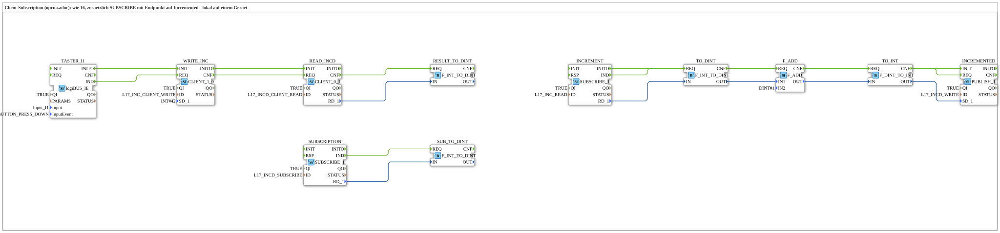

# Uebung_OPC_L17_AX: Client-Subscription lokal (Erweiterung von L16)

* * * * * * * * * *

## Einleitung

`Uebung_OPC_L17_AX` ist wie `Uebung_OPC_L16_AX` (Increment schreiben, Incremented lesen), zusätzlich abonniert ein `SUBSCRIBE_1` mit Endpunkt (`SUBSCRIPTION`) die Variable Incremented. Die Client-Subscription läuft über den Endpunkt der eigenen Station (`LOCAL_OPC`; localhost zählt als remote), im Unterschied zum lokalen `SUBSCRIBE_1` (`INCREMENT`) ohne Endpunkt.

Übersicht der Serie: [`OPC_UA_Lokal.md`](./OPC_UA_Lokal.md).

Kommentar im `.SUB`: „Client-Subscription (opcua.adoc): wie 16, zusaetzlich SUBSCRIBE mit Endpunkt auf Incremented - lokal auf einem Geraet“

## Verwendete Funktionsbausteine (FBs)

### `TASTER_I1`

- Typ: [`logiBUS::io::DI::logiBUS_IE`](https://meisterschulen-am-ostbahnhof-munchen-docs.readthedocs.io/projects/4diac-library-reference-docs/de/latest/Bibliotheken/ExternalLibraries/logiBUS/io/DI/logiBUS_IE/)
- Parameter:

    - `QI` = `TRUE`
    - `Input` = `Input_I1`
    - `InputEvent` = `BUTTON_PRESS_DOWN`

- Erklärung: Taster `Input_I1` (Ereignis `BUTTON_PRESS_DOWN`, also beim Drücken). Startet Schreiben und anschließendes Lesen.

### `WRITE_INC`

- Typ: `iec61499::net::CLIENT_1_0`
- Parameter:

    - `QI` = `TRUE`
    - `ID` = `L17_INC_CLIENT_WRITE`
    - `SD_1` = `INT#42`

- Erklärung: Schreibt per Endpunkt (`LOCAL_OPC`, eigene Station) den Wert `INT#42` auf den Knoten Increment (`SD_1`).

### `READ_INCD`

- Typ: `iec61499::net::CLIENT_0_1`
- Parameter:

    - `QI` = `TRUE`
    - `ID` = `L17_INCD_CLIENT_READ`

- Erklärung: Liest per Endpunkt den Knoten Incremented; der Wert (erwartet 43) kommt an `RD_1`.

### `RESULT_TO_DINT`

- Typ: `iec61131::conversion::F_INT_TO_DINT`
- Parameter: keine gesetzt

- Erklärung: Wandelt den gelesenen Wert von INT in DINT.

### `SUBSCRIPTION`

- Typ: `iec61499::net::SUBSCRIBE_1`
- Parameter:

    - `QI` = `TRUE`
    - `ID` = `L17_INCD_SUBSCRIBE`

- Erklärung: Abonniert Incremented per Endpunkt (`LOCAL_OPC`, eigene Station: Client-Subscription, `SUBSCRIBE` mit Endpunkt); jede Änderung löst `IND` aus.

### `SUB_TO_DINT`

- Typ: `iec61131::conversion::F_INT_TO_DINT`
- Parameter: keine gesetzt

- Erklärung: Wandelt den abonnierten Wert von INT in DINT.

### `INCREMENT`

- Typ: `iec61499::net::SUBSCRIBE_1`
- Parameter:

    - `QI` = `TRUE`
    - `ID` = `L17_INC_READ`

- Erklärung: Abonniert lokal (ohne Endpunkt) den Knoten Increment; jede Änderung (hier die 42) löst `IND` aus.

### `TO_DINT`

- Typ: `iec61131::conversion::F_INT_TO_DINT`
- Parameter: keine gesetzt

- Erklärung: Wandelt den Wert von `INCREMENT` in DINT.

### `F_ADD`

- Typ: `iec61131::arithmetic::F_ADD`
- Parameter:

    - `IN2` = `DINT#1`

- Erklärung: Addiert zu `IN1` die Konstante `IN2` = `DINT#1` (42 + 1 = 43).

### `TO_INT`

- Typ: `iec61131::conversion::F_DINT_TO_INT`
- Parameter: keine gesetzt

- Erklärung: Wandelt die Summe zurück in INT.

### `INCREMENTED`

- Typ: `iec61499::net::PUBLISH_1`
- Parameter:

    - `QI` = `TRUE`
    - `ID` = `L17_INCD_WRITE`

- Erklärung: Schreibt lokal (ohne Endpunkt) das Ergebnis auf den Knoten Incremented (`SD_1`).

## OPC-UA-Adressen (`OpcUaLokal.gcf`)

Die IDs stammen aus `const/OpcUaLokal.gcf` (Paket `Meins::OPC_UA_Lokal::const`).

| Konstante | Aktion | Knoten / ID |
|---|---|---|
| `L17_INC_CLIENT_WRITE` | WRITE (Endpunkt `LOCAL_OPC`) | `/Objects/Lokal/L17/Increment,1:s=L17_Increment` |
| `L17_INCD_CLIENT_READ` | READ (Endpunkt `LOCAL_OPC`) | `/Objects/Lokal/L17/Incremented,1:s=L17_Incremented` |
| `L17_INCD_SUBSCRIBE` | SUBSCRIBE (Endpunkt `LOCAL_OPC`) | `/Objects/Lokal/L17/Incremented,1:s=L17_Incremented` |
| `L17_INC_READ` | READ (lokal) | `/Objects/Lokal/L17/Increment,1:s=L17_Increment` |
| `L17_INCD_WRITE` | WRITE (lokal) | `/Objects/Lokal/L17/Incremented,1:s=L17_Incremented` |

## Programmablauf und Verbindungen

### Ereignisverbindungen

1. `TASTER_I1.IND` → `WRITE_INC.REQ`
2. `WRITE_INC.CNF` → `READ_INCD.REQ`
3. `TASTER_I1.INITO` → `WRITE_INC.INIT`
4. `WRITE_INC.INITO` → `READ_INCD.INIT`
5. `READ_INCD.CNF` → `RESULT_TO_DINT.REQ`
6. `SUBSCRIPTION.IND` → `SUB_TO_DINT.REQ`
7. `INCREMENT.IND` → `TO_DINT.REQ`
8. `TO_DINT.CNF` → `F_ADD.REQ`
9. `F_ADD.CNF` → `TO_INT.REQ`
10. `TO_INT.CNF` → `INCREMENTED.REQ`
11. `INCREMENT.INITO` → `INCREMENTED.INIT`

### Datenverbindungen

1. `READ_INCD.RD_1` → `RESULT_TO_DINT.IN`
2. `SUBSCRIPTION.RD_1` → `SUB_TO_DINT.IN`
3. `INCREMENT.RD_1` → `TO_DINT.IN`
4. `TO_DINT.OUT` → `F_ADD.IN1`
5. `F_ADD.OUT` → `TO_INT.IN`
6. `TO_INT.OUT` → `INCREMENTED.SD_1`

## Hinweis / Ergebnis

Nicht auf dem Gerät getestet. Erwartet: Wie L16 liefert `READ_INCD` den Wert 43; zusätzlich meldet `SUBSCRIPTION` die Änderung von Incremented.

Dasselbe Beispiel auf zwei Geräten: [Training_17_OPC_UA_RES](https://meisterschulen-am-ostbahnhof-munchen-docs.readthedocs.io/projects/4diac-exercises-docs/de/latest/Uebungen/test_VV/03_OPC_UA/Training_17_OPC_UA_RES/Training_17_OPC_UA_RES/).

## Lernziele

- Client-Subscription: `SUBSCRIBE_1` mit Endpunkt auf einen Knoten
- Unterschied zwischen lokalem `SUBSCRIBE_1` (`INCREMENT`, ohne Endpunkt) und `SUBSCRIBE_1` mit Endpunkt (`SUBSCRIPTION`)
- Mehrere Zugriffsarten (CLIENT-Write/-Read, Subscribe, Publish) im selben Netzwerk

## Zusammenfassung

Die Übung erweitert L16 um eine Client-Subscription über den Endpunkt der eigenen Station.

---

### 🌐 Passende Themen-Unterseiten auf ms-muc-docs.de

- [🌐 Eclipse 4diac IDE & Farb-Referenz auf ms-muc-docs.de](https://www.ms-muc-docs.de/iec-61499/eclipse-4diac/)
