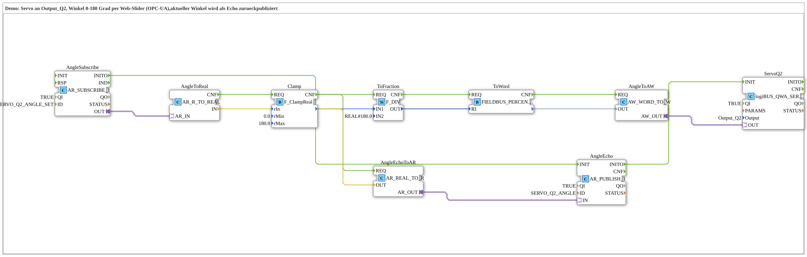

# Servo_Slider_OPC: Servo per Web-Slider (OPC-UA)

* * * * * * * * * *

## Einleitung

`Servo_Slider_OPC` ist eine Demo: Ein Servo an `Output_Q2` wird über einen Web-Slider per **OPC-UA** auf einen Winkel von **0 bis 180 Grad** gestellt; der tatsächlich verwendete (begrenzte) Winkel wird als Echo wieder per OPC-UA veröffentlicht. Die Schnittstelle der SubApp ist leer.

Die beiden OPC-UA-Verbindungen sind in `SubStrings.gcf` als WSTRING-Konstanten definiert:

| Konstante | Wert | Richtung |
|---|---|---|
| `SERVO_Q2_ANGLE_SET` | `opc_ua[READ;/Objects/Servo/Q02/ANGLE_SET,1:s=SERVO_Q2_ANGLE_SET]` | Sollwinkel vom Slider lesen |
| `SERVO_Q2_ANGLE` | `opc_ua[WRITE;/Objects/Servo/Q02/ANGLE,1:s=SERVO_Q2_ANGLE]` | Echo des Winkels schreiben |

## Verwendete Funktionsbausteine (FBs)

| Instanz | Typ | Parameter | Erklärung |
|---|---|---|---|
| `AngleSubscribe` | [AR_SUBSCRIBE_1](https://meisterschulen-am-ostbahnhof-munchen-docs.readthedocs.io/projects/4diac-library-reference-docs/de/latest/Bibliotheken/ExternalLibraries/adapter/net/AR_SUBSCRIBE_1/) | `QI` = `TRUE`, `ID` = `SERVO_Q2_ANGLE_SET` | Liest den Sollwinkel per OPC-UA |
| `AngleToReal` | [AR_R_TO_REAL](https://meisterschulen-am-ostbahnhof-munchen-docs.readthedocs.io/projects/4diac-library-reference-docs/de/latest/Bibliotheken/ExternalLibraries/adapter/conversion/unidirectional/REAL/AR_R_TO_REAL/) | – | Wandelt den Adapterwert in einen `REAL` |
| `Clamp` | [F_ClampReal](https://meisterschulen-am-ostbahnhof-munchen-docs.readthedocs.io/projects/4diac-library-reference-docs/de/latest/Bibliotheken/ExternalLibraries/logiBUS/signalprocessing/clamp/F_ClampReal/) | `rMin` = `0.0`, `rMax` = `180.0` | Begrenzt den Winkel auf 0…180 |
| `ToFraction` | [F_DIV](https://meisterschulen-am-ostbahnhof-munchen-docs.readthedocs.io/projects/4diac-library-reference-docs/de/latest/Bibliotheken/StandardLibraries/iec61131-3/arithmetic/F_DIV/) | `IN2` = `REAL#180.0` | Teilt den Winkel durch 180 (Anteil 0…1) |
| `ToWord` | [FIELDBUS_PERCENT_TO_WORD](https://meisterschulen-am-ostbahnhof-munchen-docs.readthedocs.io/projects/4diac-library-reference-docs/de/latest/Bibliotheken/StandardLibraries/signalprocessing/FIELDBUS_PERCENT_TO_WORD/) | – | Wandelt den Anteil in ein Wort (Servo-Stellwert) |
| `AngleToAW` | [AW_WORD_TO_W](https://meisterschulen-am-ostbahnhof-munchen-docs.readthedocs.io/projects/4diac-library-reference-docs/de/latest/Bibliotheken/ExternalLibraries/adapter/conversion/unidirectional/WORD/AW_WORD_TO_W/) | – | Überträgt das Wort auf den WORD-Adapter des Servo-Ausgangs |
| `ServoQ2` | [logiBUS_QWA_SERVO](https://meisterschulen-am-ostbahnhof-munchen-docs.readthedocs.io/projects/4diac-library-reference-docs/de/latest/Bibliotheken/ExternalLibraries/logiBUS/io/DO-Servo/logiBUS_QWA_SERVO/) | `QI` = `TRUE`, `Output` = `Output_Q2` | Servo-Ausgang Q2 |
| `AngleEchoToAR` | [AR_REAL_TO_R](https://meisterschulen-am-ostbahnhof-munchen-docs.readthedocs.io/projects/4diac-library-reference-docs/de/latest/Bibliotheken/ExternalLibraries/adapter/conversion/unidirectional/REAL/AR_REAL_TO_R/) | – | Wandelt den begrenzten Winkel in einen AR-Adapterwert |
| `AngleEcho` | [AR_PUBLISH_1](https://meisterschulen-am-ostbahnhof-munchen-docs.readthedocs.io/projects/4diac-library-reference-docs/de/latest/Bibliotheken/ExternalLibraries/adapter/net/AR_PUBLISH_1/) | `QI` = `TRUE`, `ID` = `SERVO_Q2_ANGLE` | Veröffentlicht den Winkel per OPC-UA |

## Programmablauf und Verbindungen

- **Initialisierung**: `AngleSubscribe.INITO` → `AngleEcho.INIT`, danach `AngleEcho.INITO` → `ServoQ2.INIT`.
- **Sollwert**: Das Subscribe-Ergebnis (`AngleSubscribe.OUT`) läuft über `AngleToReal` → `Clamp` → `ToFraction` → `ToWord` → `AngleToAW` auf `ServoQ2.OUT`. Jeder Schritt wird über sein `CNF`-Ereignis an den nächsten weitergegeben (`AngleToReal.CNF` → `Clamp.REQ` → `ToFraction.REQ` → `ToWord.REQ` → `AngleToAW.REQ`).
- **Echo**: Zusätzlich löst `Clamp.CNF` den Baustein `AngleEchoToAR` aus; dieser speist den begrenzten Winkel in `AngleEcho` ein, der ihn per OPC-UA veröffentlicht. Der Web-Client sieht also den tatsächlich ausgegebenen, auf 0…180 begrenzten Winkel.

Die Normierung (Winkel durch 180, dann Prozent-/Anteil-zu-Wort-Wandlung) bildet den Bereich 0…180 Grad auf den vollen Stellbereich des Servo-Ausgangs ab.

## Zusammenfassung

`Servo_Slider_OPC` zeigt eine Kette „OPC-UA lesen → begrenzen → normieren → Servo ausgeben" mit einem parallelen Echo-Zweig, der den begrenzten Wert wieder per OPC-UA zurückmeldet.

---

### 🌐 Passende Themen-Unterseiten auf ms-muc-docs.de

- [🌐 Eclipse 4diac IDE & Farb-Referenz auf ms-muc-docs.de](https://www.ms-muc-docs.de/iec-61499/eclipse-4diac/)
