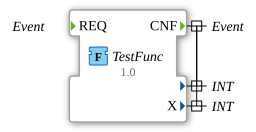

# TestFunc: Funktion (IEC 61499 Function)



* * * * * * * * * *

## Einleitung

`TestFunc` ist keine SubApp, sondern ein Funktionstyp (`.fct`, Standard 61499-1) im Paket `Meins` mit dem Kommentar "Function with empty body". Er dient als einfaches Testobjekt für die Funktions-Syntax: ein Ereigniseingang `REQ`, ein Ereignisausgang `CNF` und ein Strukturierter-Text-Rumpf. Es gibt keine Funktionsbaustein-Instanzen und keine Verbindungen.

## Schnittstelle der Funktion

| Instanz | Typ | Parameter | Erklärung |
|---|---|---|---|
| `REQ` | `Event (Ereigniseingang)` | - | Anforderung zur Ausführung. |
| `CNF` | `Event (Ereignisausgang)` | `With` = `X` (und eine unbenannte Variable) | Bestätigung; liefert die beiden Ausgangswerte. |
| `X` | `INT (Ausgangsvariable)` | Initialwert `5` | Ausgabeparameter, im Rumpf auf `7` gesetzt. |
| (unbenannt) | `INT (Ausgangsvariable)` | - | Zweite Ausgangsvariable mit leerem Namen; entspricht dem Rückgabewert `TestFunc`. |

## Programmablauf und Verbindungen

Der Rumpf ist in Structured Text geschrieben:

```
PACKAGE Meins;

FUNCTION TestFunc : INT

VAR_OUTPUT
	X : INT := 5;
END_VAR

TestFunc := 5;
X := 7;
END_FUNCTION
```

1. Der Rückgabewert `TestFunc` (INT) wird auf `5` gesetzt.
2. Der Ausgabeparameter `X` (Initialwert `5`) wird auf `7` gesetzt.

Obwohl der Kommentar "empty body" lautet, enthält der Rumpf diese beiden Zuweisungen.

## Zusammenfassung

`TestFunc` ist ein minimales Beispiel einer IEC-61499-Funktion mit Ereignis-Schnittstelle, Rückgabewert und einem Ausgabeparameter.

---

### 🌐 Passende Themen-Unterseiten auf ms-muc-docs.de

- [🌐 Eclipse 4diac IDE & Farb-Referenz auf ms-muc-docs.de](https://www.ms-muc-docs.de/iec-61499/eclipse-4diac/)
