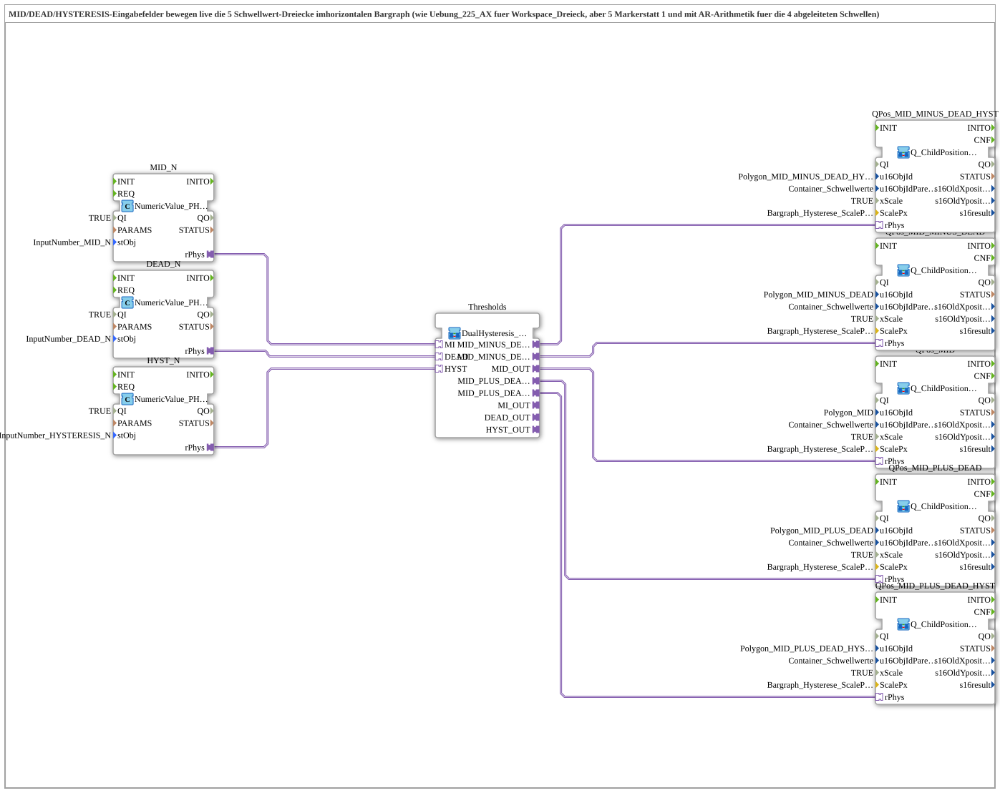

# Uebung_HystereseHorizontal_AX_simple: Hysterese-Schwellwerte im horizontalen Bargraph

* * * * * * * * * *

## Einleitung

`Uebung_HystereseHorizontal_AX_simple` ist eine Übung, bei der die drei VT-Eingabefelder `MID`, `DEAD` und `HYSTERESIS` live fünf Schwellwert-Dreiecke im **horizontalen** Bargraph verschieben. Laut Kommentar im Typ entspricht sie `Uebung_225_AX` (Workspace_Dreieck), hat aber fünf Marker statt einem und nutzt AR-Arithmetik für die vier abgeleiteten Schwellen. Die SubApp hat keine eigene Schnittstelle und keine Ereignisverbindungen.

## Verwendete Funktionsbausteine (FBs)

| Instanz | Typ | Parameter | Erklärung |
|---|---|---|---|
| `MID_N` | [`isobus::UT::io::NumericValue::NumericValue_PHYSA`](https://meisterschulen-am-ostbahnhof-munchen-docs.readthedocs.io/projects/4diac-library-reference-docs/de/latest/Bibliotheken/ExternalLibraries/isobus/UT/io/NumericValue/NumericValue_PHYSA/) | `QI` = `TRUE`, `stObj` = `InputNumber_MID_N` | Eingabefeld MID des VT; liefert den physikalischen Wert am Adapter `rPhys`. |
| `DEAD_N` | [`isobus::UT::io::NumericValue::NumericValue_PHYSA`](https://meisterschulen-am-ostbahnhof-munchen-docs.readthedocs.io/projects/4diac-library-reference-docs/de/latest/Bibliotheken/ExternalLibraries/isobus/UT/io/NumericValue/NumericValue_PHYSA/) | `QI` = `TRUE`, `stObj` = `InputNumber_DEAD_N` | Eingabefeld DEAD des VT; liefert den physikalischen Wert am Adapter `rPhys`. |
| `HYST_N` | [`isobus::UT::io::NumericValue::NumericValue_PHYSA`](https://meisterschulen-am-ostbahnhof-munchen-docs.readthedocs.io/projects/4diac-library-reference-docs/de/latest/Bibliotheken/ExternalLibraries/isobus/UT/io/NumericValue/NumericValue_PHYSA/) | `QI` = `TRUE`, `stObj` = `InputNumber_HYSTERESIS_N` | Eingabefeld HYSTERESIS des VT; liefert den physikalischen Wert am Adapter `rPhys`. |
| `Thresholds` | [`MyLib::sys::DualHysteresis_Thresholds_AR`](https://meisterschulen-am-ostbahnhof-munchen-docs.readthedocs.io/projects/4diac-library-reference-docs/de/latest/Bibliotheken/ExternalLibraries/MyLib_AX/sys/DualHysteresis_Thresholds_AR/) | - | Berechnet aus `MI`, `DEAD` und `HYST` die fünf Schwellwerte. |
| `QPos_MID` | [`MyLib::sys::Q_ChildPosition_AR_Bargraph_LeftToRight`](https://meisterschulen-am-ostbahnhof-munchen-docs.readthedocs.io/projects/4diac-library-reference-docs/de/latest/Bibliotheken/ExternalLibraries/MyLib_AX/sys/Q_ChildPosition_AR_Bargraph_LeftToRight/) | `u16ObjId` = `Polygon_MID`, `u16ObjIdParent` = `Container_Schwellwerte`, `xScale` = `TRUE`, `ScalePx` = `Bargraph_Hysterese_ScalePx` | Positioniert das Dreieck `Polygon_MID` für den Schwellwert Mitte (`MID`). |
| `QPos_MID_PLUS_DEAD` | [`MyLib::sys::Q_ChildPosition_AR_Bargraph_LeftToRight`](https://meisterschulen-am-ostbahnhof-munchen-docs.readthedocs.io/projects/4diac-library-reference-docs/de/latest/Bibliotheken/ExternalLibraries/MyLib_AX/sys/Q_ChildPosition_AR_Bargraph_LeftToRight/) | `u16ObjId` = `Polygon_MID_PLUS_DEAD`, `u16ObjIdParent` = `Container_Schwellwerte`, `xScale` = `TRUE`, `ScalePx` = `Bargraph_Hysterese_ScalePx` | Positioniert das Dreieck `Polygon_MID_PLUS_DEAD` für den Schwellwert `MID + DEAD`. |
| `QPos_MID_MINUS_DEAD` | [`MyLib::sys::Q_ChildPosition_AR_Bargraph_LeftToRight`](https://meisterschulen-am-ostbahnhof-munchen-docs.readthedocs.io/projects/4diac-library-reference-docs/de/latest/Bibliotheken/ExternalLibraries/MyLib_AX/sys/Q_ChildPosition_AR_Bargraph_LeftToRight/) | `u16ObjId` = `Polygon_MID_MINUS_DEAD`, `u16ObjIdParent` = `Container_Schwellwerte`, `xScale` = `TRUE`, `ScalePx` = `Bargraph_Hysterese_ScalePx` | Positioniert das Dreieck `Polygon_MID_MINUS_DEAD` für den Schwellwert `MID - DEAD`. |
| `QPos_MID_PLUS_DEAD_HYST` | [`MyLib::sys::Q_ChildPosition_AR_Bargraph_LeftToRight`](https://meisterschulen-am-ostbahnhof-munchen-docs.readthedocs.io/projects/4diac-library-reference-docs/de/latest/Bibliotheken/ExternalLibraries/MyLib_AX/sys/Q_ChildPosition_AR_Bargraph_LeftToRight/) | `u16ObjId` = `Polygon_MID_PLUS_DEAD_HYST`, `u16ObjIdParent` = `Container_Schwellwerte`, `xScale` = `TRUE`, `ScalePx` = `Bargraph_Hysterese_ScalePx` | Positioniert das Dreieck `Polygon_MID_PLUS_DEAD_HYST` für den Schwellwert `MID + DEAD + HYST`. |
| `QPos_MID_MINUS_DEAD_HYST` | [`MyLib::sys::Q_ChildPosition_AR_Bargraph_LeftToRight`](https://meisterschulen-am-ostbahnhof-munchen-docs.readthedocs.io/projects/4diac-library-reference-docs/de/latest/Bibliotheken/ExternalLibraries/MyLib_AX/sys/Q_ChildPosition_AR_Bargraph_LeftToRight/) | `u16ObjId` = `Polygon_MID_MINUS_DEAD_HYST`, `u16ObjIdParent` = `Container_Schwellwerte`, `xScale` = `TRUE`, `ScalePx` = `Bargraph_Hysterese_ScalePx` | Positioniert das Dreieck `Polygon_MID_MINUS_DEAD_HYST` für den Schwellwert `MID - DEAD - HYST`. |

## Programmablauf und Verbindungen

Alle Verbindungen sind Adapterverbindungen (AR, `REAL`-Werte):

1. `MID_N.rPhys` → `Thresholds.MI`
2. `DEAD_N.rPhys` → `Thresholds.DEAD`
3. `HYST_N.rPhys` → `Thresholds.HYST`
4. `Thresholds.MID_OUT` → `QPos_MID.rPhys`
5. `Thresholds.MID_PLUS_DEAD` → `QPos_MID_PLUS_DEAD.rPhys`
6. `Thresholds.MID_MINUS_DEAD` → `QPos_MID_MINUS_DEAD.rPhys`
7. `Thresholds.MID_PLUS_DEAD_HYST` → `QPos_MID_PLUS_DEAD_HYST.rPhys`
8. `Thresholds.MID_MINUS_DEAD_HYST` → `QPos_MID_MINUS_DEAD_HYST.rPhys`

Die Schwellen berechnet `Thresholds` aus Mitte, Totzone und Hysterese; `MID_PLUS_DEAD_HYST` ist `MI + (DEAD + HYST)`, `MID_MINUS_DEAD_HYST` ist `MI - (DEAD + HYST)`. `Q_ChildPosition_AR_Bargraph_LeftToRight` positioniert das jeweilige Kind-Objekt in X-Richtung (X = Wert × `ScalePx`, Y = 0); ein größerer Wert schiebt das Dreieck nach rechts.

## Zusammenfassung

`Uebung_HystereseHorizontal_AX_simple` verbindet drei Eingabefelder über die Schwellwert-Berechnung mit fünf Bargraph-Positionsbausteinen, sodass die Marker live den eingegebenen Werten folgen.

---

### 🌐 Passende Themen-Unterseiten auf ms-muc-docs.de

- [🌐 Eclipse 4diac IDE & Farb-Referenz auf ms-muc-docs.de](https://www.ms-muc-docs.de/iec-61499/eclipse-4diac/)
