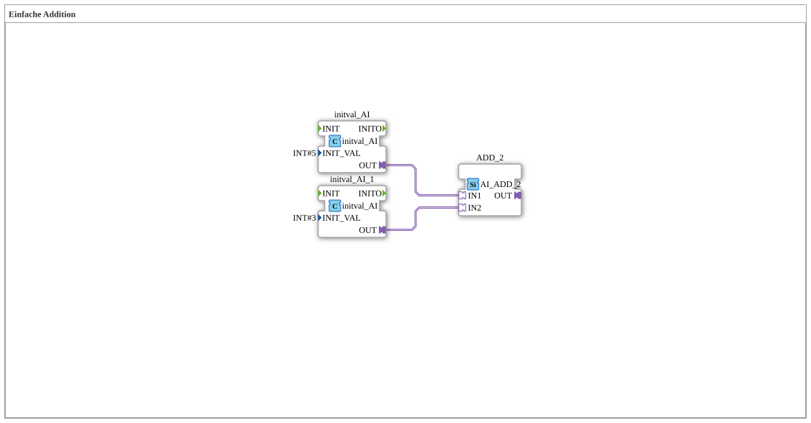

# Uebung_000_AX: Einfache Addition

* * * * * * * * * *

## Einleitung

Diese Übung ist das absolute Basisbeispiel für Berechnungen: Zwei konstante Ganzzahlwerte werden über Adapter-Verbindungen an einen Additionsbaustein der adapterbasierten IEC-61131-Bibliothek geführt. Sie zeigt, wie ein Standard-Rechenbaustein innerhalb eines IEC 61499 Netzwerks platziert und mit Werten versorgt wird. Die Übung hat keine Ein- und Ausgänge an der SubApp-Schnittstelle.

## Verwendete Funktionsbausteine (FBs)

- **initval_AI**: Konstantwert-Quelle für den ersten Summanden
    - **Typ**: [`adapter::types::unidirectional::AI::initval::initval_AI`](https://meisterschulen-am-ostbahnhof-munchen-docs.readthedocs.io/projects/4diac-library-reference-docs/de/latest/Bibliotheken/ExternalLibraries/adapter/types/unidirectional/INT/initval/initval_AI/)
    - **Parameter**: `INIT_VAL = INT#5`
    - **Erklärung**: Gibt beim Initialisieren den Wert 5 über den Adapter-Ausgang `OUT` (Adapter `AI`) aus.
- **initval_AI_1**: Konstantwert-Quelle für den zweiten Summanden
    - **Typ**: [`adapter::types::unidirectional::AI::initval::initval_AI`](https://meisterschulen-am-ostbahnhof-munchen-docs.readthedocs.io/projects/4diac-library-reference-docs/de/latest/Bibliotheken/ExternalLibraries/adapter/types/unidirectional/INT/initval/initval_AI/)
    - **Parameter**: `INIT_VAL = INT#3`
    - **Erklärung**: Gibt beim Initialisieren den Wert 3 über den Adapter-Ausgang `OUT` aus.
- **ADD_2**: Additionsbaustein
    - **Typ**: [`adapter::iec61131::arithmetic::AI_ADD_2`](https://meisterschulen-am-ostbahnhof-munchen-docs.readthedocs.io/projects/4diac-library-reference-docs/de/latest/Bibliotheken/ExternalLibraries/adapter/iec61131-3/arithmetic/AI_ADD_2/)
    - **Parameter**: keine
    - **Erklärung**: Addiert die über die Adapter `IN1` und `IN2` (jeweils Typ `AI`) angelieferten Werte und stellt die Summe am Adapter `OUT` bereit. Der Adapter-Ausgang wird laut Typ-Kommentar nur bei einer Wertänderung aktualisiert.

## Programmablauf und Verbindungen

1. `initval_AI.OUT` → `ADD_2.IN1` (AdapterConnection): der Wert 5 liegt am ersten Summanden an.
2. `initval_AI_1.OUT` → `ADD_2.IN2` (AdapterConnection): der Wert 3 liegt am zweiten Summanden an.

Der Ausgang `ADD_2.OUT` ist nicht weiterverschaltet; das Ergebnis (5 + 3 = 8) liegt dort an und kann zur Laufzeit beobachtet werden.

## Zusammenfassung

Die Übung `Uebung_000_AX` ist die einfachste Berechnung im Übungsumfeld: Zwei `initval_AI`-Bausteine liefern die Konstanten 5 und 3, `AI_ADD_2` addiert sie über Adapter-Verbindungen zu 8. Sie ist die Grundlage für jede Form von Zählern, Offsets oder Skalierungen in einer Steuerung.

---

### 🌐 Passende Themen-Unterseiten auf ms-muc-docs.de

- [🌐 Eclipse 4diac IDE & Farb-Referenz auf ms-muc-docs.de](https://www.ms-muc-docs.de/iec-61499/eclipse-4diac/)
