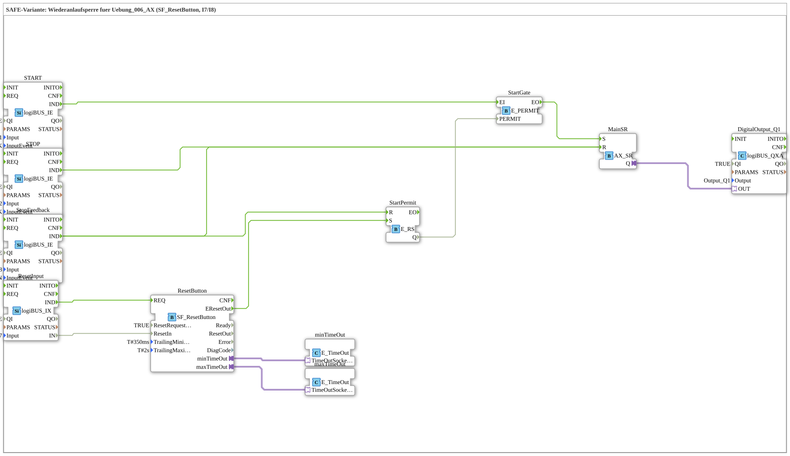

# Uebung_006_SAFE_AX: SAFE-Variante mit Wiederanlaufsperre (SF_ResetButton)

* * * * * * * * * *

## Einleitung

Diese Übung ist die SAFE-Variante von `Uebung_006_AX` (SR-Flip-Flop mit START/STOP-Tastern): STOP (`I2`) und der Meldeeingang `I7` (Rückmeldung des Hardware-Not-Halts) schalten den Ausgang softwareseitig sofort ab und sperren START über einen Freigabe-Latch (`E_RS`) und ein Start-Gatter (`E_PERMIT`). Die Sperre wird erst aufgehoben, wenn RESET (`I8`) über `SF_ResetButton` (PLCopen Safety Part 1, Kap. 6.1) eine gültige Tasten-Flanke erkennt. RESET alleine schaltet den Ausgang nicht wieder ein, dafür muss START erneut gedrückt werden.

**Kaltstart:** `StartPermit.Q` ist `FALSE` (Typ-Default von `BOOL`, `E_RS` hat keinen Initialwert). START bleibt also gesperrt, bis nach dem Anlauf eine gültige RESET-Quittierung erfolgt.

## Verwendete Funktionsbausteine (FBs)

- **START**: Taster START
    - **Typ**: [`logiBUS::io::DI::logiBUS_IE`](https://meisterschulen-am-ostbahnhof-munchen-docs.readthedocs.io/projects/4diac-library-reference-docs/de/latest/Bibliotheken/ExternalLibraries/logiBUS/io/DI/logiBUS_IE/)
    - **Parameter**: `QI = TRUE`, `Input = Input_I1`, `InputEvent = BUTTON_SINGLE_CLICK`
    - **Erklärung**: Meldet einen Einzelklick auf `I1` als Event `IND`.
- **STOP**: Hand-Stopp (nicht der Hardware-Not-Halt)
    - **Typ**: [`logiBUS::io::DI::logiBUS_IE`](https://meisterschulen-am-ostbahnhof-munchen-docs.readthedocs.io/projects/4diac-library-reference-docs/de/latest/Bibliotheken/ExternalLibraries/logiBUS/io/DI/logiBUS_IE/)
    - **Parameter**: `QI = TRUE`, `Input = Input_I2`, `InputEvent = BUTTON_SINGLE_CLICK`
    - **Erklärung**: Meldet einen Einzelklick auf `I2` als Event `IND`.
- **StopFeedback**: Meldeeingang der Hardware-Not-Halt-Rückmeldung
    - **Typ**: [`logiBUS::io::DI::logiBUS_IE`](https://meisterschulen-am-ostbahnhof-munchen-docs.readthedocs.io/projects/4diac-library-reference-docs/de/latest/Bibliotheken/ExternalLibraries/logiBUS/io/DI/logiBUS_IE/)
    - **Parameter**: `QI = TRUE`, `Input = Input_I7`, `InputEvent = BUTTON_PRESS_DOWN`
    - **Erklärung**: Meldet das Drücken (`BUTTON_PRESS_DOWN`) auf `I7` als Event `IND`.
- **ResetInput**: Pegel und Event für `SF_ResetButton`
    - **Typ**: [`logiBUS::io::DI::logiBUS_IX`](https://meisterschulen-am-ostbahnhof-munchen-docs.readthedocs.io/projects/4diac-library-reference-docs/de/latest/Bibliotheken/ExternalLibraries/logiBUS/io/DI/logiBUS_IX/)
    - **Parameter**: `QI = TRUE`, `Input = Input_I8`
    - **Erklärung**: Liefert den Pegel von `I8` (`IN`) und das zugehörige Event `IND`.
- **ResetButton**: Quittiertaster nach PLCopen Safety
    - **Typ**: `logiBUS::safety::PLCopen::SF_ResetButton`
    - **Parameter**: `ResetRequested = TRUE`, `TrailingMinimum = T#350ms`, `TrailingMaximum = T#2s`
    - **Erklärung**: Ergänzt Reset-Eingänge um eine Trailing-Edge-Auswertung (LOW-HIGH-LOW): Nach einem gültigen Drücken und Loslassen von `I8` (Eingänge `REQ` und `ResetIn`) innerhalb von `TrailingMinimum` bis `TrailingMaximum` wird das Event `EResetOut` ausgegeben. Die Zeitgrenzen werden über die Adapter `minTimeOut`/`maxTimeOut` von zwei `E_TimeOut`-Bausteinen überwacht.
- **minTimeOut**: Timer für die Mindestzeit von `SF_ResetButton`
    - **Typ**: [`iec61499::events::E_TimeOut`](https://meisterschulen-am-ostbahnhof-munchen-docs.readthedocs.io/projects/4diac-library-reference-docs/de/latest/Bibliotheken/StandardLibraries/events/E_TimeOut/)
    - **Parameter**: keine
    - **Erklärung**: Über `TimeOutSocket` mit `ResetButton.minTimeOut` verbunden.
- **maxTimeOut**: Timer für die Höchstzeit von `SF_ResetButton`
    - **Typ**: [`iec61499::events::E_TimeOut`](https://meisterschulen-am-ostbahnhof-munchen-docs.readthedocs.io/projects/4diac-library-reference-docs/de/latest/Bibliotheken/StandardLibraries/events/E_TimeOut/)
    - **Parameter**: keine
    - **Erklärung**: Über `TimeOutSocket` mit `ResetButton.maxTimeOut` verbunden.
- **StartPermit**: Freigabe-Latch (`E_RS` statt `E_SR` nur wegen kreuzungsfreier Verdrahtung)
    - **Typ**: [`iec61499::events::E_RS`](https://meisterschulen-am-ostbahnhof-munchen-docs.readthedocs.io/projects/4diac-library-reference-docs/de/latest/Bibliotheken/StandardLibraries/events/E_RS/)
    - **Parameter**: keine
    - **Erklärung**: `S` (aus `ResetButton.EResetOut`) gibt START frei, `R` (aus `StopFeedback.IND`) sperrt START. Der Ausgang `Q` speist `StartGate.PERMIT`.
- **StartGate**: Lässt START nur bei Freigabe durch
    - **Typ**: [`iec61499::events::E_PERMIT`](https://meisterschulen-am-ostbahnhof-munchen-docs.readthedocs.io/projects/4diac-library-reference-docs/de/latest/Bibliotheken/StandardLibraries/events/E_PERMIT/)
    - **Parameter**: keine
    - **Erklärung**: Leitet das START-Event (`EI`) nur dann als `EO` weiter, wenn `PERMIT` (aus `StartPermit.Q`) `TRUE` ist.
- **MainSR**: Haupt-Speicherglied für den Ausgang
    - **Typ**: [`adapter::events::unidirectional::AX_SR`](https://meisterschulen-am-ostbahnhof-munchen-docs.readthedocs.io/projects/4diac-library-reference-docs/de/latest/Bibliotheken/ExternalLibraries/adapter/events/unidirectional/BOOL/AX_SR/)
    - **Parameter**: keine
    - **Erklärung**: `S` setzt den Ausgang (nur über `StartGate`), `R` setzt ihn zurück (durch STOP oder `StopFeedback`). Der Adapterausgang `Q` führt zum Digitalausgang.
- **DigitalOutput_Q1**: logiBUS Digitalausgang
    - **Typ**: [`logiBUS::io::DQ::logiBUS_QXA`](https://meisterschulen-am-ostbahnhof-munchen-docs.readthedocs.io/projects/4diac-library-reference-docs/de/latest/Bibliotheken/ExternalLibraries/logiBUS/io/DO/logiBUS_QXA/)
    - **Parameter**: `QI = TRUE`, `Output = Output_Q1`
    - **Erklärung**: Gibt den Zustand von `MainSR.Q` an den physischen Ausgang `Q1` weiter.

## Programmablauf und Verbindungen

1. `START.IND` → `StartGate.EI` und `StartGate.EO` → `MainSR.S` (EventConnections): Ein Klick auf `I1` setzt den Ausgang nur dann, wenn `StartGate` freigegeben ist.
2. `STOP.IND` → `MainSR.R` (EventConnection): Ein Klick auf `I2` setzt den Ausgang sofort zurück.
3. `StopFeedback.IND` → `MainSR.R` und `StopFeedback.IND` → `StartPermit.R` (EventConnections): Die Hardware-Not-Halt-Rückmeldung an `I7` schaltet den Ausgang ab und sperrt zusätzlich START, indem sie den Freigabe-Latch zurücksetzt.
4. `ResetInput.IND` → `ResetButton.REQ` (EventConnection) und `ResetInput.IN` → `ResetButton.ResetIn` (DataConnection): Pegel und Event von `I8` gelangen an `SF_ResetButton`.
5. `ResetButton.minTimeOut` → `minTimeOut.TimeOutSocket` und `ResetButton.maxTimeOut` → `maxTimeOut.TimeOutSocket` (AdapterConnections): Die beiden Timer überwachen das gültige Zeitfenster der Tasten-Flanke.
6. `ResetButton.EResetOut` → `StartPermit.S` (EventConnection) und `StartPermit.Q` → `StartGate.PERMIT` (DataConnection): Eine gültige RESET-Quittierung gibt START wieder frei.
7. `MainSR.Q` → `DigitalOutput_Q1.OUT` (AdapterConnection): Der Zustand des Speicherglieds liegt am physischen Ausgang `Q1`.

**Verhalten**: START (`I1`) schaltet `Q1` nur ein, wenn eine Freigabe vorliegt. STOP (`I2`) oder die Not-Halt-Rückmeldung (`I7`) schalten `Q1` aus; die Rückmeldung sperrt zusätzlich START. Nach der Sperre bleibt `Q1` auch nach einer gültigen RESET-Quittierung (`I8`) zunächst aus; erst ein erneuter START-Klick schaltet `Q1` wieder ein.

## Zusammenfassung

Die Übung erweitert das einfache SR-Flip-Flop aus `Uebung_006_AX` um eine Wiederanlaufsperre: Der Freigabe-Latch `StartPermit` und das Gatter `StartGate` blockieren START nach einer Not-Halt-Rückmeldung, bis `SF_ResetButton` eine gültige RESET-Flanke erkannt hat. Im Kaltstart ist START ebenfalls gesperrt, weil `StartPermit.Q` den Typ-Default `FALSE` hat.

---

### 🌐 Passende Themen-Unterseiten auf ms-muc-docs.de

- [🌐 Eclipse 4diac IDE & Farb-Referenz auf ms-muc-docs.de](https://www.ms-muc-docs.de/iec-61499/eclipse-4diac/)
