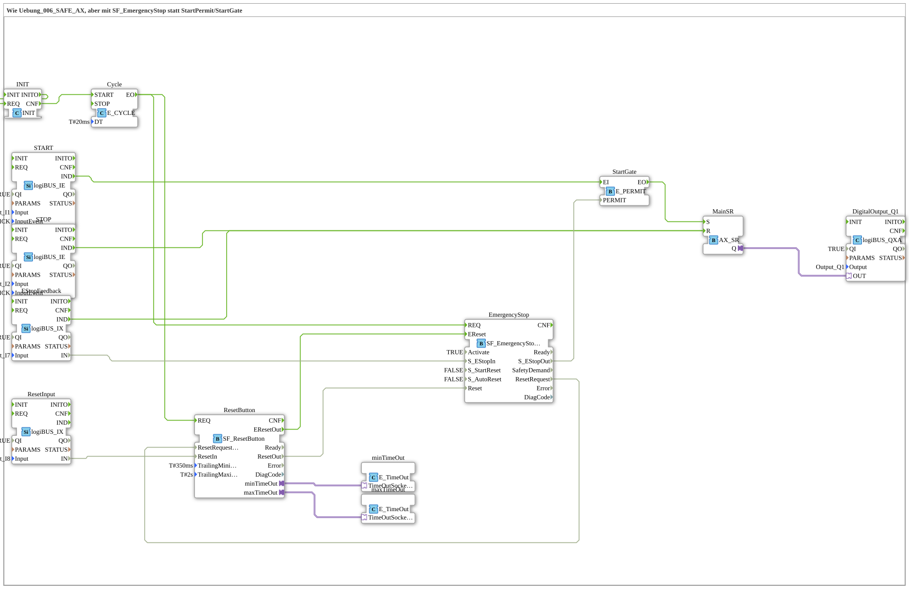

# Uebung_006_SAFE_AX_02: Start/Stopp mit SF_EmergencyStop statt StartPermit/StartGate

* * * * * * * * * *

## Einleitung

Diese Übung ist die zweite SAFE-Variante von `Uebung_006_AX`. Statt der handgebauten Lösung aus `StartPermit` (E_RS) und `StartGate` (E_PERMIT) in `Uebung_006_SAFE_AX` kommt hier der PLCopen-Standardbaustein `SF_EmergencyStop` (Part 1, Kap. 6.5) zum Einsatz. `SF_EmergencyStop` und `SF_ResetButton` sind im eingebetteten Muster (Figure 13 der Spezifikation) über `ResetRequest`/`ResetRequested` verkoppelt: `SF_EmergencyStop` fordert `SF_ResetButton` nur dann zur Überwachung an, wenn tatsächlich ein Reset nötig ist. Mit `S_StartReset = FALSE` und `S_AutoReset = FALSE` gibt es keinen automatischen Wiederanlauf; der RESET-Taster (`I7`) ist immer zwingend erforderlich.

## Verwendete Funktionsbausteine (FBs)

- **START**: Taster START
    - **Typ**: [`logiBUS::io::DI::logiBUS_IE`](https://meisterschulen-am-ostbahnhof-munchen-docs.readthedocs.io/projects/4diac-library-reference-docs/de/latest/Bibliotheken/ExternalLibraries/logiBUS/io/DI/logiBUS_IE/)
    - **Parameter**: `QI = TRUE`, `Input = Input_I1`, `InputEvent = BUTTON_SINGLE_CLICK`
    - **Erklärung**: Meldet einen Einzelklick auf `I1` als Event `IND`.
- **STOP**: Hand-Stopp (nicht HW-Not-Halt)
    - **Typ**: [`logiBUS::io::DI::logiBUS_IE`](https://meisterschulen-am-ostbahnhof-munchen-docs.readthedocs.io/projects/4diac-library-reference-docs/de/latest/Bibliotheken/ExternalLibraries/logiBUS/io/DI/logiBUS_IE/)
    - **Parameter**: `QI = TRUE`, `Input = Input_I2`, `InputEvent = BUTTON_SINGLE_CLICK`
    - **Erklärung**: Meldet einen Einzelklick auf `I2` als Event `IND`.
- **EStopFeedback**: Rückmeldung des Not-Halt-Kreises (`I8 = TRUE`: Not-Halt-Kreis ok, `I8 = FALSE`: Stopp erkannt)
    - **Typ**: [`logiBUS::io::DI::logiBUS_IX`](https://meisterschulen-am-ostbahnhof-munchen-docs.readthedocs.io/projects/4diac-library-reference-docs/de/latest/Bibliotheken/ExternalLibraries/logiBUS/io/DI/logiBUS_IX/)
    - **Parameter**: `QI = TRUE`, `Input = Input_I8`
    - **Erklärung**: Liefert den Pegel `IN` und bei Änderung das Event `IND`.
- **ResetInput**: Pegel und Event für `SF_ResetButton`
    - **Typ**: [`logiBUS::io::DI::logiBUS_IX`](https://meisterschulen-am-ostbahnhof-munchen-docs.readthedocs.io/projects/4diac-library-reference-docs/de/latest/Bibliotheken/ExternalLibraries/logiBUS/io/DI/logiBUS_IX/)
    - **Parameter**: `QI = TRUE`, `Input = Input_I7`
    - **Erklärung**: Liefert den Pegel des RESET-Tasters `I7`.
- **ResetButton**: PLCopen-Reset-Taster-Überwachung
    - **Typ**: `logiBUS::safety::PLCopen::SF_ResetButton`
    - **Parameter**: `TrailingMinimum = T#350ms`, `TrailingMaximum = T#2s`
    - **Erklärung**: Wertet den Reset-Taster mit den Zeitgrenzen `TrailingMinimum` und `TrailingMaximum` aus; die Zeitüberwachung läuft über die Adapter `minTimeOut`/`maxTimeOut`.
- **EmergencyStop**: PLCopen-Not-Halt
    - **Typ**: [`logiBUS::safety::PLCopen::SF_EmergencyStop`](https://meisterschulen-am-ostbahnhof-munchen-docs.readthedocs.io/projects/4diac-library-reference-docs/de/latest/Bibliotheken/ExternalLibraries/logiBUS/safety/PLCopen/SF_EmergencyStop/)
    - **Parameter**: `Activate = TRUE`, `S_StartReset = FALSE`, `S_AutoReset = FALSE`
    - **Erklärung**: Wertet die Not-Halt-Rückmeldung aus und liefert die Freigabe `S_EStopOut`. Ohne Startreset und ohne Autoreset ist immer ein Reset über `I7` nötig.
- **StartGate**: Lässt START nur bei Freigabe durch
    - **Typ**: [`iec61499::events::E_PERMIT`](https://meisterschulen-am-ostbahnhof-munchen-docs.readthedocs.io/projects/4diac-library-reference-docs/de/latest/Bibliotheken/StandardLibraries/events/E_PERMIT/)
    - **Parameter**: keine
    - **Erklärung**: Reicht das Event vom `START`-Taster nur weiter, wenn `PERMIT` (aus `EmergencyStop.S_EStopOut`) gesetzt ist.
- **MainSR**: Haupt-Set/Reset-Speicher
    - **Typ**: [`adapter::events::unidirectional::AX_SR`](https://meisterschulen-am-ostbahnhof-munchen-docs.readthedocs.io/projects/4diac-library-reference-docs/de/latest/Bibliotheken/ExternalLibraries/adapter/events/unidirectional/BOOL/AX_SR/)
    - **Parameter**: keine
    - **Erklärung**: Wird über `S` gesetzt und über `R` zurückgesetzt; der Zustand `Q` geht als Adapter an den Ausgang.
- **DigitalOutput_Q1**: logiBUS Digitalausgang
    - **Typ**: [`logiBUS::io::DQ::logiBUS_QXA`](https://meisterschulen-am-ostbahnhof-munchen-docs.readthedocs.io/projects/4diac-library-reference-docs/de/latest/Bibliotheken/ExternalLibraries/logiBUS/io/DO/logiBUS_QXA/)
    - **Parameter**: `QI = TRUE`, `Output = Output_Q1`
    - **Erklärung**: Legt den Zustand von `MainSR.Q` auf den physischen Ausgang `Q1`.
- **INIT**: Startimpuls
    - **Typ**: [`iec61131::booleanOperators::INIT`](https://meisterschulen-am-ostbahnhof-munchen-docs.readthedocs.io/projects/4diac-library-reference-docs/de/latest/Bibliotheken/ExternalLibraries/iec61131-3-bool/booleanOperators/INIT/)
    - **Parameter**: keine
    - **Erklärung**: `INITO` ist auf `REQ` zurückgeführt, `CNF` startet den zyklischen Baustein `Cycle`.
- **Cycle**: Zyklische Auswertung von `SF_EmergencyStop` und `SF_ResetButton`
    - **Typ**: [`iec61499::events::E_CYCLE`](https://meisterschulen-am-ostbahnhof-munchen-docs.readthedocs.io/projects/4diac-library-reference-docs/de/latest/Bibliotheken/StandardLibraries/events/E_CYCLE/)
    - **Parameter**: `DT = T#20ms`
    - **Erklärung**: Erzeugt alle 20 ms ein Event `EO` für `EmergencyStop.REQ` und `ResetButton.REQ`.
- **minTimeOut**: Zeitgeber für `TrailingMinimum`
    - **Typ**: [`iec61499::events::E_TimeOut`](https://meisterschulen-am-ostbahnhof-munchen-docs.readthedocs.io/projects/4diac-library-reference-docs/de/latest/Bibliotheken/StandardLibraries/events/E_TimeOut/)
    - **Parameter**: keine
    - **Erklärung**: Über den Adapter `TimeOutSocket` mit `ResetButton.minTimeOut` verbunden.
- **maxTimeOut**: Zeitgeber für `TrailingMaximum`
    - **Typ**: [`iec61499::events::E_TimeOut`](https://meisterschulen-am-ostbahnhof-munchen-docs.readthedocs.io/projects/4diac-library-reference-docs/de/latest/Bibliotheken/StandardLibraries/events/E_TimeOut/)
    - **Parameter**: keine
    - **Erklärung**: Über den Adapter `TimeOutSocket` mit `ResetButton.maxTimeOut` verbunden.

## Programmablauf und Verbindungen

1. `START.IND` → `StartGate.EI` und `StartGate.EO` → `MainSR.S` (EventConnections): Ein START-Klick setzt den Speicher nur, wenn `StartGate` freigegeben ist.
2. `EmergencyStop.S_EStopOut` → `StartGate.PERMIT` (DataConnection): Die Freigabe des Not-Halt-Bausteins entscheidet über `StartGate`.
3. `STOP.IND` → `MainSR.R` und `EStopFeedback.IND` → `MainSR.R` (EventConnections): Sowohl der Hand-Stopp (`I2`) als auch jede Änderung der Not-Halt-Rückmeldung (`I8`) setzen den Speicher zurück.
4. `EStopFeedback.IN` → `EmergencyStop.S_EStopIn` (DataConnection): Der Pegel des Not-Halt-Kreises wird von `SF_EmergencyStop` ausgewertet.
5. `INIT.INITO` → `INIT.REQ`, `INIT.CNF` → `Cycle.START`, `Cycle.EO` → `EmergencyStop.REQ` und `Cycle.EO` → `ResetButton.REQ` (EventConnections): Nach dem Start werden beide Sicherheitsbausteine zyklisch alle 20 ms angestoßen.
6. `ResetInput.IN` → `ResetButton.ResetIn` und `ResetButton.ResetOut` → `EmergencyStop.Reset` (DataConnections): Der RESET-Taster `I7` läuft über `SF_ResetButton` in den Not-Halt-Baustein.
7. `ResetButton.EResetOut` → `EmergencyStop.EReset` (EventConnection): Das Reset-Event wird an `SF_EmergencyStop` weitergegeben.
8. `EmergencyStop.ResetRequest` → `ResetButton.ResetRequested` (DataConnection): Die Verkopplung nach Figure 13 – `SF_ResetButton` überwacht nur dann, wenn ein Reset angefordert ist.
9. `ResetButton.minTimeOut` → `minTimeOut.TimeOutSocket` und `ResetButton.maxTimeOut` → `maxTimeOut.TimeOutSocket` (AdapterConnections): Die Zeitüberwachung des Reset-Tasters.
10. `MainSR.Q` → `DigitalOutput_Q1.OUT` (AdapterConnection): Der Speicherzustand steuert den Ausgang `Q1`.

## Zusammenfassung

Die Übung 006_SAFE_AX_02 ersetzt die handgebaute Start-Freigabe aus `StartPermit` und `StartGate` durch den PLCopen-Standardbaustein `SF_EmergencyStop` samt `SF_ResetButton`. Weil weder Startreset noch Autoreset aktiv sind, ist nach einem erkannten Stopp immer ein bewusster RESET über `I7` erforderlich, bevor `START` den Ausgang `Q1` wieder setzen kann.

---

### 🌐 Passende Themen-Unterseiten auf ms-muc-docs.de

- [🌐 Eclipse 4diac IDE & Farb-Referenz auf ms-muc-docs.de](https://www.ms-muc-docs.de/iec-61499/eclipse-4diac/)
