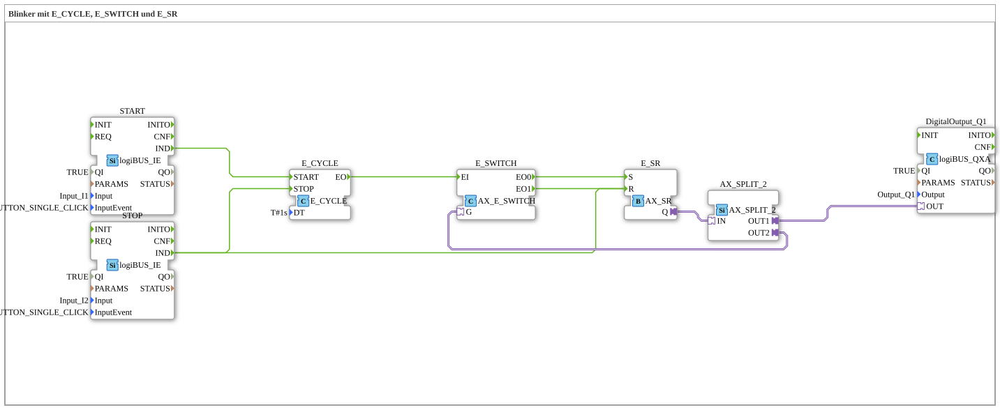

# Uebung_007a3_AX: Blinker mit E_CYCLE, E_SWITCH und E_SR

* * * * * * * * * *

## Einleitung

Dieser Artikel beschreibt die logiBUS®-Übung `Uebung_007a3_AX`. Diese Übung zeigt die "saubere" Lösung für einen schaltbaren Blinker. Ziel ist, dass der Blinker nach dem Stoppen immer im Zustand "AUS" stehen bleibt (Vorteil laut Kommentar im Netzwerk: "dieser Blinker bleibt immer auf AUS stehen").

## Verwendete Funktionsbausteine (FBs)

- **START**: logiBUS Eingang mit Klick-Erkennung für den Start
    - **Typ**: `logiBUS::io::DI::logiBUS_IE`
    - **Parameter**: `QI = TRUE`, `Input = Input_I1`, `InputEvent = BUTTON_SINGLE_CLICK`
    - **Erklärung**: Meldet einen Einzelklick auf `I1` als Event `IND`.
- **STOP**: logiBUS Eingang mit Klick-Erkennung für den Stopp
    - **Typ**: `logiBUS::io::DI::logiBUS_IE`
    - **Parameter**: `QI = TRUE`, `Input = Input_I2`, `InputEvent = BUTTON_SINGLE_CLICK`
    - **Erklärung**: Meldet einen Einzelklick auf `I2` als Event `IND`.
- **E_CYCLE**: Taktgeber
    - **Typ**: `iec61499::events::E_CYCLE`
    - **Parameter**: `DT = T#1s`
    - **Erklärung**: Erzeugt nach `START` im Abstand von einer Sekunde Ereignisse `EO`, bis `STOP` eintrifft.
- **E_SWITCH**: Ereignisweiche
    - **Typ**: `adapter::events::unidirectional::AX_E_SWITCH`
    - **Parameter**: keine
    - **Erklärung**: Leitet jedes Taktereignis `EI` abhängig vom über den Adapter `G` gelieferten Zustand entweder an `EO0` oder an `EO1` weiter.
- **E_SR**: Speicher ("Blinker ist an")
    - **Typ**: `adapter::events::unidirectional::AX_SR`
    - **Parameter**: keine
    - **Erklärung**: Set-Reset-Speicher mit Eingängen `S` und `R` und Ausgang `Q` (Adapter).
- **AX_SPLIT_2**: Signalverteiler
    - **Typ**: `adapter::events::unidirectional::AX_SPLIT_2`
    - **Parameter**: keine
    - **Erklärung**: Verteilt den Zustand von `E_SR.Q` an die Lampe (`OUT1`) und an die Rückkopplung zu `E_SWITCH.G` (`OUT2`).
- **DigitalOutput_Q1**: logiBUS Digitalausgang (die Lampe)
    - **Typ**: `logiBUS::io::DQ::logiBUS_QXA`
    - **Parameter**: `QI = TRUE`, `Output = Output_Q1`
    - **Erklärung**: Gibt den Zustand des Speichers an den physischen Ausgang `Q1` weiter.

## Programmablauf und Verbindungen

1. `START.IND` → `E_CYCLE.START`: der Klick auf `I1` startet den Taktgeber.
2. `STOP.IND` → `E_CYCLE.STOP`: der Klick auf `I2` stoppt den Taktgeber.
3. `E_CYCLE.EO` → `E_SWITCH.EI`: jeder Takt läuft in die Ereignisweiche.
4. `E_SWITCH.EO0` → `E_SR.S` und `E_SWITCH.EO1` → `E_SR.R`: je nach Weichenstellung wird der Speicher gesetzt oder zurückgesetzt.
5. `E_SR.Q` → `AX_SPLIT_2.IN`: der Speicherzustand wird verteilt.
6. `AX_SPLIT_2.OUT1` → `DigitalOutput_Q1.OUT`: die Lampe `Q1` folgt dem Speicher.
7. `AX_SPLIT_2.OUT2` → `E_SWITCH.G`: Rückkopplung. Ist der Speicher gesetzt, schaltet der nächste Takt ihn zurück, ist er zurückgesetzt, setzt der nächste Takt ihn. So toggelt die Lampe im Sekundentakt.
8. `STOP.IND` → `E_SR.R`: **zusätzlich** zum Stoppen des Taktgebers wird der Speicher direkt zurückgesetzt.

**Verhalten**: Ein Klick auf `I1` startet das Blinken, ein Klick auf `I2` stoppt es. Weil `STOP` zusätzlich direkt `E_SR.R` ansteuert, wird `Q` und damit die Lampe `Q1` beim Stoppen **zwingend** auf FALSE gesetzt - der Blinker bleibt immer auf AUS stehen.

## Zusammenfassung

Die Übung löst das Problem, dass ein einfacher Blinker beim Stoppen im Zustand "EIN" hängen bleiben könnte. Durch die Kombination aus `E_CYCLE`, der rückgekoppelten Weiche `E_SWITCH` und dem Speicher `E_SR` sowie dem zusätzlichen direkten Reset von `E_SR` durch `STOP` endet der Blinker garantiert im Zustand AUS.

**Anwendungsbeispiel - professioneller Indikator**: Eine Störungsleuchte in der Industrie muss blinken, wenn ein Fehler vorliegt, und **aus** sein, wenn der Fehler quittiert wurde. Sie darf niemals dauerhaft leuchten (das würde oft "Betriebsbereit" oder etwas anderes bedeuten).

---

### 🌐 Passende Themen-Unterseiten auf ms-muc-docs.de

- [🌐 Eclipse 4diac IDE & Farb-Referenz auf ms-muc-docs.de](https://www.ms-muc-docs.de/iec-61499/eclipse-4diac/)
