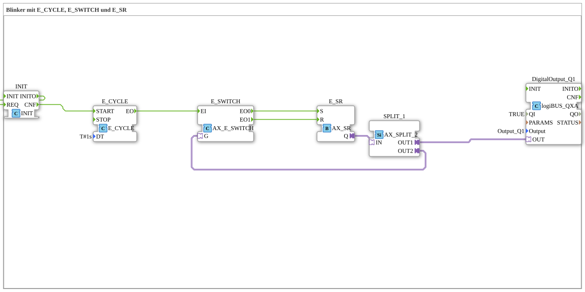

# Uebung_008_AX: Blinker mit E_CYCLE, E_SWITCH und E_SR

* * * * * * * * * *

## Einleitung

Implementierung eines dauerhaft laufenden Blinkers als Basis-Baustein. Ein zyklischer Takt (`E_CYCLE`, 1 s) schaltet über eine Weiche (`E_SWITCH`) abwechselnd das Setzen und das Rücksetzen eines Set/Reset-Speichers (`E_SR`) an. Der Speicherzustand wird auf den Ausgang `Q1` gelegt und zugleich als Schaltsignal auf die Weiche zurückgeführt. Da keine externen Eingriffe vorgesehen sind, blinkt der Ausgang permanent, solange die Steuerung läuft.

## Verwendete Funktionsbausteine (FBs)

- **INIT**: Startauslöser
    - **Typ**: [`iec61131::booleanOperators::INIT`](https://meisterschulen-am-ostbahnhof-munchen-docs.readthedocs.io/projects/4diac-library-reference-docs/de/latest/Bibliotheken/ExternalLibraries/iec61131-3-bool/booleanOperators/INIT/)
    - **Parameter**: keine
    - **Erklärung**: Durchleitung von Ereignissen für die Initialisierungsphase. Der Ausgang `INITO` ist auf den eigenen Eingang `REQ` zurückgeführt, die anschließende Bestätigung `CNF` startet den Takt.
- **E_CYCLE**: Taktgeber
    - **Typ**: [`iec61499::events::E_CYCLE`](https://meisterschulen-am-ostbahnhof-munchen-docs.readthedocs.io/projects/4diac-library-reference-docs/de/latest/Bibliotheken/StandardLibraries/events/E_CYCLE/)
    - **Parameter**: `DT = T#1s`
    - **Erklärung**: Erzeugt nach dem Start im Abstand von einer Sekunde ein Ereignis `EO`.
- **E_SWITCH**: Weiche
    - **Typ**: [`adapter::events::unidirectional::AX_E_SWITCH`](https://meisterschulen-am-ostbahnhof-munchen-docs.readthedocs.io/projects/4diac-library-reference-docs/de/latest/Bibliotheken/ExternalLibraries/adapter/events/unidirectional/BOOL/AX_E_SWITCH/)
    - **Parameter**: keine
    - **Erklärung**: Leitet das Ereignis `EI` abhängig vom Schaltsignal am Adapter `G` an `EO0` (`G` = 0) oder `EO1` (`G` = 1) weiter.
- **E_SR**: Set/Reset-Speicher
    - **Typ**: [`adapter::events::unidirectional::AX_SR`](https://meisterschulen-am-ostbahnhof-munchen-docs.readthedocs.io/projects/4diac-library-reference-docs/de/latest/Bibliotheken/ExternalLibraries/adapter/events/unidirectional/BOOL/AX_SR/)
    - **Parameter**: keine
    - **Erklärung**: Das Ereignis `S` setzt den Ausgang `Q` auf TRUE, `R` setzt ihn auf FALSE.
- **SPLIT_1**: Signalverteiler
    - **Typ**: [`adapter::events::unidirectional::AX_SPLIT_2`](https://meisterschulen-am-ostbahnhof-munchen-docs.readthedocs.io/projects/4diac-library-reference-docs/de/latest/Bibliotheken/ExternalLibraries/adapter/events/unidirectional/BOOL/AX_SPLIT_2/)
    - **Parameter**: keine
    - **Erklärung**: Verteilt das Signal vom Speicher `E_SR.Q` auf zwei Ausgänge: `OUT1` für den Ausgang `Q1`, `OUT2` als Rückführung zur Weiche.
- **DigitalOutput_Q1**: logiBUS Digitalausgang
    - **Typ**: [`logiBUS::io::DQ::logiBUS_QXA`](https://meisterschulen-am-ostbahnhof-munchen-docs.readthedocs.io/projects/4diac-library-reference-docs/de/latest/Bibliotheken/ExternalLibraries/logiBUS/io/DO/logiBUS_QXA/)
    - **Parameter**: `QI = TRUE`, `Output = Output_Q1`
    - **Erklärung**: Gibt den Zustand des Speichers an den physischen Ausgang `Q1` aus.

## Programmablauf und Verbindungen

1. `INIT.INITO` → `INIT.REQ` (EventConnection): Die Initialisierungsbestätigung löst die Dienstanforderung am selben Baustein aus.
2. `INIT.CNF` → `E_CYCLE.START` (EventConnection): Der Takt wird gestartet.
3. `E_CYCLE.EO` → `E_SWITCH.EI` (EventConnection): Jeder Taktimpuls (alle 1 s) geht in die Weiche.
4. `E_SWITCH.EO0` → `E_SR.S` und `E_SWITCH.EO1` → `E_SR.R` (EventConnections): Bei `G` = 0 wird der Speicher gesetzt, bei `G` = 1 zurückgesetzt.
5. `E_SR.Q` → `SPLIT_1.IN` (AdapterConnection): Der Speicherzustand geht in den Verteiler.
6. `SPLIT_1.OUT1` → `DigitalOutput_Q1.OUT` (AdapterConnection): Der Zustand wird auf den physischen Ausgang `Q1` gelegt.
7. `SPLIT_1.OUT2` → `E_SWITCH.G` (AdapterConnection): Der Zustand wird als Schaltsignal auf die Weiche zurückgeführt.

**Verhalten**: Ist der Speicher zurückgesetzt (`Q` = FALSE, `G` = 0), setzt der nächste Taktimpuls ihn über `EO0`/`S`; ist er gesetzt (`G` = 1), setzt der nächste Impuls ihn über `EO1`/`R` zurück. Der Ausgang `Q1` wechselt dadurch jede Sekunde seinen Zustand.

## Anwendungsbeispiel

**Lebenszeichen (Heartbeat)**: Eine LED, die auf der Platine oder am Schaltschrank blinkt, um anzuzeigen: "Die CPU lebt noch und das Programm läuft".

## Zusammenfassung

Die Übung zeigt einen Blinker aus Standardbausteinen: `E_CYCLE` liefert den Takt, `E_SWITCH` und `E_SR` bilden mit der Rückführung über `SPLIT_1` eine Toggle-Logik, und `INIT` startet den Takt nach der Initialisierung.

---

### 🌐 Passende Themen-Unterseiten auf ms-muc-docs.de

- [🌐 Eclipse 4diac IDE & Farb-Referenz auf ms-muc-docs.de](https://www.ms-muc-docs.de/iec-61499/eclipse-4diac/)
