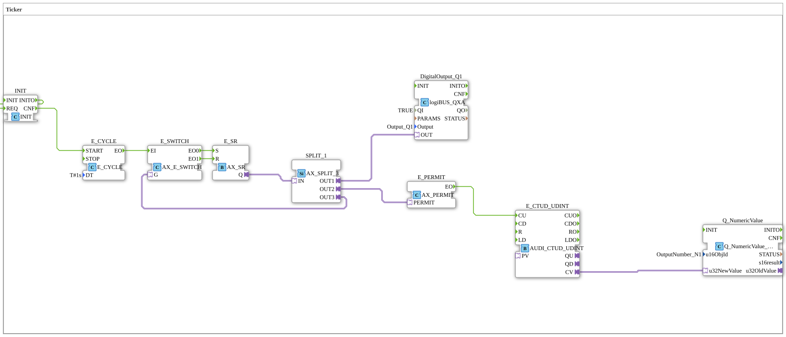

# Uebung_009_AX: Ticker (AX-Adapter basiert)

* * * * * * * * * *

## Einleitung

Diese Übung demonstriert einen adapterbasierten Ticker: Ein Taktgeber lässt einen Ausgang im Sekundentakt blinken, jede zweite Taktflanke (Ausgang geht auf TRUE) wird von einem Auf-/Abwärtszähler gezählt, und der Zählerstand wird als Zahl auf dem ISOBUS-Terminal angezeigt. Durch die `AX`/`AUDI`-Adapter werden Ereignis- und Datenfluss jeweils in einer einzigen Verbindung gebündelt.

## Verwendete Funktionsbausteine (FBs)

- **INIT**: Startauslöser
    - **Typ**: [`iec61131::booleanOperators::INIT`](https://meisterschulen-am-ostbahnhof-munchen-docs.readthedocs.io/projects/4diac-library-reference-docs/de/latest/Bibliotheken/ExternalLibraries/iec61131-3-bool/booleanOperators/INIT/)
    - **Parameter**: keine
    - **Erklärung**: Leitet `INIT` unverzögert als `INITO` und `REQ` als `CNF` weiter. `INITO` ist auf `REQ` zurückgeführt, `CNF` startet den Taktgeber.
- **E_CYCLE**: Taktgeber
    - **Typ**: [`iec61499::events::E_CYCLE`](https://meisterschulen-am-ostbahnhof-munchen-docs.readthedocs.io/projects/4diac-library-reference-docs/de/latest/Bibliotheken/StandardLibraries/events/E_CYCLE/)
    - **Parameter**: `DT = T#1s`
    - **Erklärung**: Erzeugt nach dem Start (`START`) jede Sekunde ein Ereignis `EO`.
- **E_SWITCH**: adapterbasierte Ereignisweiche
    - **Typ**: [`adapter::events::unidirectional::AX_E_SWITCH`](https://meisterschulen-am-ostbahnhof-munchen-docs.readthedocs.io/projects/4diac-library-reference-docs/de/latest/Bibliotheken/ExternalLibraries/adapter/events/unidirectional/BOOL/AX_E_SWITCH/)
    - **Parameter**: keine
    - **Erklärung**: Leitet das Takt-Ereignis `EI` je nach Wert des Adapters `G` an `EO0` (`G` = FALSE) oder `EO1` (`G` = TRUE) weiter.
- **E_SR**: adapterbasiertes Speicherglied (Blinkerstatus)
    - **Typ**: [`adapter::events::unidirectional::AX_SR`](https://meisterschulen-am-ostbahnhof-munchen-docs.readthedocs.io/projects/4diac-library-reference-docs/de/latest/Bibliotheken/ExternalLibraries/adapter/events/unidirectional/BOOL/AX_SR/)
    - **Parameter**: keine
    - **Erklärung**: `S` (aus `E_SWITCH.EO0`) setzt, `R` (aus `E_SWITCH.EO1`) setzt zurück. Der Zustand wird über den Adapterausgang `Q` ausgegeben.
- **SPLIT_1**: Signalverteiler
    - **Typ**: [`adapter::events::unidirectional::AX_SPLIT_3`](https://meisterschulen-am-ostbahnhof-munchen-docs.readthedocs.io/projects/4diac-library-reference-docs/de/latest/Bibliotheken/ExternalLibraries/adapter/events/unidirectional/BOOL/AX_SPLIT_3/)
    - **Parameter**: keine
    - **Erklärung**: Verteilt das `AX`-Signal von `E_SR.Q` auf drei Ziele: `OUT1` (Digitalausgang), `OUT2` (Zählfreigabe) und `OUT3` (Rückführung an die Weiche).
- **E_PERMIT**: adapterbasiertes Ereignis-Gatter
    - **Typ**: [`adapter::events::unidirectional::AX_PERMIT`](https://meisterschulen-am-ostbahnhof-munchen-docs.readthedocs.io/projects/4diac-library-reference-docs/de/latest/Bibliotheken/ExternalLibraries/adapter/events/unidirectional/BOOL/AX_PERMIT/)
    - **Parameter**: keine
    - **Erklärung**: Löst `EO` nur aus, wenn am Adapter `PERMIT` ein Ereignis (`PERMIT.E1`) eintrifft und `PERMIT.D1` `TRUE` ist.
- **E_CTUD_UDINT**: adapterbasierter Vorwärts-/Rückwärtszähler
    - **Typ**: [`adapter::events::unidirectional::AUDI_CTUD_UDINT`](https://meisterschulen-am-ostbahnhof-munchen-docs.readthedocs.io/projects/4diac-library-reference-docs/de/latest/Bibliotheken/ExternalLibraries/adapter/events/unidirectional/UDINT/AUDI_CTUD_UDINT/)
    - **Parameter**: keine
    - **Erklärung**: Erhöht bei jedem `CU`-Ereignis den Zählwert um 1 und gibt ihn über den `AUDI`-Adapter `CV` aus.
- **Q_NumericValue**: Anzeige auf dem ISOBUS-Terminal
    - **Typ**: [`isobus::UT::Q::Q_NumericValue_AUDI`](https://meisterschulen-am-ostbahnhof-munchen-docs.readthedocs.io/projects/4diac-library-reference-docs/de/latest/Bibliotheken/ExternalLibraries/isobus/UT/Q/Q_NumericValue_AUDI/)
    - **Parameter**: `u16ObjId = OutputNumber_N1`
    - **Erklärung**: Empfängt den Zählwert über den `AUDI`-Adapter `u32NewValue` und zeigt ihn im Objekt `OutputNumber_N1` an.
- **DigitalOutput_Q1**: logiBUS Digitalausgang
    - **Typ**: [`logiBUS::io::DQ::logiBUS_QXA`](https://meisterschulen-am-ostbahnhof-munchen-docs.readthedocs.io/projects/4diac-library-reference-docs/de/latest/Bibliotheken/ExternalLibraries/logiBUS/io/DO/logiBUS_QXA/)
    - **Parameter**: `QI = TRUE`, `Output = Output_Q1`
    - **Erklärung**: Gibt den Blinkerzustand an den physischen Ausgang `Q1` weiter.

## Programmablauf und Verbindungen

1. `INIT.INITO` → `INIT.REQ` und `INIT.CNF` → `E_CYCLE.START` (EventConnections): Der Taktgeber wird beim Initialisieren gestartet.
2. `E_CYCLE.EO` → `E_SWITCH.EI` (EventConnection): Jede Sekunde trifft ein Takt-Ereignis an der Weiche ein.
3. `E_SWITCH.EO0` → `E_SR.S` und `E_SWITCH.EO1` → `E_SR.R` (EventConnections): Ist das Speicherglied zurückgesetzt, setzt der Takt es, andernfalls setzt der Takt es zurück. Der Zustand wechselt also mit jedem Takt.
4. `E_SR.Q` → `SPLIT_1.IN` (AdapterConnection): Der Zustand wird auf drei Ziele verteilt.
5. `SPLIT_1.OUT3` → `E_SWITCH.G` (AdapterConnection): Der aktuelle Zustand steuert die Weiche und erzeugt damit das Umschalten.
6. `SPLIT_1.OUT1` → `DigitalOutput_Q1.OUT` (AdapterConnection): `Q1` blinkt im Rhythmus des Zustands.
7. `SPLIT_1.OUT2` → `E_PERMIT.PERMIT` (AdapterConnection): Bei jeder Zustandsänderung trifft ein Ereignis am Gatter ein; es wird nur durchgelassen, wenn der Zustand `TRUE` ist.
8. `E_PERMIT.EO` → `E_CTUD_UDINT.CU` (EventConnection): Jedes durchgelassene Ereignis zählt den Zähler um 1 hoch.
9. `E_CTUD_UDINT.CV` → `Q_NumericValue.u32NewValue` (AdapterConnection): Der Zählwert wird an das ISOBUS-Terminal gesendet.

**Verhalten**: `Q1` ist abwechselnd je eine Sekunde ein- und ausgeschaltet. Der Zähler wird jeweils beim Einschalten erhöht, also einmal alle zwei Sekunden; auf dem Terminal steigt die Zahl in `OutputNumber_N1` stetig an.

## Zusammenfassung

Die Übung zeigt die Vorteile einer konsequent adapterbasierten Entwicklung: Takt, Blinkerzustand, Zähler und Anzeige sind mit wenigen Adapterverbindungen verschaltet, weil Ereignis- und Datenfluss jeweils gebündelt übertragen werden. `AX_SPLIT_3` verteilt den Blinkerzustand gleichzeitig auf Ausgang, Zählfreigabe und Rückführung.

---

### 🌐 Passende Themen-Unterseiten auf ms-muc-docs.de

- [🌐 Eclipse 4diac IDE & Farb-Referenz auf ms-muc-docs.de](https://www.ms-muc-docs.de/iec-61499/eclipse-4diac/)
