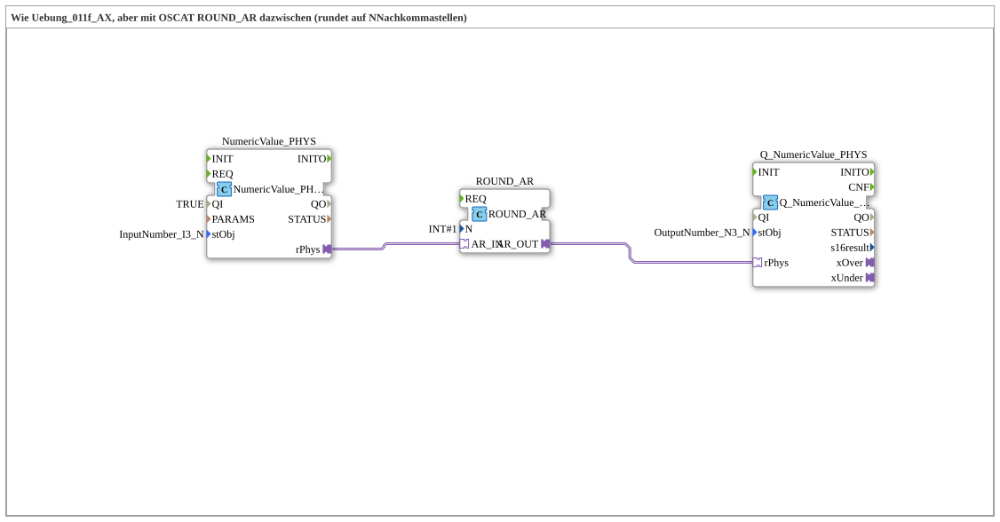

# Uebung_011f_ROUND_AR_AX: Physikalischer Zahlenwert mit OSCAT ROUND_AR runden

* * * * * * * * * *

## Einleitung

Diese Übung entspricht `Uebung_011f_AX`, jedoch ist zwischen Eingabe und Ausgabe der OSCAT-Baustein `ROUND_AR` eingefügt, der den Wert auf N Nachkommastellen rundet. Der physikalische Zahlenwert der Eingabe `InputNumber_I3_N` wird als `REAL`-Adapter (`rPhys`) durch `ROUND_AR` geführt und an der Ausgabe `OutputNumber_N3_N` angezeigt.

## Verwendete Funktionsbausteine (FBs)

- **NumericValue_PHYS**: Eingabe eines physikalischen Zahlenwerts
    - **Typ**: [`isobus::UT::io::NumericValue::NumericValue_PHYSA`](https://meisterschulen-am-ostbahnhof-munchen-docs.readthedocs.io/projects/4diac-library-reference-docs/de/latest/Bibliotheken/ExternalLibraries/isobus/UT/io/NumericValue/NumericValue_PHYSA/)
    - **Parameter**: `QI = TRUE`, `stObj = InputNumber_I3_N`
    - **Erklärung**: Liefert den eingegebenen Zahlenwert als physikalischen Wert über den Adapter `rPhys`.
- **ROUND_AR**: Rundet auf N Nachkommastellen
    - **Typ**: `OSCAT_adapter::Mathematical::ROUND_AR`
    - **Parameter**: `N = 1`
    - **Erklärung**: Rundet den Wert von `AR_IN` auf `N` Nachkommastellen (hier eine) und gibt ihn über `AR_OUT` aus.
- **Q_NumericValue_PHYS**: Ausgabe eines physikalischen Zahlenwerts
    - **Typ**: [`isobus::UT::Q::Q_NumericValue_PHYSA`](https://meisterschulen-am-ostbahnhof-munchen-docs.readthedocs.io/projects/4diac-library-reference-docs/de/latest/Bibliotheken/ExternalLibraries/isobus/UT/Q/Q_NumericValue_PHYSA/)
    - **Parameter**: `stObj = OutputNumber_N3_N`
    - **Erklärung**: Zeigt den über `rPhys` empfangenen Wert an `OutputNumber_N3_N` an.

## Programmablauf und Verbindungen

1. `NumericValue_PHYS.rPhys` → `ROUND_AR.AR_IN` (AdapterConnection): Der physikalische Eingabewert geht in den Rundungsbaustein.
2. `ROUND_AR.AR_OUT` → `Q_NumericValue_PHYS.rPhys` (AdapterConnection): Der gerundete Wert wird an die Ausgabe weitergereicht.

**Beispiel** (aus dem Kommentar im Netzwerk): Eingabe I3 = -500.00 → `rPhys` = -500.0 → `ROUND_AR` (`N = 1`) → -500.0 → `Q_NumericValue_PHYS` (N3) → N3 zeigt -500.00.

## Zusammenfassung

Die Übung zeigt, wie sich in den Adapterpfad eines physikalischen Zahlenwerts ein OSCAT-Baustein (`ROUND_AR`) einschleifen lässt, ohne die Ein- und Ausgabebausteine zu ändern. Gegenüber `Uebung_011f_AX` wird der Wert dadurch auf die eingestellte Zahl von Nachkommastellen gerundet.

---

### 🌐 Passende Themen-Unterseiten auf ms-muc-docs.de

- [🌐 Eclipse 4diac IDE & Farb-Referenz auf ms-muc-docs.de](https://www.ms-muc-docs.de/iec-61499/eclipse-4diac/)
