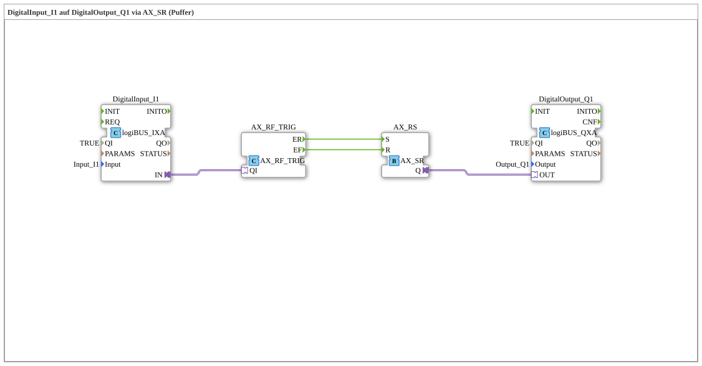

# Uebung_020a_AX: DigitalInput_I1 auf DigitalOutput_Q1 via AX_SR (Puffer)

* * * * * * * * * *

## Einleitung

Diese Übung leitet einen digitalen Eingang über einen Set/Reset-Speicher (`AX_SR`) auf einen digitalen Ausgang weiter. Im Gegensatz zu [Uebung_001_AX](./Uebung_001_AX.md), die eine direkte Verbindung nutzt, werden die Flanken des Eingangs hier explizit in Ereignisse gewandelt: die steigende Flanke setzt den Speicher, die fallende Flanke setzt ihn zurück. Im Ergebnis verhält sich die Schaltung wie eine direkte Verbindung, nutzt aber intern eine ereignisbasierte Speicherlogik.

## Verwendete Funktionsbausteine (FBs)

- **DigitalInput_I1**: logiBUS Digitaleingang
    - **Typ**: [`logiBUS::io::DI::logiBUS_IXA`](https://meisterschulen-am-ostbahnhof-munchen-docs.readthedocs.io/projects/4diac-library-reference-docs/de/latest/Bibliotheken/ExternalLibraries/logiBUS/io/DI/logiBUS_IXA/)
    - **Parameter**: `QI = TRUE`, `Input = Input_I1`
    - **Erklärung**: Liest den physischen Eingang `Input_I1` und stellt ihn als AX-Adapterausgang `IN` bereit.
- **AX_RF_TRIG**: Flankenerkennung
    - **Typ**: [`adapter::events::unidirectional::AX_RF_TRIG`](https://meisterschulen-am-ostbahnhof-munchen-docs.readthedocs.io/projects/4diac-library-reference-docs/de/latest/Bibliotheken/ExternalLibraries/adapter/events/unidirectional/BOOL/AX_RF_TRIG/)
    - **Parameter**: keine
    - **Erklärung**: Wertet das Signal am Adapter `QI` aus und meldet eine steigende Flanke (0→1) als Ereignis `ER`, eine fallende Flanke (1→0) als Ereignis `EF`.
- **AX_RS**: Set/Reset-Speicher
    - **Typ**: [`adapter::events::unidirectional::AX_SR`](https://meisterschulen-am-ostbahnhof-munchen-docs.readthedocs.io/projects/4diac-library-reference-docs/de/latest/Bibliotheken/ExternalLibraries/adapter/events/unidirectional/BOOL/AX_SR/)
    - **Parameter**: keine
    - **Erklärung**: Das Ereignis `S` setzt den Ausgang `Q` auf TRUE, `R` setzt ihn auf FALSE. Der Speicher hält den Zustand zwischen den Ereignissen.
- **DigitalOutput_Q1**: logiBUS Digitalausgang
    - **Typ**: [`logiBUS::io::DQ::logiBUS_QXA`](https://meisterschulen-am-ostbahnhof-munchen-docs.readthedocs.io/projects/4diac-library-reference-docs/de/latest/Bibliotheken/ExternalLibraries/logiBUS/io/DO/logiBUS_QXA/)
    - **Parameter**: `QI = TRUE`, `Output = Output_Q1`
    - **Erklärung**: Setzt den physischen Ausgang `Output_Q1` auf den Zustand von `AX_RS.Q`.

## Programmablauf und Verbindungen

1. `DigitalInput_I1.IN` → `AX_RF_TRIG.QI` (AdapterConnection): Das Eingangssignal wird der Flankenerkennung zugeführt.
2. `AX_RF_TRIG.ER` → `AX_RS.S` (EventConnection): Die steigende Flanke setzt den Speicher.
3. `AX_RF_TRIG.EF` → `AX_RS.R` (EventConnection): Die fallende Flanke setzt den Speicher zurück.
4. `AX_RS.Q` → `DigitalOutput_Q1.OUT` (AdapterConnection): Der Speicherzustand wird auf den physischen Ausgang `Q1` gelegt.

**Verhalten**: Beim Drücken von `I1` setzt die steigende Flanke den Speicher, `Q1` geht an. Beim Loslassen setzt die fallende Flanke ihn zurück, `Q1` geht aus.

## Anwendungsbeispiel

Dieses Muster ist die Basis für **Signalfilterung oder Entprellung**. Wenn man zwischen die Flankenerkennung und den Speicher weitere Logik (z.B. Timer) einfügt, kann man sehr präzise steuern, unter welchen Bedingungen ein Signal "einrasten" oder "abfallen" soll.

## Zusammenfassung

Die Übung zeigt, wie ein Eingangssignal über Flankenerkennung (`AX_RF_TRIG`) und einen Set/Reset-Speicher (`AX_SR`) als Puffer auf einen Ausgang gelegt wird. Das Ergebnis entspricht einer direkten Durchschaltung, die Signalverarbeitung läuft aber ereignisbasiert.

---

### 🌐 Passende Themen-Unterseiten auf ms-muc-docs.de

- [🌐 Eclipse 4diac IDE & Farb-Referenz auf ms-muc-docs.de](https://www.ms-muc-docs.de/iec-61499/eclipse-4diac/)
