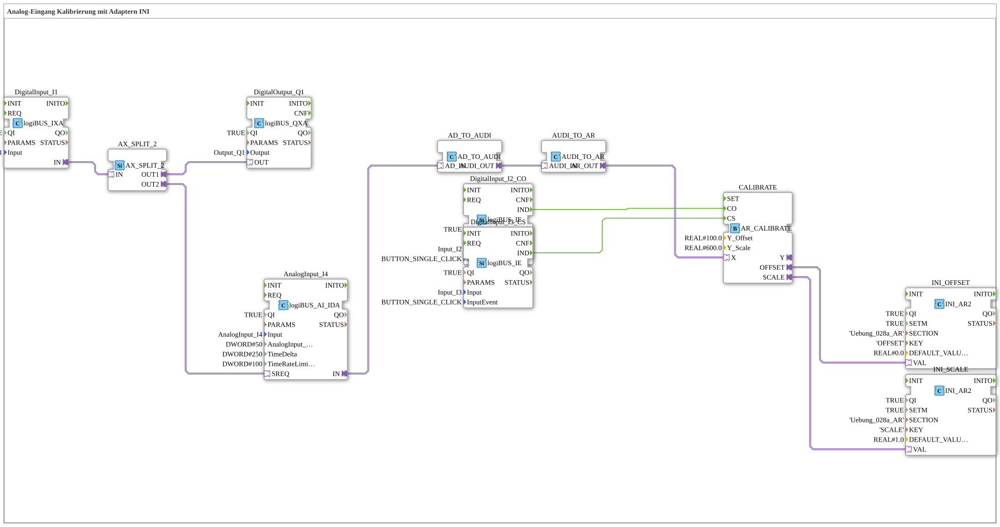

# Uebung_028a_AR: Analog-Eingang Kalibrierung mit Adaptern INI

* * * * * * * * * *

## Einleitung

Diese Übung demonstriert die Kalibrierung eines analogen Eingangssignals mithilfe von Adaptern und der Speicherung der Kalibrierungsparameter (Offset und Skalierung) in einer INI-Datei. Der Funktionsbaustein `AR_CALIBRATE` führt die Zwei-Punkt-Kalibrierung durch. Die Kalibrierung wird über zwei digitale Eingänge (`Input_I3`, `Input_I4`) ausgelöst, die Ergebnisse werden in zwei separaten Speicherbausteinen (`INI_AR2`) abgelegt. Die Konvertierung zwischen den Adaptertypen `AD` und `AR` erfolgt numerisch über einen einzelnen Adapterkonverter (`AD_TO_AR_NUM`).

## Verwendete Funktionsbausteine (FBs)

Die Übung verwendet ausschließlich direkt instanziierte Funktionsbausteine (keine Unter-Applikationen).

- **DigitalInput_I2**: logiBUS Digitaleingang
    - **Typ**: `logiBUS::io::DI::logiBUS_IXA`
    - **Parameter**: `QI = TRUE`, `Input = Input_I2`
    - **Erklärung**: Liest den Zustand des Eingangs `I2` und gibt ihn über den Adapter `IN` weiter. Dient als Trigger für die Messanforderung des Analogeingangs.
- **DigitalOutput_Q1**: logiBUS Digitalausgang
    - **Typ**: `logiBUS::io::DQ::logiBUS_QXA`
    - **Parameter**: `QI = TRUE`, `Output = Output_Q1`
    - **Erklärung**: Schaltet den Ausgang `Q1` entsprechend dem Zustand von `I2` (über `AX_SPLIT_2.OUT2`).
- **AnalogInput_AI1**: logiBUS Analogeingang
    - **Typ**: `logiBUS::io::AI::logiBUS_AI_IDA`
    - **Parameter**: `QI = TRUE`, `Input = AnalogInput_I1`, `AnalogInput_hysteresis = 50`, `TimeDelta = 250`, `TimeRateLimit = 100`
    - **Erklärung**: Liest den analogen Eingang `I1` und stellt den Wert über den Adapter `IN` bereit. Über den Adapter `SREQ` kann eine Messung angefordert werden. Die Parameter dienen der Filterung (Hysterese, Zeitdelta, Ratenbegrenzung).
- **CALIBRATE**: Zwei-Punkt-Kalibrierung
    - **Typ**: `adapter::Engineering::measurements::AR_CALIBRATE`
    - **Parameter**: `Y_Offset = 100.0`, `Y_Scale = 600.0`
    - **Erklärung**: Berechnet den kalibrierten Wert nach der Formel `Y = (X + OFFSET) * SCALE`. Mit dem Event `CO` (Calibrate Offset) wird `OFFSET := Y_Offset - X` gesetzt, mit dem Event `CS` (Calibrate Scale) wird `SCALE := Y_Scale / (X + OFFSET)` gesetzt. `Y_Offset` und `Y_Scale` sind dabei Sollwerte auf der Ausgangsseite. `CO` muss vor `CS` ausgeführt werden, da `CS` den Offset verwendet. Die berechneten Werte werden über die bidirektionalen Adapter `OFFSET` und `SCALE` ausgegeben bzw. eingelesen. Der kalibrierte Ausgang `Y` ist in dieser Übung nicht verschaltet.
- **INI_OFFSET**: Speicherbaustein für den Offset
    - **Typ**: `eclipse4diac::storage::INI_AR2`
    - **Parameter**: `QI = TRUE`, `SETM = TRUE`, `SECTION = 'Uebung_028a_AR'`, `KEY = 'OFFSET'`, `DEFAULT_VALUE = 0.0`
    - **Erklärung**: Lädt den Wert aus der INI-Datei (Abschnitt `Uebung_028a_AR`, Schlüssel `OFFSET`; ohne Eintrag gilt `DEFAULT_VALUE`) und liefert ihn über den Adapter `VAL`; neue Werte von `VAL` werden gespeichert. `SETM = TRUE` aktiviert die Spiegelung beim Setzen.
- **INI_SCALE**: Speicherbaustein für die Skalierung
    - **Typ**: `eclipse4diac::storage::INI_AR2`
    - **Parameter**: `QI = TRUE`, `SETM = TRUE`, `SECTION = 'Uebung_028a_AR'`, `KEY = 'SCALE'`, `DEFAULT_VALUE = 1.0`
    - **Erklärung**: Analog zu `INI_OFFSET`, jedoch für den Skalierungsfaktor (Schlüssel `SCALE`).
- **DigitalInput_I3_CO**: logiBUS Eingang mit Klick-Erkennung für die Offset-Kalibrierung
    - **Typ**: `logiBUS::io::DI::logiBUS_IE`
    - **Parameter**: `QI = TRUE`, `Input = Input_I3`, `InputEvent = BUTTON_SINGLE_CLICK`
    - **Erklärung**: Ein Einzelklick auf `I3` löst `CALIBRATE.CO` aus.
- **DigitalInput_I4_CS**: logiBUS Eingang mit Klick-Erkennung für die Skalen-Kalibrierung
    - **Typ**: `logiBUS::io::DI::logiBUS_IE`
    - **Parameter**: `QI = TRUE`, `Input = Input_I4`, `InputEvent = BUTTON_SINGLE_CLICK`
    - **Erklärung**: Ein Einzelklick auf `I4` löst `CALIBRATE.CS` aus.
- **AX_SPLIT_2**: Adapter-Splitter
    - **Typ**: `adapter::events::unidirectional::AX_SPLIT_2`
    - **Parameter**: keine
    - **Erklärung**: Verteilt das Signal von `DigitalInput_I2` gleichzeitig auf die Messanforderung `AnalogInput_AI1.SREQ` (`OUT1`) und auf `DigitalOutput_Q1` (`OUT2`).
- **AD_TO_AR_NUM**: Adapterkonverter (numerisch)
    - **Typ**: `adapter::conversion::unidirectional::AD_TO_AR_NUM`
    - **Parameter**: keine
    - **Erklärung**: Wandelt den vom Analogeingang gelieferten `AD`-Adapter numerisch (AD → UDINT → REAL) in den `AR`-Adapter um, den `AR_CALIBRATE` am Eingang `X` erwartet.

## Programmablauf und Verbindungen

1. `DigitalInput_I2.IN` → `AX_SPLIT_2.IN` (AdapterConnection): das Signal von `I2` wird in den Splitter geführt.
2. `AX_SPLIT_2.OUT1` → `AnalogInput_AI1.SREQ` und `AX_SPLIT_2.OUT2` → `DigitalOutput_Q1.OUT` (AdapterConnections): `Q1` folgt `I2`, gleichzeitig wird eine Messung am Analogeingang angefordert.
3. `AnalogInput_AI1.IN` → `AD_TO_AR_NUM.AD_IN` und `AD_TO_AR_NUM.AR_OUT` → `CALIBRATE.X` (AdapterConnections): der Messwert wird über den numerischen Konverter an den Kalibrierbaustein geführt.
4. `DigitalInput_I3_CO.IND` → `CALIBRATE.CO` (EventConnection): ein Klick auf `I3` löst die Offset-Kalibrierung aus.
5. `DigitalInput_I4_CS.IND` → `CALIBRATE.CS` (EventConnection): ein Klick auf `I4` löst die Skalen-Kalibrierung aus.
6. `CALIBRATE.OFFSET` → `INI_OFFSET.VAL` und `CALIBRATE.SCALE` → `INI_SCALE.VAL` (AdapterConnections): Offset und Skalierung werden in der INI-Datei abgelegt bzw. beim Start von dort geladen, sodass die Kalibrierung dauerhaft erhalten bleibt.

**Wichtige Anmerkung** (Kommentar im Modell): Ein `AD_TO_AR` wäre wie ein „reinterpret_cast“ (Bitmuster). `AD_TO_AR_NUM` wandelt dagegen den Zahlenwert (AD → UDINT → REAL).

**Lernziele dieser Übung**:

- Umgang mit analogen Eingangsadaptern und deren Parametrierung.
- Einsatz des numerischen Adapterkonverters `AD_TO_AR_NUM` zur Typanpassung.
- Verwendung von INI-Speicherbausteinen zum dauerhaften Ablegen von Konfigurationsparametern.
- Verständnis der Zwei-Punkt-Kalibrierung (Offset, dann Skalierung).

## Zusammenfassung

Die Übung `Uebung_028a_AR` implementiert eine Analog-Eingangs-Kalibrierung, bei der Offset und Skalierung über zwei Klick-Eingänge (`I3`, `I4`) eingelernt und in einer INI-Datei persistiert werden. Eine Messung wird über `I2` angefordert, das gleichzeitig `Q1` schaltet. Der Adapterkonverter `AD_TO_AR_NUM` demonstriert die wertrichtige (numerische) Weiterverarbeitung analoger Signale in der 4diac IDE.

---

### 🌐 Passende Themen-Unterseiten auf ms-muc-docs.de

- [🌐 Eclipse 4diac IDE & Farb-Referenz auf ms-muc-docs.de](https://www.ms-muc-docs.de/iec-61499/eclipse-4diac/)
