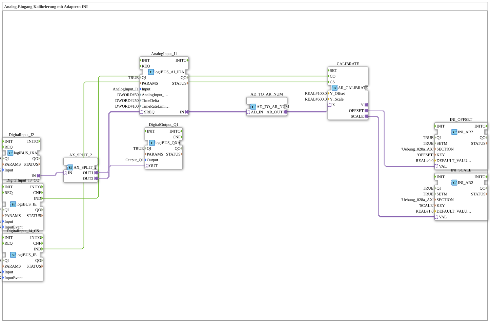

# Uebung_028a_AX: Analog-Eingang Kalibrierung mit Adaptern INI

* * * * * * * * * *

## Einleitung

Diese Übung kalibriert einen Analog-Eingang (`I4`) mit dem Baustein `AR_CALIBRATE`. Der Analogwert wird als Adapter geführt und über eine doppelte Konvertierung (`AD_TO_AUDI`, dann `AUDI_TO_AR`) in einen `REAL`-Wert gewandelt. Die berechneten Kalibrierwerte `OFFSET` und `SCALE` werden über zwei `INI_AR2`-Bausteine in einer INI-Datei gespeichert.

> **Wichtig**: Doppelte Konvertierung. Ein `AD_TO_AR` wäre wie ein "reinterpret_cast".

## Verwendete Funktionsbausteine (FBs)

- **DigitalInput_I1**: logiBUS Digitaleingang
    - **Typ**: [`logiBUS::io::DI::logiBUS_IXA`](https://meisterschulen-am-ostbahnhof-munchen-docs.readthedocs.io/projects/4diac-library-reference-docs/de/latest/Bibliotheken/ExternalLibraries/logiBUS/io/DI/logiBUS_IXA/)
    - **Parameter**: `QI = TRUE`, `Input = Input_I1`
    - **Erklärung**: Liefert den Zustand von `I1` als Adapter.
- **AX_SPLIT_2**: Verteilung des Adapters auf zwei Ziele
    - **Typ**: [`adapter::events::unidirectional::AX_SPLIT_2`](https://meisterschulen-am-ostbahnhof-munchen-docs.readthedocs.io/projects/4diac-library-reference-docs/de/latest/Bibliotheken/ExternalLibraries/adapter/events/unidirectional/BOOL/AX_SPLIT_2/)
    - **Parameter**: keine
    - **Erklärung**: `OUT1` geht an den Ausgang `Q1`, `OUT2` an `AnalogInput_I4.SREQ`.
- **DigitalOutput_Q1**: logiBUS Digitalausgang
    - **Typ**: [`logiBUS::io::DQ::logiBUS_QXA`](https://meisterschulen-am-ostbahnhof-munchen-docs.readthedocs.io/projects/4diac-library-reference-docs/de/latest/Bibliotheken/ExternalLibraries/logiBUS/io/DO/logiBUS_QXA/)
    - **Parameter**: `QI = TRUE`, `Output = Output_Q1`
    - **Erklärung**: Gibt den Wert von `AX_SPLIT_2.OUT1` am physischen Ausgang `Q1` aus.
- **AnalogInput_I4**: logiBUS Analogeingang
    - **Typ**: [`logiBUS::io::AI::logiBUS_AI_IDA`](https://meisterschulen-am-ostbahnhof-munchen-docs.readthedocs.io/projects/4diac-library-reference-docs/de/latest/Bibliotheken/ExternalLibraries/logiBUS/io/AI/logiBUS_AI_IDA/)
    - **Parameter**: `QI = TRUE`, `Input = AnalogInput_I4`, `AnalogInput_hysteresis = 50`, `TimeDelta = 250`, `TimeRateLimit = 100`
    - **Erklärung**: Liefert den Analogwert von `I4` über den Adapter `IN`.
- **AD_TO_AUDI**: erste Konvertierung
    - **Typ**: [`adapter::conversion::unidirectional::AD_TO_AUDI`](https://meisterschulen-am-ostbahnhof-munchen-docs.readthedocs.io/projects/4diac-library-reference-docs/de/latest/Bibliotheken/ExternalLibraries/adapter/conversion/unidirectional/AD_AUDI/AD_TO_AUDI/)
    - **Parameter**: keine
    - **Erklärung**: Wandelt `AD_IN` in `AUDI_OUT`.
- **AUDI_TO_AR**: zweite Konvertierung
    - **Typ**: [`adapter::conversion::unidirectional::AUDI_TO_AR`](https://meisterschulen-am-ostbahnhof-munchen-docs.readthedocs.io/projects/4diac-library-reference-docs/de/latest/Bibliotheken/ExternalLibraries/adapter/conversion/unidirectional/AR_AUDI/AUDI_TO_AR/)
    - **Parameter**: keine
    - **Erklärung**: Wandelt `AUDI_IN` in `AR_OUT`.
- **DigitalInput_I2_CO**: Taster für das Ereignis `CO`
    - **Typ**: [`logiBUS::io::DI::logiBUS_IE`](https://meisterschulen-am-ostbahnhof-munchen-docs.readthedocs.io/projects/4diac-library-reference-docs/de/latest/Bibliotheken/ExternalLibraries/logiBUS/io/DI/logiBUS_IE/)
    - **Parameter**: `QI = TRUE`, `Input = Input_I2`, `InputEvent = BUTTON_SINGLE_CLICK`
    - **Erklärung**: Meldet einen Einzelklick auf `I2` als `IND`.
- **DigitalInput_I3_CS**: Taster für das Ereignis `CS`
    - **Typ**: [`logiBUS::io::DI::logiBUS_IE`](https://meisterschulen-am-ostbahnhof-munchen-docs.readthedocs.io/projects/4diac-library-reference-docs/de/latest/Bibliotheken/ExternalLibraries/logiBUS/io/DI/logiBUS_IE/)
    - **Parameter**: `QI = TRUE`, `Input = Input_I3`, `InputEvent = BUTTON_SINGLE_CLICK`
    - **Erklärung**: Meldet einen Einzelklick auf `I3` als `IND`.
- **CALIBRATE**: Kalibrierung
    - **Typ**: [`adapter::Engineering::measurements::AR_CALIBRATE`](https://meisterschulen-am-ostbahnhof-munchen-docs.readthedocs.io/projects/4diac-library-reference-docs/de/latest/Bibliotheken/ExternalLibraries/adapter/Engineering/measurements/AR_CALIBRATE/)
    - **Parameter**: `Y_Offset = 100.0`, `Y_Scale = 600.0`
    - **Erklärung**: Erhält den gewandelten Messwert über `X` und die Ereignisse `CO` und `CS`; liefert `OFFSET` und `SCALE` als Adapter.
- **INI_OFFSET**: Ablage von `OFFSET` in der INI-Datei
    - **Typ**: [`eclipse4diac::storage::INI_AR2`](https://meisterschulen-am-ostbahnhof-munchen-docs.readthedocs.io/projects/4diac-library-reference-docs/de/latest/Bibliotheken/ExternalLibraries/logiBUS/storage/ini/INI_AR2/)
    - **Parameter**: `QI = TRUE`, `SETM = TRUE`, `SECTION = 'Uebung_028a_AX'`, `KEY = 'OFFSET'`, `DEFAULT_VALUE = 0.0`
    - **Erklärung**: Speichert den Wert von `CALIBRATE.OFFSET` (Eingang `VAL`) unter dem Schlüssel `OFFSET`.
- **INI_SCALE**: Ablage von `SCALE` in der INI-Datei
    - **Typ**: [`eclipse4diac::storage::INI_AR2`](https://meisterschulen-am-ostbahnhof-munchen-docs.readthedocs.io/projects/4diac-library-reference-docs/de/latest/Bibliotheken/ExternalLibraries/logiBUS/storage/ini/INI_AR2/)
    - **Parameter**: `QI = TRUE`, `SETM = TRUE`, `SECTION = 'Uebung_028a_AX'`, `KEY = 'SCALE'`, `DEFAULT_VALUE = 1.0`
    - **Erklärung**: Speichert den Wert von `CALIBRATE.SCALE` (Eingang `VAL`) unter dem Schlüssel `SCALE`.

## Programmablauf und Verbindungen

1. `DigitalInput_I1.IN` → `AX_SPLIT_2.IN`; `AX_SPLIT_2.OUT1` → `DigitalOutput_Q1.OUT` und `AX_SPLIT_2.OUT2` → `AnalogInput_I4.SREQ` (AdapterConnections): `I1` schaltet `Q1` und ist gleichzeitig mit `SREQ` des Analogeingangs verbunden.
2. `AnalogInput_I4.IN` → `AD_TO_AUDI.AD_IN` → `AD_TO_AUDI.AUDI_OUT` → `AUDI_TO_AR.AUDI_IN` → `AUDI_TO_AR.AR_OUT` → `CALIBRATE.X` (AdapterConnections): Der Analogwert wird doppelt konvertiert und als Messwert `X` an `CALIBRATE` gegeben.
3. `DigitalInput_I2_CO.IND` → `CALIBRATE.CO` und `DigitalInput_I3_CS.IND` → `CALIBRATE.CS` (EventConnections): Die beiden Taster `I2` und `I3` lösen die Ereignisse `CO` und `CS` aus.
4. `CALIBRATE.OFFSET` → `INI_OFFSET.VAL` und `CALIBRATE.SCALE` → `INI_SCALE.VAL` (AdapterConnections): Die Kalibrierwerte werden in der INI-Datei abgelegt.

## Zusammenfassung

Die Übung 028a_AX zeigt eine Kalibrierung eines Analog-Eingangs mit `AR_CALIBRATE`, bei der Messwert und Kalibrierwerte ausschließlich über Adapter geführt werden. Wichtig ist die doppelte Konvertierung `AD_TO_AUDI` und `AUDI_TO_AR`; ein einzelnes `AD_TO_AR` würde den Wert nur umdeuten ("reinterpret_cast"). `OFFSET` und `SCALE` werden über `INI_AR2` in der INI-Sektion `Uebung_028a_AX` abgelegt.

---

### 🌐 Passende Themen-Unterseiten auf ms-muc-docs.de

- [🌐 Eclipse 4diac IDE & Farb-Referenz auf ms-muc-docs.de](https://www.ms-muc-docs.de/iec-61499/eclipse-4diac/)
