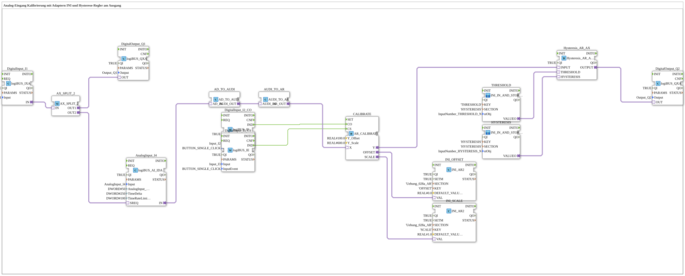

# Uebung_028b_AR: Analog-Eingang Kalibrierung mit Adaptern INI und Hysterese-Regler am Ausgang

* * * * * * * * * *

## Einleitung

Diese Übung demonstriert die Kalibrierung eines analogen Eingangssignals mit Hilfe von Adaptern und einer INI-basierten Speicherung der Kalibrierparameter. Das kalibrierte Signal wird anschließend durch einen Hysterese-Regler geführt, dessen Schwellwert und Hysterese über das VT eingegeben und ebenfalls in der INI-Datei gespeichert werden. Die Übung zeigt die Verknüpfung von analogen und digitalen Ein-/Ausgängen, Adapter-Konvertierungen sowie die persistente Speicherung von Parametern.

## Verwendete Funktionsbausteine (FBs)

- **DigitalInput_I2**: logiBUS Digitaleingang
    - **Typ**: [`logiBUS::io::DI::logiBUS_IXA`](https://meisterschulen-am-ostbahnhof-munchen-docs.readthedocs.io/projects/4diac-library-reference-docs/de/latest/Bibliotheken/ExternalLibraries/logiBUS/io/DI/logiBUS_IXA/)
    - **Parameter**: `QI = TRUE`, `Input = Input_I2`
    - **Erklärung**: Liefert den Zustand von `I2` als AX-Adaptersignal.
- **AX_SPLIT_2**: Signalverteiler
    - **Typ**: [`adapter::events::unidirectional::AX_SPLIT_2`](https://meisterschulen-am-ostbahnhof-munchen-docs.readthedocs.io/projects/4diac-library-reference-docs/de/latest/Bibliotheken/ExternalLibraries/adapter/events/unidirectional/BOOL/AX_SPLIT_2/)
    - **Parameter**: keine
    - **Erklärung**: Verteilt das AX-Signal von `I2` auf zwei Ausgänge: `OUT1` zum Analogeingang (Messanforderung), `OUT2` zum Digitalausgang `Q1`.
- **DigitalOutput_Q1**: logiBUS Digitalausgang
    - **Typ**: [`logiBUS::io::DQ::logiBUS_QXA`](https://meisterschulen-am-ostbahnhof-munchen-docs.readthedocs.io/projects/4diac-library-reference-docs/de/latest/Bibliotheken/ExternalLibraries/logiBUS/io/DO/logiBUS_QXA/)
    - **Parameter**: `QI = TRUE`, `Output = Output_Q1`
    - **Erklärung**: Gibt das Signal von `I2` am physischen Ausgang `Q1` aus.
- **AnalogInput_I1**: logiBUS Analogeingang
    - **Typ**: [`logiBUS::io::AI::logiBUS_AI_IDA`](https://meisterschulen-am-ostbahnhof-munchen-docs.readthedocs.io/projects/4diac-library-reference-docs/de/latest/Bibliotheken/ExternalLibraries/logiBUS/io/AI/logiBUS_AI_IDA/)
    - **Parameter**: `QI = TRUE`, `Input = AnalogInput_I1`, `AnalogInput_hysteresis = 50`, `TimeDelta = 250`, `TimeRateLimit = 100`
    - **Erklärung**: Stellt den analogen Messwert am AD-Adapter `IN` bereit. Über den Socket `SREQ` kann eine Messung extern angefordert werden.
- **AD_TO_AR_NUM**: Konvertierungsadapter
    - **Typ**: [`adapter::conversion::unidirectional::AD_TO_AR_NUM`](https://meisterschulen-am-ostbahnhof-munchen-docs.readthedocs.io/projects/4diac-library-reference-docs/de/latest/Bibliotheken/ExternalLibraries/adapter/conversion/unidirectional/AD_AR/AD_TO_AR_NUM/)
    - **Parameter**: keine
    - **Erklärung**: Wandelt den Rohwert vom AD-Adapter numerisch (AD → UDINT → REAL) in einen REAL-Wert am AR-Adapter. **Hinweis** (Kommentar im Netzwerk): Ein `AD_TO_AR` wäre wie ein „reinterpret_cast“ (Bitmuster); `AD_TO_AR_NUM` wandelt dagegen den Zahlenwert.
- **DigitalInput_I3_CO**: Klick-Eingang für die Offset-Kalibrierung
    - **Typ**: [`logiBUS::io::DI::logiBUS_IE`](https://meisterschulen-am-ostbahnhof-munchen-docs.readthedocs.io/projects/4diac-library-reference-docs/de/latest/Bibliotheken/ExternalLibraries/logiBUS/io/DI/logiBUS_IE/)
    - **Parameter**: `QI = TRUE`, `Input = Input_I3`, `InputEvent = BUTTON_SINGLE_CLICK`
    - **Erklärung**: Meldet einen Einzelklick auf `I3` als Ereignis `IND`.
- **DigitalInput_I4_CS**: Klick-Eingang für die Skalen-Kalibrierung
    - **Typ**: [`logiBUS::io::DI::logiBUS_IE`](https://meisterschulen-am-ostbahnhof-munchen-docs.readthedocs.io/projects/4diac-library-reference-docs/de/latest/Bibliotheken/ExternalLibraries/logiBUS/io/DI/logiBUS_IE/)
    - **Parameter**: `QI = TRUE`, `Input = Input_I4`, `InputEvent = BUTTON_SINGLE_CLICK`
    - **Erklärung**: Meldet einen Einzelklick auf `I4` als Ereignis `IND`.
- **CALIBRATE**: Kalibrierung
    - **Typ**: [`adapter::Engineering::measurements::AR_CALIBRATE`](https://meisterschulen-am-ostbahnhof-munchen-docs.readthedocs.io/projects/4diac-library-reference-docs/de/latest/Bibliotheken/ExternalLibraries/adapter/Engineering/measurements/AR_CALIBRATE/)
    - **Parameter**: `Y_Offset = 100.0`, `Y_Scale = 600.0`
    - **Erklärung**: Berechnet `Y = (X + OFFSET) * SCALE`. Das Ereignis `CO` ermittelt den Offset als `Y_Offset - X`, das Ereignis `CS` den Skalenfaktor als `Y_Scale / (X + OFFSET)`. Ausgänge sind der kalibrierte Wert `Y` sowie die Adapter `OFFSET` und `SCALE`.
- **INI_OFFSET**: INI-Speicher für den Offset
    - **Typ**: [`eclipse4diac::storage::INI_AR2`](https://meisterschulen-am-ostbahnhof-munchen-docs.readthedocs.io/projects/4diac-library-reference-docs/de/latest/Bibliotheken/ExternalLibraries/logiBUS/storage/ini/INI_AR2/)
    - **Parameter**: `QI = TRUE`, `SETM = TRUE`, `SECTION = 'Uebung_028a_AR'`, `KEY = 'OFFSET'`, `DEFAULT_VALUE = 0.0`
    - **Erklärung**: Liest den Wert aus der INI-Datei und schreibt über den bidirektionalen Adapter `VAL` den von `CALIBRATE` berechneten Offset zurück.
- **INI_SCALE**: INI-Speicher für die Skalierung
    - **Typ**: [`eclipse4diac::storage::INI_AR2`](https://meisterschulen-am-ostbahnhof-munchen-docs.readthedocs.io/projects/4diac-library-reference-docs/de/latest/Bibliotheken/ExternalLibraries/logiBUS/storage/ini/INI_AR2/)
    - **Parameter**: `QI = TRUE`, `SETM = TRUE`, `SECTION = 'Uebung_028a_AR'`, `KEY = 'SCALE'`, `DEFAULT_VALUE = 1.0`
    - **Erklärung**: Wie `INI_OFFSET`, jedoch für den Skalenfaktor.
- **THRESHOLD**: VT-Eingabe und Speicherung des Schwellwerts
    - **Typ**: [`MyLib::sys::INI_IN_AND_STORE_AR`](https://meisterschulen-am-ostbahnhof-munchen-docs.readthedocs.io/projects/4diac-library-reference-docs/de/latest/Bibliotheken/ExternalLibraries/MyLib_AX/sys/INI_IN_AND_STORE_AR/) (SubApp-Instanz)
    - **Parameter**: `KEY = 'THRESHOLD'`, `SECTION = 'HYSTERESIS'`, `stObj = InputNumber_THRESHOLD_N`
    - **Erklärung**: Ein über das VT (Eingabefeld `InputNumber_THRESHOLD_N`) eingegebener, physikalisch skalierter REAL-Wert wird in der INI-Datei abgelegt, wieder auf dem VT angezeigt und am Adapter `VALUEO` ausgegeben.
- **HYSTERESIS**: VT-Eingabe und Speicherung der Hysteresebreite
    - **Typ**: [`MyLib::sys::INI_IN_AND_STORE_AR`](https://meisterschulen-am-ostbahnhof-munchen-docs.readthedocs.io/projects/4diac-library-reference-docs/de/latest/Bibliotheken/ExternalLibraries/MyLib_AX/sys/INI_IN_AND_STORE_AR/) (SubApp-Instanz)
    - **Parameter**: `KEY = 'HYSTERESIS'`, `SECTION = 'HYSTERESIS'`, `stObj = InputNumber_HYSTERESIS_N`
    - **Erklärung**: Wie `THRESHOLD`, jedoch für die Hysteresebreite (Eingabefeld `InputNumber_HYSTERESIS_N`).
- **Hysteresis_AR_AX**: Hysterese-Regler
    - **Typ**: [`logiBUS::signalprocessing::hysteresis::Hysteresis_AR_AX`](https://meisterschulen-am-ostbahnhof-munchen-docs.readthedocs.io/projects/4diac-library-reference-docs/de/latest/Bibliotheken/ExternalLibraries/adapter/signalprocessing/hysteresis/Hysteresis_AR_AX/)
    - **Parameter**: `QI = TRUE`
    - **Erklärung**: Schaltet `OUTPUT` ein, wenn `INPUT` den Wert `THRESHOLD + HYSTERESIS/2` erreicht oder überschreitet, und aus, wenn `INPUT` den Wert `THRESHOLD - HYSTERESIS/2` unterschreitet.
- **DigitalOutput_Q2**: logiBUS Digitalausgang
    - **Typ**: [`logiBUS::io::DQ::logiBUS_QXA`](https://meisterschulen-am-ostbahnhof-munchen-docs.readthedocs.io/projects/4diac-library-reference-docs/de/latest/Bibliotheken/ExternalLibraries/logiBUS/io/DO/logiBUS_QXA/)
    - **Parameter**: `QI = TRUE`, `Output = Output_Q2`
    - **Erklärung**: Gibt das Ergebnis des Hysterese-Reglers am physischen Ausgang `Q2` aus.

## Programmablauf und Verbindungen

1. `DigitalInput_I2.IN` → `AX_SPLIT_2.IN` (AdapterConnection): Der Zustand von `I2` wird verteilt.
2. `AX_SPLIT_2.OUT2` → `DigitalOutput_Q1.OUT`: `Q1` folgt `I2`.
3. `AX_SPLIT_2.OUT1` → `AnalogInput_I1.SREQ`: `I2` fordert eine Messung am Analogeingang an.
4. `AnalogInput_I1.IN` → `AD_TO_AR_NUM.AD_IN`: Der Messwert wird numerisch in einen REAL-Wert umgewandelt.
5. `AD_TO_AR_NUM.AR_OUT` → `CALIBRATE.X`: Der umgewandelte Wert ist der Kalibriereingang.
6. `DigitalInput_I3_CO.IND` → `CALIBRATE.CO` und `DigitalInput_I4_CS.IND` → `CALIBRATE.CS` (EventConnections): Ein Klick auf `I3` löst die Offset-Kalibrierung aus, ein Klick auf `I4` die Skalen-Kalibrierung.
7. `CALIBRATE.OFFSET` → `INI_OFFSET.VAL` und `CALIBRATE.SCALE` → `INI_SCALE.VAL`: Die berechneten Kalibrierwerte werden in der INI-Datei (Sektion `Uebung_028a_AR`) gespeichert.
8. `CALIBRATE.Y` → `Hysteresis_AR_AX.INPUT`: Der kalibrierte Messwert wird ausgewertet.
9. `THRESHOLD.VALUEO` → `Hysteresis_AR_AX.THRESHOLD` und `HYSTERESIS.VALUEO` → `Hysteresis_AR_AX.HYSTERESIS`: Schwellwert und Hysteresebreite aus den VT-Eingaben.
10. `Hysteresis_AR_AX.OUTPUT` → `DigitalOutput_Q2.OUT`: Das Hysterese-Ergebnis schaltet `Q2`.

**Lernziele**:

- Verständnis der Adapter-Konvertierung zwischen analogen Signaltypen (`AD` → `AR`, numerisch mit `AD_TO_AR_NUM`)
- Umgang mit **INI**-Bausteinen zum persistenten Speichern und Laden von Kalibrierparametern
- Einsatz eines Kalibrierungsadapters (Offset/Skalierung)
- Realisierung einer Hysterese-Funktion zur Schwellwertüberwachung

## Zusammenfassung

Die Übung **Uebung_028b_AR** realisiert eine vollständige Kette zur Verarbeitung eines analogen Eingangssignals: Messung, Kalibrierung, Speicherung der Kalibrierdaten und anschließende Hysterese-Auswertung. Durch die Kombination von digitalen Ereignissen, Adapter-Konvertierungen und INI-basierter Parameterverwaltung wird ein praxisnahes Beispiel für industrielle Analogwertverarbeitung in 4diac dargestellt.

---

### 🌐 Passende Themen-Unterseiten auf ms-muc-docs.de

- [🌐 Eclipse 4diac IDE & Farb-Referenz auf ms-muc-docs.de](https://www.ms-muc-docs.de/iec-61499/eclipse-4diac/)
