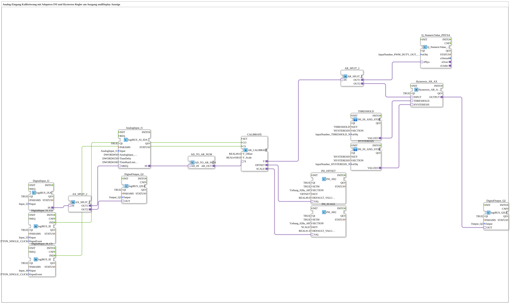

# Uebung_028c_AR: Analog-Eingang Kalibrierung mit Adaptern INI und Hysterese-Regler am Ausgang und Display Anzeige

* * * * * * * * * *

## Einleitung

Diese Übung kalibriert den Analog-Eingang `I1` mit dem Baustein `AR_CALIBRATE`; die Kalibrierwerte `OFFSET` und `SCALE` werden über zwei `INI_AR2`-Bausteine in einer INI-Datei abgelegt. Der kalibrierte Wert `Y` wird über `AR_SPLIT_2` verteilt: Ein Zweig geht an eine numerische Anzeige (`Q_NumericValue_PHYSA`), der andere an einen Hysterese-Baustein (`Hysteresis_AR_AX`), dessen Ergebnis den Digitalausgang `Q2` schaltet. Schwellwert und Hysterese liefern die beiden SubApps `THRESHOLD` und `HYSTERESIS` (`INI_IN_AND_STORE_AR`). Der Taster `I2` schaltet den Ausgang `Q1` und ist über `AX_SPLIT_2` zugleich mit `SREQ` des Analogeingangs verbunden.

> **Wichtig**: Ein `AD_TO_AR` wäre wie ein "reinterpret_cast" (Bitmuster). `AD_TO_AR_NUM` wandelt dagegen den Zahlenwert (AD → UDINT → REAL).

> **Beispiel** (Kommentar im Netzwerk): `0.0` entspricht 0,5 V, `100.0` entspricht 4,5 V (typischer Automotive-Sensor).

## Verwendete Funktionsbausteine (FBs)

- **DigitalInput_I2**: logiBUS Digitaleingang
    - **Typ**: [`logiBUS::io::DI::logiBUS_IXA`](https://meisterschulen-am-ostbahnhof-munchen-docs.readthedocs.io/projects/4diac-library-reference-docs/de/latest/Bibliotheken/ExternalLibraries/logiBUS/io/DI/logiBUS_IXA/)
    - **Parameter**: `QI = TRUE`, `Input = Input_I2`
    - **Erklärung**: Liefert den Zustand von `I2` als Adapter.
- **AX_SPLIT_2**: Verteilung des Adapters auf zwei Ziele
    - **Typ**: [`adapter::events::unidirectional::AX_SPLIT_2`](https://meisterschulen-am-ostbahnhof-munchen-docs.readthedocs.io/projects/4diac-library-reference-docs/de/latest/Bibliotheken/ExternalLibraries/adapter/events/unidirectional/BOOL/AX_SPLIT_2/)
    - **Parameter**: keine
    - **Erklärung**: `OUT1` geht an `AnalogInput_I1.SREQ`, `OUT2` an `DigitalOutput_Q1`.
- **DigitalOutput_Q1**: logiBUS Digitalausgang
    - **Typ**: [`logiBUS::io::DQ::logiBUS_QXA`](https://meisterschulen-am-ostbahnhof-munchen-docs.readthedocs.io/projects/4diac-library-reference-docs/de/latest/Bibliotheken/ExternalLibraries/logiBUS/io/DO/logiBUS_QXA/)
    - **Parameter**: `QI = TRUE`, `Output = Output_Q1`
    - **Erklärung**: Gibt `AX_SPLIT_2.OUT2` am physischen Ausgang `Q1` aus.
- **AnalogInput_I1**: logiBUS Analogeingang
    - **Typ**: [`logiBUS::io::AI::logiBUS_AI_IDA`](https://meisterschulen-am-ostbahnhof-munchen-docs.readthedocs.io/projects/4diac-library-reference-docs/de/latest/Bibliotheken/ExternalLibraries/logiBUS/io/AI/logiBUS_AI_IDA/)
    - **Parameter**: `QI = TRUE`, `Input = AnalogInput_I1`, `AnalogInput_hysteresis = 50`, `TimeDelta = 250`, `TimeRateLimit = 100`
    - **Erklärung**: Liefert den Analogwert von `I1` über den Adapter `IN`.
- **AD_TO_AR_NUM**: numerische Konvertierung
    - **Typ**: [`adapter::conversion::unidirectional::AD_TO_AR_NUM`](https://meisterschulen-am-ostbahnhof-munchen-docs.readthedocs.io/projects/4diac-library-reference-docs/de/latest/Bibliotheken/ExternalLibraries/adapter/conversion/unidirectional/AD_AR/AD_TO_AR_NUM/)
    - **Parameter**: keine
    - **Erklärung**: Wandelt `AD_IN` numerisch (AD → UDINT → REAL) in `AR_OUT`.
- **DigitalInput_I3_CO**: Taster für das Ereignis `CO`
    - **Typ**: [`logiBUS::io::DI::logiBUS_IE`](https://meisterschulen-am-ostbahnhof-munchen-docs.readthedocs.io/projects/4diac-library-reference-docs/de/latest/Bibliotheken/ExternalLibraries/logiBUS/io/DI/logiBUS_IE/)
    - **Parameter**: `QI = TRUE`, `Input = Input_I3`, `InputEvent = BUTTON_SINGLE_CLICK`
    - **Erklärung**: Meldet einen Einzelklick auf `I3` als `IND`.
- **DigitalInput_I4_CS**: Taster für das Ereignis `CS`
    - **Typ**: [`logiBUS::io::DI::logiBUS_IE`](https://meisterschulen-am-ostbahnhof-munchen-docs.readthedocs.io/projects/4diac-library-reference-docs/de/latest/Bibliotheken/ExternalLibraries/logiBUS/io/DI/logiBUS_IE/)
    - **Parameter**: `QI = TRUE`, `Input = Input_I4`, `InputEvent = BUTTON_SINGLE_CLICK`
    - **Erklärung**: Meldet einen Einzelklick auf `I4` als `IND`.
- **CALIBRATE**: Kalibrierung
    - **Typ**: [`adapter::Engineering::measurements::AR_CALIBRATE`](https://meisterschulen-am-ostbahnhof-munchen-docs.readthedocs.io/projects/4diac-library-reference-docs/de/latest/Bibliotheken/ExternalLibraries/adapter/Engineering/measurements/AR_CALIBRATE/)
    - **Parameter**: `Y_Offset = 0.0`, `Y_Scale = 100.0`
    - **Erklärung**: Erhält den Messwert über `X` sowie die Ereignisse `CO` und `CS`; liefert den kalibrierten Wert `Y` sowie `OFFSET` und `SCALE`.
- **INI_OFFSET**: Ablage von `OFFSET` in der INI-Datei
    - **Typ**: [`eclipse4diac::storage::INI_AR2`](https://meisterschulen-am-ostbahnhof-munchen-docs.readthedocs.io/projects/4diac-library-reference-docs/de/latest/Bibliotheken/ExternalLibraries/logiBUS/storage/ini/INI_AR2/)
    - **Parameter**: `QI = TRUE`, `SETM = TRUE`, `SECTION = 'Uebung_028a_AR'`, `KEY = 'OFFSET'`, `DEFAULT_VALUE = 0.0`
    - **Erklärung**: Speichert den Wert von `CALIBRATE.OFFSET` (Eingang `VAL`).
- **INI_SCALE**: Ablage von `SCALE` in der INI-Datei
    - **Typ**: [`eclipse4diac::storage::INI_AR2`](https://meisterschulen-am-ostbahnhof-munchen-docs.readthedocs.io/projects/4diac-library-reference-docs/de/latest/Bibliotheken/ExternalLibraries/logiBUS/storage/ini/INI_AR2/)
    - **Parameter**: `QI = TRUE`, `SETM = TRUE`, `SECTION = 'Uebung_028a_AR'`, `KEY = 'SCALE'`, `DEFAULT_VALUE = 1.0`
    - **Erklärung**: Speichert den Wert von `CALIBRATE.SCALE` (Eingang `VAL`).
- **AR_SPLIT_2**: Verteilung des kalibrierten Werts
    - **Typ**: [`adapter::events::unidirectional::AR_SPLIT_2`](https://meisterschulen-am-ostbahnhof-munchen-docs.readthedocs.io/projects/4diac-library-reference-docs/de/latest/Bibliotheken/ExternalLibraries/adapter/events/unidirectional/REAL/AR_SPLIT_2/)
    - **Parameter**: keine
    - **Erklärung**: `OUT1` geht an die Anzeige, `OUT2` an den Hysterese-Baustein.
- **Q_NumericValue_PHYSA**: numerische Anzeige
    - **Typ**: [`isobus::UT::Q::Q_NumericValue_PHYSA`](https://meisterschulen-am-ostbahnhof-munchen-docs.readthedocs.io/projects/4diac-library-reference-docs/de/latest/Bibliotheken/ExternalLibraries/isobus/UT/Q/Q_NumericValue_PHYSA/)
    - **Parameter**: `stObj = InputNumber_PWM_DUTY_OUT_N`
    - **Erklärung**: Zeigt den über `rPhys` empfangenen kalibrierten Wert an.
- **Hysteresis_AR_AX**: Hysterese-Baustein
    - **Typ**: [`logiBUS::signalprocessing::hysteresis::Hysteresis_AR_AX`](https://meisterschulen-am-ostbahnhof-munchen-docs.readthedocs.io/projects/4diac-library-reference-docs/de/latest/Bibliotheken/ExternalLibraries/adapter/signalprocessing/hysteresis/Hysteresis_AR_AX/)
    - **Parameter**: `QI = TRUE`
    - **Erklärung**: Erhält `INPUT`, `THRESHOLD` und `HYSTERESIS` als `REAL`-Adapter und liefert `OUTPUT` als digitalen Adapter.
- **DigitalOutput_Q2**: logiBUS Digitalausgang
    - **Typ**: [`logiBUS::io::DQ::logiBUS_QXA`](https://meisterschulen-am-ostbahnhof-munchen-docs.readthedocs.io/projects/4diac-library-reference-docs/de/latest/Bibliotheken/ExternalLibraries/logiBUS/io/DO/logiBUS_QXA/)
    - **Parameter**: `QI = TRUE`, `Output = Output_Q2`
    - **Erklärung**: Gibt `Hysteresis_AR_AX.OUTPUT` am physischen Ausgang `Q2` aus.

### Sub-Bausteine: `THRESHOLD` und `HYSTERESIS`

- **THRESHOLD** und **HYSTERESIS**: Instanzen von [`MyLib::sys::INI_IN_AND_STORE_AR`](https://meisterschulen-am-ostbahnhof-munchen-docs.readthedocs.io/projects/4diac-library-reference-docs/de/latest/Bibliotheken/ExternalLibraries/MyLib_AX/sys/INI_IN_AND_STORE_AR/)
    - **Parameter `THRESHOLD`**: `KEY = 'THRESHOLD'`, `SECTION = 'HYSTERESIS'`, `stObj = InputNumber_THRESHOLD_N`
    - **Parameter `HYSTERESIS`**: `KEY = 'HYSTERESIS'`, `SECTION = 'HYSTERESIS'`, `stObj = InputNumber_HYSTERESIS_N`
    - **Erklärung**: Intern ein `NumericValue_PHYSA` (Eingabe), ein `INI_AR` (Speicherung unter `SECTION`/`KEY`) und ein `Q_NumericValue_PHYSA` (Anzeige); der Wert wird über den Plug `VALUEO` ausgegeben.

## Programmablauf und Verbindungen

1. `DigitalInput_I2.IN` → `AX_SPLIT_2.IN`; `AX_SPLIT_2.OUT1` → `AnalogInput_I1.SREQ` und `AX_SPLIT_2.OUT2` → `DigitalOutput_Q1.OUT` (AdapterConnections).
2. `AnalogInput_I1.IN` → `AD_TO_AR_NUM.AD_IN` und `AD_TO_AR_NUM.AR_OUT` → `CALIBRATE.X` (AdapterConnections): Der Analogwert wird numerisch konvertiert.
3. `DigitalInput_I3_CO.IND` → `CALIBRATE.CO` und `DigitalInput_I4_CS.IND` → `CALIBRATE.CS` (EventConnections).
4. `CALIBRATE.OFFSET` → `INI_OFFSET.VAL` und `CALIBRATE.SCALE` → `INI_SCALE.VAL` (AdapterConnections): Ablage der Kalibrierwerte.
5. `CALIBRATE.Y` → `AR_SPLIT_2.IN`; `AR_SPLIT_2.OUT1` → `Q_NumericValue_PHYSA.rPhys` und `AR_SPLIT_2.OUT2` → `Hysteresis_AR_AX.INPUT` (AdapterConnections): Der kalibrierte Wert geht an die Anzeige und an den Hysterese-Baustein.
6. `THRESHOLD.VALUEO` → `Hysteresis_AR_AX.THRESHOLD` und `HYSTERESIS.VALUEO` → `Hysteresis_AR_AX.HYSTERESIS` (AdapterConnections): Schwellwert und Hysterese.
7. `Hysteresis_AR_AX.OUTPUT` → `DigitalOutput_Q2.OUT` (AdapterConnection): Das Hysterese-Ergebnis schaltet `Q2`.

## Zusammenfassung

Die Übung 028c_AR erweitert die Kalibrierung aus `Uebung_028a_AX` um eine Anzeige des kalibrierten Werts und um einen Hysterese-Regler, dessen Schwellwert und Hysterese über die SubApps `THRESHOLD` und `HYSTERESIS` eingegeben und in der INI-Sektion `HYSTERESIS` abgelegt werden. Alle Signale laufen durchgehend über Adapter; die numerische Konvertierung mit `AD_TO_AR_NUM` ist dabei wichtig, weil ein einfaches `AD_TO_AR` den Wert nur umdeuten würde.

---

### 🌐 Passende Themen-Unterseiten auf ms-muc-docs.de

- [🌐 Eclipse 4diac IDE & Farb-Referenz auf ms-muc-docs.de](https://www.ms-muc-docs.de/iec-61499/eclipse-4diac/)
- [🌐 Das PWM-Signal & Infografik auf ms-muc-docs.de](https://www.ms-muc-docs.de/automatisierung/das-pwm-signal-die-kunst-spannung-zu-zerhacken/das-pwm-signal-die-kunst-spannung-zu-zerhacken-website/)
