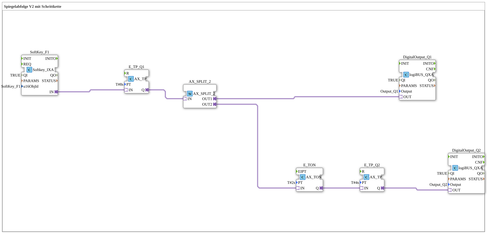

# Uebung_039b_AX: Spiegelabfolge V2 mit Schrittkette

* * * * * * * * * *

## Einleitung

Diese Übung realisiert eine Spiegelabfolge (V2) als Schrittkette aus adapterbasierten Zeitgliedern: Ein Druck auf die Softkey-Taste `SoftKey_F1` startet einen 8 Sekunden langen Impuls auf `Q1`. Mit dem Impuls läuft zugleich eine Einschaltverzögerung von 2 Sekunden an, nach deren Ablauf ein 4 Sekunden langer Impuls auf `Q2` ausgelöst wird.

## Verwendete Funktionsbausteine (FBs)

- **SoftKey_F1**: Softkey-Eingang des ISOBUS-Terminals
    - **Typ**: [`isobus::UT::io::Softkey::Softkey_IXA`](https://meisterschulen-am-ostbahnhof-munchen-docs.readthedocs.io/projects/4diac-library-reference-docs/de/latest/Bibliotheken/ExternalLibraries/isobus/UT/io/Softkey/Softkey_IXA/)
    - **Parameter**: `QI = TRUE`, `u16ObjId = SoftKey_F1`
    - **Erklärung**: Liefert den Zustand der Softkey-Taste `SoftKey_F1` als AX-Adapterausgang `IN`.
- **E_TP_Q1**: Impulsgeber für `Q1`
    - **Typ**: [`adapter::events::unidirectional::timers::AX_TP`](https://meisterschulen-am-ostbahnhof-munchen-docs.readthedocs.io/projects/4diac-library-reference-docs/de/latest/Bibliotheken/ExternalLibraries/adapter/events/unidirectional/BOOL/timers/AX_TP/)
    - **Parameter**: `PT = T#8s`
    - **Erklärung**: Erzeugt aus dem Tastensignal einen Impuls der Länge 8 Sekunden am Adapterausgang `Q`.
- **AX_SPLIT_2**: Adapter-Signalverteiler
    - **Typ**: [`adapter::events::unidirectional::AX_SPLIT_2`](https://meisterschulen-am-ostbahnhof-munchen-docs.readthedocs.io/projects/4diac-library-reference-docs/de/latest/Bibliotheken/ExternalLibraries/adapter/events/unidirectional/BOOL/AX_SPLIT_2/)
    - **Parameter**: keine
    - **Erklärung**: Verteilt den Impuls von `E_TP_Q1.Q` auf zwei Ziele: `OUT1` (Ausgang `Q1`) und `OUT2` (Einschaltverzögerung).
- **E_TON**: Einschaltverzögerung
    - **Typ**: [`adapter::events::unidirectional::timers::AX_TON`](https://meisterschulen-am-ostbahnhof-munchen-docs.readthedocs.io/projects/4diac-library-reference-docs/de/latest/Bibliotheken/ExternalLibraries/adapter/events/unidirectional/BOOL/timers/AX_TON/)
    - **Parameter**: `PT = T#2s`
    - **Erklärung**: Verzögert das Einschalten des Signals aus `AX_SPLIT_2.OUT2` um 2 Sekunden.
- **E_TP_Q2**: Impulsgeber für `Q2`
    - **Typ**: [`adapter::events::unidirectional::timers::AX_TP`](https://meisterschulen-am-ostbahnhof-munchen-docs.readthedocs.io/projects/4diac-library-reference-docs/de/latest/Bibliotheken/ExternalLibraries/adapter/events/unidirectional/BOOL/timers/AX_TP/)
    - **Parameter**: `PT = T#4s`
    - **Erklärung**: Erzeugt aus dem verzögerten Signal von `E_TON.Q` einen Impuls der Länge 4 Sekunden.
- **DigitalOutput_Q1**: logiBUS Digitalausgang
    - **Typ**: [`logiBUS::io::DQ::logiBUS_QXA`](https://meisterschulen-am-ostbahnhof-munchen-docs.readthedocs.io/projects/4diac-library-reference-docs/de/latest/Bibliotheken/ExternalLibraries/logiBUS/io/DO/logiBUS_QXA/)
    - **Parameter**: `QI = TRUE`, `Output = Output_Q1`
    - **Erklärung**: Schaltet den physischen Ausgang `Q1` entsprechend dem 8-Sekunden-Impuls.
- **DigitalOutput_Q2**: logiBUS Digitalausgang
    - **Typ**: [`logiBUS::io::DQ::logiBUS_QXA`](https://meisterschulen-am-ostbahnhof-munchen-docs.readthedocs.io/projects/4diac-library-reference-docs/de/latest/Bibliotheken/ExternalLibraries/logiBUS/io/DO/logiBUS_QXA/)
    - **Parameter**: `QI = TRUE`, `Output = Output_Q2`
    - **Erklärung**: Schaltet den physischen Ausgang `Q2` entsprechend dem 4-Sekunden-Impuls.

## Programmablauf und Verbindungen

1. `SoftKey_F1.IN` → `E_TP_Q1.IN` (AdapterConnection): Die Softkey-Taste startet den 8-Sekunden-Impuls.
2. `E_TP_Q1.Q` → `AX_SPLIT_2.IN` (AdapterConnection): Der Impuls wird auf zwei Ziele verteilt.
3. `AX_SPLIT_2.OUT1` → `DigitalOutput_Q1.OUT` (AdapterConnection): `Q1` folgt dem 8-Sekunden-Impuls.
4. `AX_SPLIT_2.OUT2` → `E_TON.IN` (AdapterConnection): Der Impuls startet die 2-Sekunden-Einschaltverzögerung.
5. `E_TON.Q` → `E_TP_Q2.IN` (AdapterConnection): Das verzögerte Signal startet den 4-Sekunden-Impuls.
6. `E_TP_Q2.Q` → `DigitalOutput_Q2.OUT` (AdapterConnection): `Q2` folgt dem 4-Sekunden-Impuls.

## Zusammenfassung

Die Übung 039b_AX bildet eine zeitgesteuerte Schrittkette aus den Bausteinen `AX_TP` und `AX_TON`: Ein Tastendruck löst `Q1` für 8 Sekunden aus und startet über die Einschaltverzögerung von 2 Sekunden einen Impuls von 4 Sekunden auf `Q2`. `AX_SPLIT_2` verteilt dabei den Impuls ohne zusätzliche Ereignisverbindungen auf Ausgang und Folgeschritt.

---

### 🌐 Passende Themen-Unterseiten auf ms-muc-docs.de

- [🌐 Eclipse 4diac IDE & Farb-Referenz auf ms-muc-docs.de](https://www.ms-muc-docs.de/iec-61499/eclipse-4diac/)
