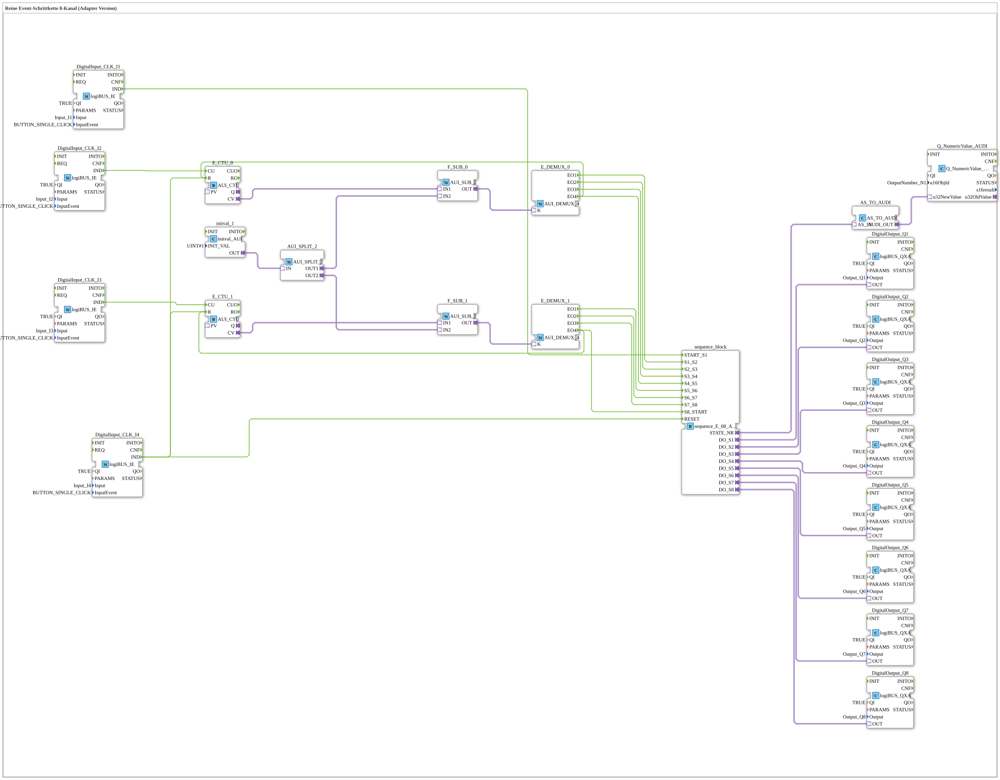

# Uebung_059_AX: Reine Event-Schrittkette 8-Kanal (Adapter Version)

* * * * * * * * * *

## Einleitung

Diese Übung realisiert eine rein ereignisgesteuerte Schrittkette mit AX-Adaptertechnologie: eine Abfolge von 8 Ausgängen (`Q1` bis `Q8`), bei der jeder Schritt ausschließlich durch ein externes Ereignis (Tasterklick) weitergeschaltet wird - keine automatische Zeitsteuerung. Da nur die physischen Taster `I1` bis `I4` zur Verfügung stehen, aber bis zu 8 Übergänge benötigt werden, zählt je ein Zähler die Klicks von `I2` bzw. `I3`, und ein nachgeschalteter Demultiplexer fächert den Zählerstand auf die einzelnen Übergänge des Sequenzers auf. So lassen sich mit zwei Tastern 8 Zustandsübergänge auslösen, ohne für jeden Schritt einen eigenen Taster zu benötigen.

## Verwendete Funktionsbausteine (FBs)

- **DigitalInput_CLK_I1** ... **DigitalInput_CLK_I4**: Klick-Eingänge
    - **Typ**: [`logiBUS::io::DI::logiBUS_IE`](https://meisterschulen-am-ostbahnhof-munchen-docs.readthedocs.io/projects/4diac-library-reference-docs/de/latest/Bibliotheken/ExternalLibraries/logiBUS/io/DI/logiBUS_IE/)
    - **Parameter**: `QI = TRUE`, `Input = Input_I1` ... `Input_I4`, jeweils `InputEvent = BUTTON_SINGLE_CLICK`
    - **Erklärung**: Melden einen Einzelklick auf `I1` bis `I4` als Ereignis `IND`.
- **sequence_block**: Sequenzer
    - **Typ**: [`logiBUS::utils::sequence::event::sequence_E_08_AX`](https://meisterschulen-am-ostbahnhof-munchen-docs.readthedocs.io/projects/4diac-library-reference-docs/de/latest/Bibliotheken/ExternalLibraries/logiBUS/utils/sequence/event/sequence_E_08_AX/)
    - **Parameter**: keine
    - **Erklärung**: Rein ereignisgesteuerte Sequenz mit 8 Zuständen. Die Ausgänge `DO_S1` ... `DO_S8` sind AX-Adapter, die Schrittnummer liegt am Adapter `STATE_NR` an. Die Eingänge `START_S1`, `S1_S2` ... `S7_S8`, `S8_START` und `RESET` steuern die Übergänge.
- **E_CTU_0**, **E_CTU_1**: Ereigniszähler
    - **Typ**: [`adapter::events::unidirectional::AUI_CTU`](https://meisterschulen-am-ostbahnhof-munchen-docs.readthedocs.io/projects/4diac-library-reference-docs/de/latest/Bibliotheken/ExternalLibraries/adapter/events/unidirectional/UINT/AUI_CTU/)
    - **Parameter**: keine
    - **Erklärung**: Zählt bei jedem Ereignis `CU` hoch und gibt den Zählerstand über den Adapter `CV` aus; `R` setzt den Zähler zurück.
- **initval_1**: Startwert 1
    - **Typ**: [`adapter::types::unidirectional::AUI::initval::initval_AUI`](https://meisterschulen-am-ostbahnhof-munchen-docs.readthedocs.io/projects/4diac-library-reference-docs/de/latest/Bibliotheken/ExternalLibraries/adapter/types/unidirectional/UINT/initval/initval_AUI/)
    - **Parameter**: `INIT_VAL = 1`
    - **Erklärung**: Stellt den konstanten Wert 1 als AUI-Signal bereit.
- **AUI_SPLIT_2**: Signalverteiler
    - **Typ**: [`adapter::events::unidirectional::AUI_SPLIT_2`](https://meisterschulen-am-ostbahnhof-munchen-docs.readthedocs.io/projects/4diac-library-reference-docs/de/latest/Bibliotheken/ExternalLibraries/adapter/events/unidirectional/UINT/AUI_SPLIT_2/)
    - **Parameter**: keine
    - **Erklärung**: Verteilt den Wert 1 von `initval_1` auf beide Subtrahierer.
- **F_SUB_0**, **F_SUB_1**: Subtrahierer
    - **Typ**: [`adapter::iec61131::arithmetic::AUI_SUB_2`](https://meisterschulen-am-ostbahnhof-munchen-docs.readthedocs.io/projects/4diac-library-reference-docs/de/latest/Bibliotheken/ExternalLibraries/adapter/iec61131-3/arithmetic/AUI_SUB_2/)
    - **Parameter**: keine
    - **Erklärung**: Bilden `IN1 - IN2`, hier den Zählerstand minus 1. Damit entspricht der erste Klick dem Index 0.
- **E_DEMUX_0**, **E_DEMUX_1**: Ereignis-Demultiplexer
    - **Typ**: [`adapter::events::unidirectional::AUI_DEMUX_4`](https://meisterschulen-am-ostbahnhof-munchen-docs.readthedocs.io/projects/4diac-library-reference-docs/de/latest/Bibliotheken/ExternalLibraries/adapter/events/unidirectional/UINT/AUI_DEMUX_4/)
    - **Parameter**: keine
    - **Erklärung**: Leitet das Ereignis abhängig vom Index am Adapter `K` an `EO1` (Index 0), `EO2` (1), `EO3` (2) oder `EO4` (3) weiter.
- **AS_TO_AUDI**: Konvertierungsadapter
    - **Typ**: [`adapter::conversion::unidirectional::AS_TO_AUDI`](https://meisterschulen-am-ostbahnhof-munchen-docs.readthedocs.io/projects/4diac-library-reference-docs/de/latest/Bibliotheken/ExternalLibraries/adapter/conversion/unidirectional/AS_AUDI/AS_TO_AUDI/)
    - **Parameter**: keine
    - **Erklärung**: Wandelt die Schrittnummer vom AS-Adapter in einen AUDI-Adapter.
- **Q_NumericValue_AUDI**: VT-Anzeige der Schrittnummer
    - **Typ**: [`isobus::UT::Q::Q_NumericValue_AUDI`](https://meisterschulen-am-ostbahnhof-munchen-docs.readthedocs.io/projects/4diac-library-reference-docs/de/latest/Bibliotheken/ExternalLibraries/isobus/UT/Q/Q_NumericValue_AUDI/)
    - **Parameter**: `u16ObjId = OutputNumber_N1`
    - **Erklärung**: Zeigt die aktuelle Schrittnummer auf dem ISOBUS-Terminal an.
- **DigitalOutput_Q1** ... **DigitalOutput_Q8**: Digitalausgänge
    - **Typ**: [`logiBUS::io::DQ::logiBUS_QXA`](https://meisterschulen-am-ostbahnhof-munchen-docs.readthedocs.io/projects/4diac-library-reference-docs/de/latest/Bibliotheken/ExternalLibraries/logiBUS/io/DO/logiBUS_QXA/)
    - **Parameter**: `QI = TRUE`, `Output = Output_Q1` ... `Output_Q8`
    - **Erklärung**: Geben den Zustand des jeweiligen Schritts an die physischen Ausgänge `Q1` bis `Q8` aus.

## Programmablauf und Verbindungen

1. `DigitalInput_CLK_I1.IND` → `sequence_block.START_S1`: Ein Klick auf `I1` startet die Sequenz in Schritt 1.
2. `DigitalInput_CLK_I2.IND` → `E_CTU_0.CU`: Die Klicks auf `I2` werden gezählt. `E_CTU_0.CV` → `F_SUB_0.IN1` und `AUI_SPLIT_2.OUT1` → `F_SUB_0.IN2` (Wert 1), `F_SUB_0.OUT` → `E_DEMUX_0.K`: Der Index ist Zählerstand minus 1.
3. `E_DEMUX_0.EO1` → `sequence_block.S1_S2`, `E_DEMUX_0.EO2` → `S2_S3`, `E_DEMUX_0.EO3` → `S3_S4`, `E_DEMUX_0.EO4` → `S4_S5`: Der 1. bis 4. Klick auf `I2` schaltet von Schritt 1 nach 2, 2 nach 3, 3 nach 4 bzw. 4 nach 5.
4. `E_DEMUX_0.EO4` → `E_CTU_0.R`: Nach dem 4. Klick wird der Zähler `E_CTU_0` zurückgesetzt.
5. `DigitalInput_CLK_I3.IND` → `E_CTU_1.CU`, `E_CTU_1.CV` → `F_SUB_1.IN1`, `AUI_SPLIT_2.OUT2` → `F_SUB_1.IN2`, `F_SUB_1.OUT` → `E_DEMUX_1.K`: Gleiches Prinzip für die Klicks auf `I3`.
6. `E_DEMUX_1.EO1` → `sequence_block.S5_S6`, `EO2` → `S6_S7`, `EO3` → `S7_S8`, `EO4` → `S8_START`: Der 1. bis 4. Klick auf `I3` schaltet von Schritt 5 nach 6, 6 nach 7, 7 nach 8 bzw. 8 zurück zum Start. `E_DEMUX_1.EO4` → `E_CTU_1.R` setzt auch diesen Zähler zurück.
7. `DigitalInput_CLK_I4.IND` → `sequence_block.RESET`, `E_CTU_0.R` und `E_CTU_1.R`: Ein Klick auf `I4` setzt Sequenz und beide Zähler zurück.
8. `sequence_block.DO_S1` ... `DO_S8` → `DigitalOutput_Q1.OUT` ... `DigitalOutput_Q8.OUT` (AdapterConnections): Der aktive Schritt schaltet den zugehörigen Ausgang.
9. `sequence_block.STATE_NR` → `AS_TO_AUDI.AS_IN` und `AS_TO_AUDI.AUDI_OUT` → `Q_NumericValue_AUDI.u32NewValue`: Die Schrittnummer wird auf dem VT angezeigt.

**Verhalten**: Klick auf `I1` → Schritt 1, `Q1` aktiv. Jeder weitere Klick auf `I2` (Schritte 1 bis 5) bzw. `I3` (Schritte 5 bis 8 und zurück zum Start) schaltet zum nächsten Schritt weiter. Ein Klick auf `I4` setzt alles zurück.

## Zusammenfassung

Die Übung zeigt eine rein ereignisgesteuerte 8-Schritt-Kette in AX-Adaptertechnik. Mit je einem Zähler und einem Demultiplexer pro Taster (`I2`, `I3`) werden 8 Übergänge mit nur zwei Weiterschalt-Tastern realisiert; `I1` startet und `I4` setzt zurück.

---

### 🌐 Passende Themen-Unterseiten auf ms-muc-docs.de

- [🌐 Eclipse 4diac IDE & Farb-Referenz auf ms-muc-docs.de](https://www.ms-muc-docs.de/iec-61499/eclipse-4diac/)
