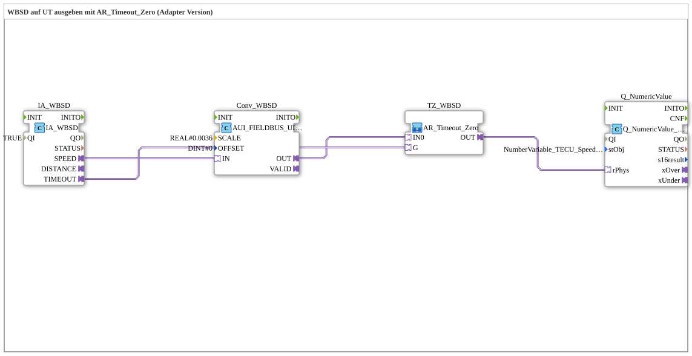

# Uebung_070d_AUI: WBSD auf UT ausgeben mit AR_Timeout_Zero (Adapter-Version)

* * * * * * * * * *

## Einleitung

Diese Übung gibt die radbasierte Geschwindigkeit (Wheel Based Speed and Distance, WBSD) des TECU auf dem ISOBUS-Terminal aus: mit PHYS-Skalierung und der Fendt-Schaltung `AR_Timeout_Zero` (Adapter-Version, analog zur Krauternter-SubApp `TECU_WBSD.SUB`). Bei einem Kommunikationsausfall wird `0.0` angezeigt, statt den letzten Wert einzufrieren.

## Verwendete Funktionsbausteine (FBs)

- **IA_WBSD**: ISOBUS-Adapter für Wheel Based Speed and Distance (WBSD)
    - **Typ**: [`isobus::tecu::IA_WBSD`](https://meisterschulen-am-ostbahnhof-munchen-docs.readthedocs.io/projects/4diac-library-reference-docs/de/latest/Bibliotheken/ExternalLibraries/isobus/TECU/IA_WBSD/)
    - **Parameter**: `QI = TRUE`
    - **Erklärung**: Liefert die radbasierte Geschwindigkeit als `AUI`-Adapter `SPEED` und den Timeout-Status als `AX`-Adapter `TIMEOUT`.
- **Conv_WBSD**: Skalierung des Feldbuswerts
    - **Typ**: [`logiBUS::signalprocessing::fieldbus::AUI_FIELDBUS_UINT_TO_SIGNAL_SCALED`](https://meisterschulen-am-ostbahnhof-munchen-docs.readthedocs.io/projects/4diac-library-reference-docs/de/latest/Bibliotheken/ExternalLibraries/logiBUS/signalprocessing/fieldbus/AUI_FIELDBUS_UINT_TO_SIGNAL_SCALED/)
    - **Parameter**: `SCALE = 0.0036`, `OFFSET = 0`
    - **Erklärung**: Wandelt den `AUI`-Wert (UINT vom Feldbus) nur bei gültigem Signal in einen skalierten `AR`-Wert (REAL) um; `OFFSET` wird nach der Skalierung addiert.
- **TZ_WBSD**: Fendt-Schaltung (SubApp)
    - **Typ**: `MyLib::sys::AR_Timeout_Zero`
    - **Parameter**: keine
    - **Erklärung**: Gibt `IN0` unverändert aus, außer `G` (hier `IA_WBSD.TIMEOUT`, echter Kommunikationsausfall) ist `TRUE`: Dann wird `0.0` statt des sonst eingefrorenen letzten Werts ausgegeben.
- **Q_NumericValue**: Anzeige auf dem ISOBUS-Terminal
    - **Typ**: [`isobus::UT::Q::Q_NumericValue_PHYSA`](https://meisterschulen-am-ostbahnhof-munchen-docs.readthedocs.io/projects/4diac-library-reference-docs/de/latest/Bibliotheken/ExternalLibraries/isobus/UT/Q/Q_NumericValue_PHYSA/)
    - **Parameter**: `stObj = NumberVariable_TECU_Speed_WBSD_N`
    - **Erklärung**: Zeigt den physikalischen Wert (`rPhys`) im Objekt `NumberVariable_TECU_Speed_WBSD_N` an.

## Programmablauf und Verbindungen

1. `IA_WBSD.SPEED` → `Conv_WBSD.IN` (AdapterConnection): Der Geschwindigkeitswert vom TECU wird skaliert.
2. `Conv_WBSD.OUT` → `TZ_WBSD.IN0` (AdapterConnection): Der skalierte Wert ist der Live-Wert der Fendt-Schaltung.
3. `IA_WBSD.TIMEOUT` → `TZ_WBSD.G` (AdapterConnection): Der Timeout-Status steuert, ob `0.0` ausgegeben wird.
4. `TZ_WBSD.OUT` → `Q_NumericValue.rPhys` (AdapterConnection): Das Ergebnis wird auf dem Terminal angezeigt.

**Verhalten**: Solange der TECU die Botschaft liefert, zeigt das Terminal den mit `0.0036` skalierten Wert. Fällt die Kommunikation aus (`TIMEOUT`), zeigt es `0.0`.

## Zusammenfassung

Die Übung zeigt die Kette TECU-Adapter → Skalierung → Fendt-Schaltung → Anzeige. Die wiederverwendbare SubApp `AR_Timeout_Zero` (aus `MyLib_AX`) kapselt dabei die Auswahl zwischen Live-Wert und `0.0`.

---

### 🌐 Passende Themen-Unterseiten auf ms-muc-docs.de

- [🌐 Eclipse 4diac IDE & Farb-Referenz on ms-muc-docs.de](https://www.ms-muc-docs.de/iec-61499/eclipse-4diac/)
