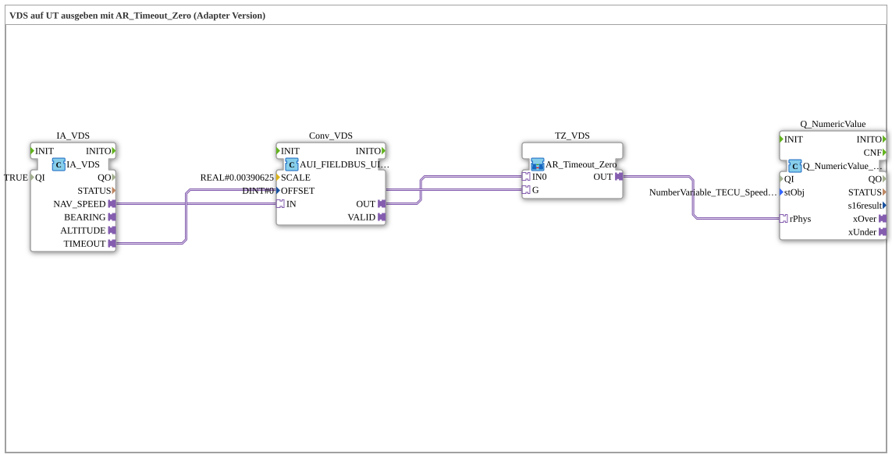

# Uebung_073d_AUI: VDS auf UT ausgeben mit AR_Timeout_Zero (Adapter Version)

* * * * * * * * * *

## Einleitung

Diese Übung gibt die navigationsbasierte Fahrzeuggeschwindigkeit (**VDS**, Navigation-Based Vehicle Speed) des TECU auf einem Universal Terminal (UT) aus. Der Rohwert wird über den ISOBUS-Adapter `IA_VDS` empfangen, mit `0.00390625` (= 1/256) skaliert und über einen physikalischen Wert (`PHYSA`) auf das VT-Zahlenfeld geschrieben. Zusätzlich wird die "Fendt-Schaltung" `AR_Timeout_Zero` verwendet: Bei einem echten Kommunikationsausfall (Timeout) wird `0.0` angezeigt, statt des sonst einfach eingefrorenen letzten Werts. Die Übung ist analog zu `TECU_VDS.SUB` der Krauternter-Software und verwendet die Adapter-Technik (*AUI*).

## Verwendete Funktionsbausteine (FBs)

- **IA_VDS**: ISOBUS-Adapter für Vehicle Direction/Speed
    - **Typ**: `isobus::tecu::IA_VDS`
    - **Parameter**: `QI = TRUE`
    - **Erklärung**: Liefert unter anderem die Navigationsgeschwindigkeit als UINT-Adapter `NAV_SPEED` sowie den Adapter `TIMEOUT` (AX, TRUE bei Kommunikationsausfall). `BEARING` und `ALTITUDE` bleiben in dieser Übung unbenutzt.
- **Conv_VDS**: Skalierung des Rohwerts
    - **Typ**: `logiBUS::signalprocessing::fieldbus::AUI_FIELDBUS_UINT_TO_SIGNAL_SCALED`
    - **Parameter**: `SCALE = 0.00390625`, `OFFSET = 0`
    - **Erklärung**: Wandelt den UINT-Rohwert (`IN`, AUI) in einen skalierten REAL-Wert (`OUT`, AR) um; zusätzlich gibt es einen Adapter `VALID`, der hier nicht verwendet wird.
- **TZ_VDS**: Timeout-Nullung (SubApp-Instanz)
    - **Typ**: `MyLib::sys::AR_Timeout_Zero`
    - **Parameter**: keine
    - **Erklärung**: Liefert `IN0` unverändert an `OUT`, außer `G` ist TRUE (Timeout) - dann wird `0.0` ausgegeben. Intern: `initval_AR` (`INIT_VAL = 0.0`) und der Selektor `AR_AX_SEL_AR`.
- **Q_NumericValue**: Ausgabe auf das VT-Zahlenfeld
    - **Typ**: `isobus::UT::Q::Q_NumericValue_PHYSA`
    - **Parameter**: `stObj = NumberVariable_TECU_Speed_VDS_N`
    - **Erklärung**: Schreibt den physikalischen REAL-Wert (`rPhys`) unter Berücksichtigung von Skalierung, Offset und Nachkommastellen aus `stObj` in das zugehörige Objekt des Object Pools.

## Programmablauf und Verbindungen

1. `IA_VDS.NAV_SPEED` → `Conv_VDS.IN`: der Rohwert wird zur Skalierung geführt.
2. `Conv_VDS.OUT` → `TZ_VDS.IN0`: der skalierte Wert ist der Live-Wert der Timeout-Nullung.
3. `IA_VDS.TIMEOUT` → `TZ_VDS.G`: der Kommunikationsstatus entscheidet zwischen Live-Wert und `0.0`.
4. `TZ_VDS.OUT` → `Q_NumericValue.rPhys`: das Ergebnis wird auf dem UT angezeigt.

**Verhalten**: Solange Daten vom TECU eintreffen, zeigt das UT die skalierte Fahrzeuggeschwindigkeit. Fällt die Kommunikation aus (`TIMEOUT` = TRUE), springt die Anzeige auf `0.0`.

## Zusammenfassung

Die Übung zeigt die komplette Signalkette eines TECU-Messwerts im Adapter-Stil: Empfang (`IA_VDS`), Skalierung (`AUI_FIELDBUS_UINT_TO_SIGNAL_SCALED`), Absicherung gegen Kommunikationsausfall (`AR_Timeout_Zero`) und Ausgabe auf dem Terminal (`Q_NumericValue_PHYSA`).

---

### 🌐 Passende Themen-Unterseiten auf ms-muc-docs.de

- [🌐 Eclipse 4diac IDE & Farb-Referenz auf ms-muc-docs.de](https://www.ms-muc-docs.de/iec-61499/eclipse-4diac/)
