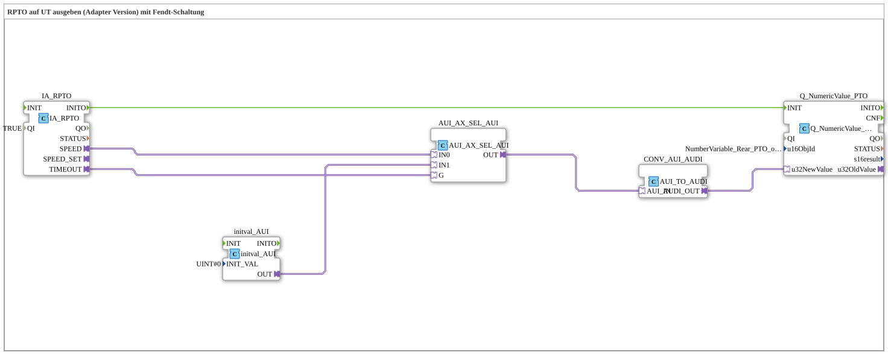

# Uebung_074_AUI: RPTO auf UT ausgeben (Adapter Version) mit Fendt-Schaltung

* * * * * * * * * *

## Einleitung

Diese Übung demonstriert die Ausgabe der Drehzahl der hinteren Zapfwelle (Rear PTO) auf ein User Terminal (UT) unter Verwendung von Adaptern. Sie implementiert eine sogenannte „Fendt-Schaltung“: Bei einem Timeout des PTO-Signals wird auf dem UT der Wert 0 angezeigt (Kommentar im Netzwerk). Dadurch wird ein sicheres Verhalten bei Sensorausfall oder Kommunikationsstörungen erreicht.

Die Übung basiert auf ISOBUS-Komponenten (TECU-Interface) und zeigt den Umgang mit Adaptern zur Typumwandlung und Signalauswahl.

## Verwendete Funktionsbausteine (FBs)

- **IA_RPTO**: ISOBUS-Adapter für die hintere Zapfwelle
    - **Typ**: [`isobus::tecu::IA_RPTO`](https://meisterschulen-am-ostbahnhof-munchen-docs.readthedocs.io/projects/4diac-library-reference-docs/de/latest/Bibliotheken/ExternalLibraries/isobus/TECU/IA_RPTO/)
    - **Parameter**: `QI = TRUE`
    - **Erklärung**: Schnittstelle zur hinteren Zapfwelle (ISO 11783-7, PGN 65091). Der Adapter `SPEED` liefert die Drehzahl als AUI-Wert, der Adapter `TIMEOUT` meldet den Timeout-Status. Nach der Initialisierung wird `INITO` ausgegeben.
- **initval_AUI**: Ersatzwert 0
    - **Typ**: [`adapter::types::unidirectional::AUI::initval::initval_AUI`](https://meisterschulen-am-ostbahnhof-munchen-docs.readthedocs.io/projects/4diac-library-reference-docs/de/latest/Bibliotheken/ExternalLibraries/adapter/types/unidirectional/UINT/initval/initval_AUI/)
    - **Parameter**: `INIT_VAL = 0`
    - **Erklärung**: Stellt den konstanten Wert 0 als AUI-Signal bereit. Er wird bei Timeout statt der Drehzahl angezeigt.
- **AUI_AX_SEL_AUI**: Auswahlbaustein
    - **Typ**: [`adapter::iec61131::selection::AUI_AX_SEL_AUI`](https://meisterschulen-am-ostbahnhof-munchen-docs.readthedocs.io/projects/4diac-library-reference-docs/de/latest/Bibliotheken/ExternalLibraries/adapter/iec61131-3/selection/AUI_AX_SEL_AUI/)
    - **Parameter**: keine
    - **Erklärung**: Wählt anhand des AX-Signals `G` zwischen den AUI-Werten `IN0` (bei `G` = FALSE) und `IN1` (bei `G` = TRUE) und gibt den gewählten Wert an `OUT` aus. Dient hier der Realisierung der Fendt-Schaltung.
- **CONV_AUI_AUDI**: Konvertierungsadapter
    - **Typ**: [`adapter::conversion::unidirectional::AUI_TO_AUDI`](https://meisterschulen-am-ostbahnhof-munchen-docs.readthedocs.io/projects/4diac-library-reference-docs/de/latest/Bibliotheken/ExternalLibraries/adapter/conversion/unidirectional/AUDI_AUI/AUI_TO_AUDI/)
    - **Parameter**: keine
    - **Erklärung**: Wandelt den AUI-Wert (UINT) in das AUDI-Format (UDINT) um, das der Anzeigebaustein erwartet.
- **Q_NumericValue_PTO**: VT-Anzeige
    - **Typ**: [`isobus::UT::Q::Q_NumericValue_AUDI`](https://meisterschulen-am-ostbahnhof-munchen-docs.readthedocs.io/projects/4diac-library-reference-docs/de/latest/Bibliotheken/ExternalLibraries/isobus/UT/Q/Q_NumericValue_AUDI/)
    - **Parameter**: `u16ObjId = NumberVariable_Rear_PTO_output_shaft_speed`
    - **Erklärung**: Empfängt den Wert über den Socket `u32NewValue` und zeigt ihn auf dem User Terminal unter der vorgegebenen Objekt-ID an. Wird über das Ereignis `INIT` initialisiert.

## Programmablauf und Verbindungen

1. `IA_RPTO.INITO` → `Q_NumericValue_PTO.INIT` (EventConnection): Nach der Initialisierung des Zapfwellen-Adapters wird die Anzeige initialisiert.
2. `IA_RPTO.SPEED` → `AUI_AX_SEL_AUI.IN0` (AdapterConnection): Die gemessene Drehzahl liegt am Eingang `IN0` des Selektors an.
3. `initval_AUI.OUT` → `AUI_AX_SEL_AUI.IN1`: Der Wert 0 liegt am Eingang `IN1` an.
4. `IA_RPTO.TIMEOUT` → `AUI_AX_SEL_AUI.G`: Der Timeout-Status steuert die Auswahl. Im Normalbetrieb (`TIMEOUT` = FALSE) wird die Drehzahl (`IN0`) durchgeschaltet, bei Timeout (`TIMEOUT` = TRUE) der Wert 0 (`IN1`).
5. `AUI_AX_SEL_AUI.OUT` → `CONV_AUI_AUDI.AUI_IN`: Der gewählte Wert wird in das AUDI-Format konvertiert.
6. `CONV_AUI_AUDI.AUDI_OUT` → `Q_NumericValue_PTO.u32NewValue`: Der Wert wird an die Anzeige übergeben und auf dem User Terminal dargestellt - im Normalbetrieb die tatsächliche Drehzahl, bei Timeout eine 0.

**Lernziele**:

- Verständnis der Verwendung von Adaptern zur Anbindung unterschiedlicher Datentypen (AUI, AUDI).
- Implementierung einer einfachen Fallback-Logik (Fendt-Schaltung) mit einem 2-Kanal-Selektor.
- Umgang mit ISOBUS-TECU-Bausteinen und UT-Anzeigebausteinen in 4diac.
- Erkennen und Behandeln von Timeout-Situationen in der Feldbuskommunikation.

**Hinweis zur Einrichtung**: Die Objekt-ID `NumberVariable_Rear_PTO_output_shaft_speed` muss im verwendeten ISOBUS-Objektpool definiert sein.

## Zusammenfassung

Die Übung `Uebung_074_AUI` realisiert eine sichere Anzeige der Zapfwellendrehzahl auf einem User Terminal. Durch die Kombination eines Adapter-Selektors mit einem konstanten Nullwert im Fehlerfall wird eine einfache, aber robuste Fendt-Schaltung umgesetzt. Sie vermittelt grundlegende Konzepte der Adapter-Kommunikation und der ereignisbasierten Datenvorverarbeitung in 4diac.

---

### 🌐 Passende Themen-Unterseiten auf ms-muc-docs.de

- [🌐 Eclipse 4diac IDE & Farb-Referenz auf ms-muc-docs.de](https://www.ms-muc-docs.de/iec-61499/eclipse-4diac/)
