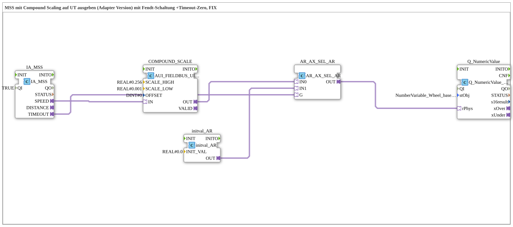

# Uebung_076a_AUI: MSS mit Compound Scaling auf UT ausgeben (Adapter Version) mit Fendt-Schaltung + Timeout-Zero

* * * * * * * * * *

## Einleitung

Diese Übung gibt die maschinenselektierte Geschwindigkeit (Machine Selected Speed, MSS) der TECU auf einem User Terminal (UT) aus. Der 16-Bit-Rohwert des ISOBUS-Adapters wird mit einer zusammengesetzten Skalierung (Compound Scaling, getrennte Faktoren für oberes und unteres Byte) in einen physikalischen REAL-Wert umgerechnet. Zusätzlich ist die „Fendt-Schaltung“ mit Timeout-Zero umgesetzt: Bei einem Timeout wird auf dem UT der Wert 0.0 angezeigt (Kommentar im Netzwerk: analog zur Krauternter-`TECU_MSS.SUB`). Alle Verbindungen laufen über Adapter.

## Verwendete Funktionsbausteine (FBs)

- **IA_MSS**: ISOBUS-Adapter für die maschinenselektierte Geschwindigkeit
    - **Typ**: [`isobus::tecu::IA_MSS`](https://meisterschulen-am-ostbahnhof-munchen-docs.readthedocs.io/projects/4diac-library-reference-docs/de/latest/Bibliotheken/ExternalLibraries/isobus/TECU/IA_MSS/)
    - **Parameter**: `QI = TRUE`
    - **Erklärung**: Stellt die Geschwindigkeit als AUI-Wert am Adapter `SPEED` und den Timeout-Status am Adapter `TIMEOUT` bereit (PGN 61474).
- **COMPOUND_SCALE**: zusammengesetzte Skalierung
    - **Typ**: [`logiBUS::signalprocessing::fieldbus::AUI_FIELDBUS_UINT_TO_SIGNAL_COMPOUND_SCALE`](https://meisterschulen-am-ostbahnhof-munchen-docs.readthedocs.io/projects/4diac-library-reference-docs/de/latest/Bibliotheken/ExternalLibraries/logiBUS/signalprocessing/fieldbus/AUI_FIELDBUS_UINT_TO_SIGNAL_COMPOUND_SCALE/)
    - **Parameter**: `SCALE_HIGH = REAL#0.256`, `SCALE_LOW = REAL#0.001`, `OFFSET = DINT#0`
    - **Erklärung**: Teilt den 16-Bit-Eingangswert in oberes und unteres Byte, skaliert beide mit `SCALE_HIGH` bzw. `SCALE_LOW`, summiert sie und addiert den `OFFSET`. Das Ergebnis liegt am AR-Adapter `OUT`.
- **initval_AR**: Ersatzwert 0.0
    - **Typ**: [`adapter::types::unidirectional::AR::initval::initval_AR`](https://meisterschulen-am-ostbahnhof-munchen-docs.readthedocs.io/projects/4diac-library-reference-docs/de/latest/Bibliotheken/ExternalLibraries/adapter/types/unidirectional/REAL/initval/initval_AR/)
    - **Parameter**: `INIT_VAL = REAL#0.0`
    - **Erklärung**: Stellt den konstanten Wert 0.0 als AR-Signal bereit; er wird bei Timeout statt der Geschwindigkeit angezeigt.
- **AR_AX_SEL_AR**: Auswahlbaustein
    - **Typ**: [`adapter::iec61131::selection::AR_AX_SEL_AR`](https://meisterschulen-am-ostbahnhof-munchen-docs.readthedocs.io/projects/4diac-library-reference-docs/de/latest/Bibliotheken/ExternalLibraries/adapter/iec61131-3/selection/adapter/AR_AX_SEL_AR/)
    - **Parameter**: keine
    - **Erklärung**: Wählt anhand des AX-Signals `G` zwischen den AR-Werten `IN0` (`G` = FALSE) und `IN1` (`G` = TRUE) und gibt den gewählten Wert an `OUT` aus.
- **Q_NumericValue**: VT-Anzeige
    - **Typ**: [`isobus::UT::Q::Q_NumericValue_PHYSA`](https://meisterschulen-am-ostbahnhof-munchen-docs.readthedocs.io/projects/4diac-library-reference-docs/de/latest/Bibliotheken/ExternalLibraries/isobus/UT/Q/Q_NumericValue_PHYSA/)
    - **Parameter**: `stObj = NumberVariable_Wheel_based_machine_speed_N`
    - **Erklärung**: Zeigt den physikalischen REAL-Wert vom Adapter `rPhys` auf dem im Objektpool-Eintrag `stObj` angegebenen VT-Objekt an. Laut Kommentar im Netzwerk wird ersatzweise `NumberVariable_Wheel_based_machine_speed` verwendet, solange `NumberVariable_Machine_selected_speed` im Objektpool noch nicht angelegt ist (TODO).

## Programmablauf und Verbindungen

1. `IA_MSS.SPEED` → `COMPOUND_SCALE.IN` (AdapterConnection): Der Rohwert der Geschwindigkeit wird skaliert.
2. `COMPOUND_SCALE.OUT` → `AR_AX_SEL_AR.IN0`: Der skalierte Wert ist der Live-Wert (`IN0`).
3. `initval_AR.OUT` → `AR_AX_SEL_AR.IN1`: Der Wert 0.0 liegt am Eingang `IN1` an.
4. `IA_MSS.TIMEOUT` → `AR_AX_SEL_AR.G`: Der Timeout-Status steuert die Auswahl. Im Normalbetrieb (`TIMEOUT` = FALSE) wird die Geschwindigkeit durchgeschaltet, bei Timeout (`TIMEOUT` = TRUE) der Wert 0.0.
5. `AR_AX_SEL_AR.OUT` → `Q_NumericValue.rPhys`: Der gewählte Wert wird auf dem UT angezeigt.

**Verhalten**: Im Normalbetrieb zeigt das UT die skalierte maschinenselektierte Geschwindigkeit, bei Timeout der TECU-Nachricht 0.0.

## Zusammenfassung

Die Übung kombiniert eine zusammengesetzte Skalierung des 16-Bit-TECU-Rohwerts mit der Fendt-Schaltung: Ein Adapter-Selektor ersetzt bei Timeout den Messwert durch 0.0, sodass die Anzeige bei Kommunikationsausfall nicht auf dem letzten Wert stehen bleibt.

---

### 🌐 Passende Themen-Unterseiten auf ms-muc-docs.de

- [🌐 Eclipse 4diac IDE & Farb-Referenz auf ms-muc-docs.de](https://www.ms-muc-docs.de/iec-61499/eclipse-4diac/)
