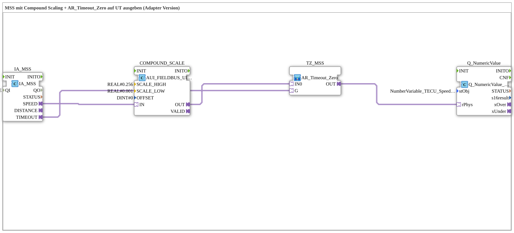

# Uebung_076c_AUI: MSS mit Compound Scaling + AR_Timeout_Zero auf UT ausgeben (Adapter-Version)

* * * * * * * * * *

## Einleitung

Diese Übung gibt die MSS-Geschwindigkeit des TECU auf dem Universal Terminal (UT) aus. Der Rohwert wird mit einer Compound-Skalierung (`SCALE_HIGH = 0.256`, `SCALE_LOW = 0.001`, `OFFSET = 0`) in einen physikalischen `REAL`-Wert gewandelt und durch die SubApp `AR_Timeout_Zero` (Fendt-Schaltung) geführt: Bei einem Kommunikationsausfall (`IA_MSS.TIMEOUT`) wird `0.0` ausgegeben. Alle Verbindungen sind Adapter (analog zu `TECU_MSS.SUB` im Projekt Krauternter).

## Verwendete Funktionsbausteine (FBs)

- **IA_MSS**: TECU-Eingang MSS
    - **Typ**: [`isobus::tecu::IA_MSS`](https://meisterschulen-am-ostbahnhof-munchen-docs.readthedocs.io/projects/4diac-library-reference-docs/de/latest/Bibliotheken/ExternalLibraries/isobus/TECU/IA_MSS/)
    - **Parameter**: `QI = TRUE`
    - **Erklärung**: Liefert `SPEED` (Rohwert) und `TIMEOUT` (Kommunikationsausfall) als Adapter.
- **COMPOUND_SCALE**: Compound-Skalierung
    - **Typ**: [`logiBUS::signalprocessing::fieldbus::AUI_FIELDBUS_UINT_TO_SIGNAL_COMPOUND_SCALE`](https://meisterschulen-am-ostbahnhof-munchen-docs.readthedocs.io/projects/4diac-library-reference-docs/de/latest/Bibliotheken/ExternalLibraries/logiBUS/signalprocessing/fieldbus/AUI_FIELDBUS_UINT_TO_SIGNAL_COMPOUND_SCALE/)
    - **Parameter**: `SCALE_HIGH = REAL#0.256`, `SCALE_LOW = REAL#0.001`, `OFFSET = DINT#0`
    - **Erklärung**: Wandelt den `UINT`-Rohwert (`IN`) mit den zwei Skalierungsfaktoren `SCALE_HIGH` und `SCALE_LOW` in einen `REAL`-Adapterwert (`OUT`).
- **TZ_MSS**: Fendt-Schaltung (SubApp)
    - **Typ**: `MyLib::sys::AR_Timeout_Zero` (SubApp-Instanz)
    - **Parameter**: keine
    - **Erklärung**: `OUT` liefert `IN0` unverändert, außer `G` ist `TRUE` (Timeout), dann `0.0`.
- **Q_NumericValue**: numerische Anzeige
    - **Typ**: [`isobus::UT::Q::Q_NumericValue_PHYSA`](https://meisterschulen-am-ostbahnhof-munchen-docs.readthedocs.io/projects/4diac-library-reference-docs/de/latest/Bibliotheken/ExternalLibraries/isobus/UT/Q/Q_NumericValue_PHYSA/)
    - **Parameter**: `stObj = NumberVariable_TECU_Speed_MSS_N`
    - **Erklärung**: Zeigt den physikalischen Wert aus `rPhys` am UT-Objekt `NumberVariable_TECU_Speed_MSS_N` an.

## Programmablauf und Verbindungen

1. `IA_MSS.SPEED` → `COMPOUND_SCALE.IN` (AdapterConnection): Der Rohwert wird mit Compound-Skalierung gewandelt.
2. `COMPOUND_SCALE.OUT` → `TZ_MSS.IN0` (AdapterConnection): Der skalierte Wert ist der Live-Wert der Fendt-Schaltung.
3. `IA_MSS.TIMEOUT` → `TZ_MSS.G` (AdapterConnection): Ein Timeout schaltet die Ausgabe auf `0.0`.
4. `TZ_MSS.OUT` → `Q_NumericValue.rPhys` (AdapterConnection): Das Ergebnis wird am UT angezeigt.

## Zusammenfassung

Die Übung 076c_AUI entspricht in der Struktur `Uebung_072d_AUI`, verwendet aber statt der einfachen Skalierung den Baustein `AUI_FIELDBUS_UINT_TO_SIGNAL_COMPOUND_SCALE` mit zwei Skalierungsfaktoren. Die Absicherung gegen Kommunikationsausfall übernimmt wieder `AR_Timeout_Zero`.

---

### 🌐 Passende Themen-Unterseiten auf ms-muc-docs.de

- [🌐 Eclipse 4diac IDE & Farb-Referenz auf ms-muc-docs.de](https://www.ms-muc-docs.de/iec-61499/eclipse-4diac/)
