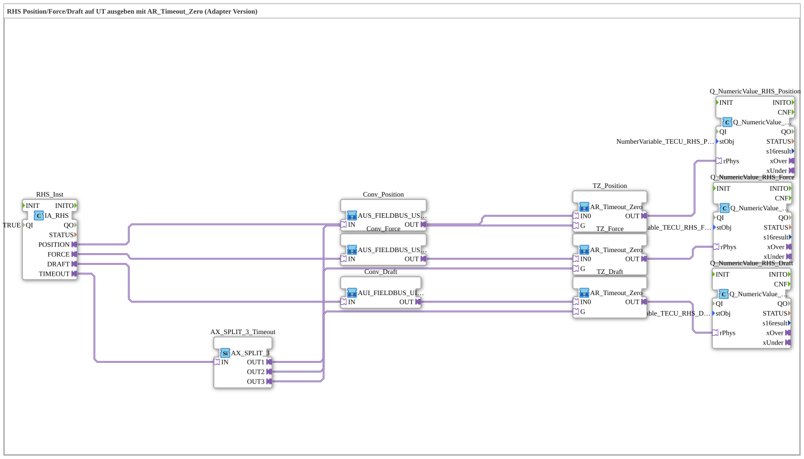

# Uebung_077_AUI: RHS Position/Force/Draft auf UT ausgeben mit AR_Timeout_Zero (Adapter Version)

* * * * * * * * * *

## Einleitung

Diese Übung gibt die Werte des ISOBUS-TECU-Heckkraftheber-Status (**RHS**, Rear Hitch Status) auf einem Universal Terminal (UT) aus: **Position**, **Force** (Nominal Lower Link Force) und **Draft**. Jeder Rohwert wird in einen REAL-Wert umgesetzt (unskaliert, NOT_AVAILABLE/ERROR_INDICATOR werden zu `0.0` gefiltert), durch eine eigene `AR_Timeout_Zero`-Instanz gegen Kommunikationsausfall abgesichert und über `Q_NumericValue_PHYSA` angezeigt. Die Übung ist analog zu `TECU_RHS.SUB` der Krauternter-Software.

## Verwendete Funktionsbausteine (FBs)

- **RHS_Inst**: ISOBUS-Adapter für den Heckkraftheber-Status
    - **Typ**: `isobus::tecu::IA_RHS`
    - **Parameter**: `QI = TRUE`
    - **Erklärung**: Liefert die Adapter `POSITION` und `FORCE` (je AUS, USINT-Rohwert), `DRAFT` (AUI, UINT-Rohwert) sowie `TIMEOUT` (AX, TRUE bei Kommunikationsausfall).
- **AX_SPLIT_3_Timeout**: Verteiler für den Timeout-Status
    - **Typ**: `adapter::events::unidirectional::AX_SPLIT_3`
    - **Parameter**: keine
    - **Erklärung**: Verteilt `RHS_Inst.TIMEOUT` auf `OUT1` (→ `TZ_Position.G`), `OUT2` (→ `TZ_Force.G`) und `OUT3` (→ `TZ_Draft.G`).
- **Conv_Position**, **Conv_Force**: Umsetzung USINT → REAL
    - **Typ**: `MyLib::sys::AUS_FIELDBUS_USINT_TO_AR` (SubApp-Instanzen)
    - **Parameter**: keine
    - **Erklärung**: Wandeln den TECU-Rohwert (`IN`, AUS) in einen AR-Wert (`OUT`) um. NOT_AVAILABLE/ERROR_INDICATOR werden gefiltert (Ausgabe `0.0`), sonst bleibt der Wert unskaliert (`SCALE = 1.0`, `OFFSET = 0` fest).
- **Conv_Draft**: Umsetzung UINT → REAL
    - **Typ**: `MyLib::sys::AUI_FIELDBUS_UINT_TO_AR` (SubApp-Instanz)
    - **Parameter**: keine
    - **Erklärung**: Wie oben, jedoch für den UINT-Rohwert (`IN`, AUI).
- **TZ_Position**, **TZ_Force**, **TZ_Draft**: Timeout-Nullung (SubApp-Instanzen)
    - **Typ**: `MyLib::sys::AR_Timeout_Zero`
    - **Parameter**: keine
    - **Erklärung**: Liefern `IN0` unverändert an `OUT`, außer `G` ist TRUE (Timeout) - dann `0.0`.
- **Q_NumericValue_RHS_Position**, **Q_NumericValue_RHS_Force**, **Q_NumericValue_RHS_Draft**: Ausgabe auf VT-Zahlenfelder
    - **Typ**: `isobus::UT::Q::Q_NumericValue_PHYSA`
    - **Parameter**: `stObj = NumberVariable_TECU_RHS_Position_N` / `NumberVariable_TECU_RHS_Force_N` / `NumberVariable_TECU_RHS_Draft_N`
    - **Erklärung**: Schreiben den physikalischen Wert (`rPhys`) in das zugehörige VT-Objekt.

## Programmablauf und Verbindungen

1. Position: `RHS_Inst.POSITION` → `Conv_Position.IN` → `TZ_Position.IN0`; `AX_SPLIT_3_Timeout.OUT1` → `TZ_Position.G`; `TZ_Position.OUT` → `Q_NumericValue_RHS_Position.rPhys`.
2. Force: `RHS_Inst.FORCE` → `Conv_Force.IN` → `TZ_Force.IN0`; `AX_SPLIT_3_Timeout.OUT2` → `TZ_Force.G`; `TZ_Force.OUT` → `Q_NumericValue_RHS_Force.rPhys`.
3. Draft: `RHS_Inst.DRAFT` → `Conv_Draft.IN` → `TZ_Draft.IN0`; `AX_SPLIT_3_Timeout.OUT3` → `TZ_Draft.G`; `TZ_Draft.OUT` → `Q_NumericValue_RHS_Draft.rPhys`.
4. `RHS_Inst.TIMEOUT` → `AX_SPLIT_3_Timeout.IN`: ein Timeout-Status steuert alle drei Nullungen.

**Verhalten**: Solange Daten eintreffen, zeigt das UT Position, Kraft und Zugkraft des Heckkrafthebers. Bei Kommunikationsausfall (`TIMEOUT` = TRUE) zeigen alle drei Felder `0.0`.

## Zusammenfassung

Die Übung überträgt das Muster aus `Uebung_073d_AUI` und `Uebung_075a_AUI` auf drei Werte mit unterschiedlichen Rohdatentypen (USINT und UINT): jeweils eine passende Konverter-SubApp, eine `AR_Timeout_Zero`-Instanz und ein `Q_NumericValue_PHYSA`, wobei ein gemeinsamer `AX_SPLIT_3` den Timeout-Status verteilt.

---

### 🌐 Passende Themen-Unterseiten auf ms-muc-docs.de

- [🌐 Eclipse 4diac IDE & Farb-Referenz auf ms-muc-docs.de](https://www.ms-muc-docs.de/iec-61499/eclipse-4diac/)
