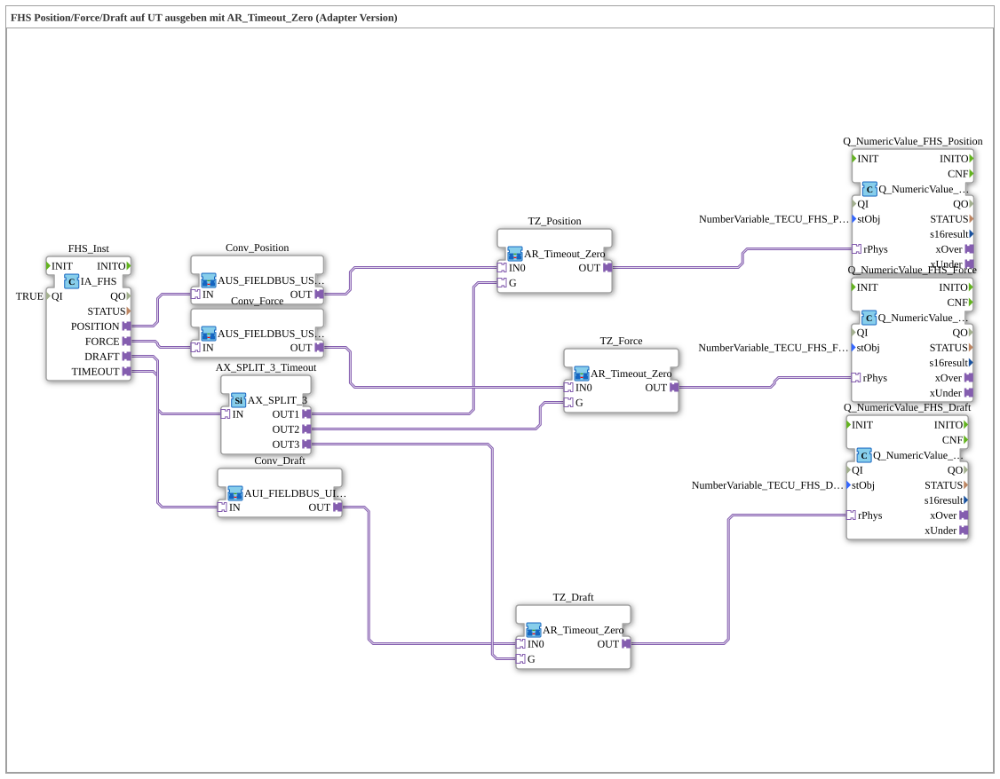

# Uebung_078_AUI: FHS Position/Force/Draft auf UT ausgeben mit AR_Timeout_Zero (Adapter Version)

* * * * * * * * * *

## Einleitung

Diese Übung gibt die drei Messwerte des Front Hitch Status (FHS) - Position, Kraft (Force) und Zugkraft (Draft) - auf einem User Terminal (UT) aus. Jeder Rohwert wird in einen REAL-Wert umgewandelt und durch einen `AR_Timeout_Zero`-Baustein geführt, der bei einem Timeout der FHS-Nachricht den Wert 0.0 liefert, statt den letzten Wert einzufrieren. Das gemeinsame Timeout-Signal wird dafür auf drei Ziele verteilt. Alle Verbindungen laufen über Adapter.

## Verwendete Funktionsbausteine (FBs)

- **FHS_Inst**: ISOBUS-Adapter für den Front Hitch Status
    - **Typ**: [`isobus::tecu::IA_FHS`](https://meisterschulen-am-ostbahnhof-munchen-docs.readthedocs.io/projects/4diac-library-reference-docs/de/latest/Bibliotheken/ExternalLibraries/isobus/TECU/IA_FHS/)
    - **Parameter**: `QI = TRUE`
    - **Erklärung**: Stellt `POSITION` und `FORCE` als AUS-Adapter, `DRAFT` als AUI-Adapter und den Timeout-Status `TIMEOUT` als AX-Adapter bereit (PGN 65094).
- **Conv_Position**, **Conv_Force**: Umwandlung AUS → AR
    - **Typ**: `MyLib::sys::AUS_FIELDBUS_USINT_TO_AR` (SubApp-Instanz, siehe [AUS_FIELDBUS_USINT_TO_AR](https://meisterschulen-am-ostbahnhof-munchen-docs.readthedocs.io/projects/4diac-library-reference-docs/de/latest/Bibliotheken/ExternalLibraries/MyLib_AX/sys/AUS_FIELDBUS_USINT_TO_AR/))
    - **Parameter**: keine
    - **Erklärung**: Wandelt den TECU-Rohwert (USINT) unskaliert (`SCALE` = 1.0, `OFFSET` = 0) in einen AR-Wert um. Bei `NOT_AVAILABLE` oder `ERROR_INDI` wird 0.0 geliefert.
- **Conv_Draft**: Umwandlung AUI → AR
    - **Typ**: `MyLib::sys::AUI_FIELDBUS_UINT_TO_AR` (SubApp-Instanz)
    - **Parameter**: keine
    - **Erklärung**: Wie oben, jedoch für den UINT-Rohwert des AUI-Adapters `DRAFT`.
- **TZ_Position**, **TZ_Force**, **TZ_Draft**: Timeout-Zero
    - **Typ**: `MyLib::sys::AR_Timeout_Zero` (SubApp-Instanz)
    - **Parameter**: keine
    - **Erklärung**: Fendt-Schaltung: Der Adapter `OUT` liefert den Live-Wert `IN0` unverändert, außer `G` (in der Regel `IA_*.TIMEOUT`) ist TRUE - dann 0.0 statt des sonst eingefrorenen letzten Werts. Intern besteht der Baustein aus einem `initval_AR` mit `INIT_VAL = 0.0` und einem `AR_AX_SEL_AR`.
- **AX_SPLIT_3_Timeout**: Verteiler des Timeout-Signals
    - **Typ**: [`adapter::events::unidirectional::AX_SPLIT_3`](https://meisterschulen-am-ostbahnhof-munchen-docs.readthedocs.io/projects/4diac-library-reference-docs/de/latest/Bibliotheken/ExternalLibraries/adapter/events/unidirectional/BOOL/AX_SPLIT_3/)
    - **Parameter**: keine
    - **Erklärung**: Verteilt das Timeout-Signal von `FHS_Inst.TIMEOUT` auf die drei Timeout-Zero-Bausteine.
- **Q_NumericValue_FHS_Position**, **Q_NumericValue_FHS_Force**, **Q_NumericValue_FHS_Draft**: VT-Anzeigen
    - **Typ**: [`isobus::UT::Q::Q_NumericValue_PHYSA`](https://meisterschulen-am-ostbahnhof-munchen-docs.readthedocs.io/projects/4diac-library-reference-docs/de/latest/Bibliotheken/ExternalLibraries/isobus/UT/Q/Q_NumericValue_PHYSA/)
    - **Parameter**: `stObj = NumberVariable_TECU_FHS_Position_N`, `NumberVariable_TECU_FHS_Force_N` bzw. `NumberVariable_TECU_FHS_Draft_N`
    - **Erklärung**: Zeigen den physikalischen REAL-Wert vom Adapter `rPhys` auf dem im Objektpool-Eintrag `stObj` angegebenen VT-Objekt an.

## Programmablauf und Verbindungen

1. Position: `FHS_Inst.POSITION` → `Conv_Position.IN` → `TZ_Position.IN0` (`Conv_Position.OUT`) → `Q_NumericValue_FHS_Position.rPhys` (`TZ_Position.OUT`).
2. Force: `FHS_Inst.FORCE` → `Conv_Force.IN` → `TZ_Force.IN0` (`Conv_Force.OUT`) → `Q_NumericValue_FHS_Force.rPhys` (`TZ_Force.OUT`).
3. Draft: `FHS_Inst.DRAFT` → `Conv_Draft.IN` → `TZ_Draft.IN0` (`Conv_Draft.OUT`) → `Q_NumericValue_FHS_Draft.rPhys` (`TZ_Draft.OUT`).
4. `FHS_Inst.TIMEOUT` → `AX_SPLIT_3_Timeout.IN`: Das Timeout-Signal wird verteilt.
5. `AX_SPLIT_3_Timeout.OUT1` → `TZ_Position.G`, `AX_SPLIT_3_Timeout.OUT2` → `TZ_Force.G`, `AX_SPLIT_3_Timeout.OUT3` → `TZ_Draft.G`: Bei Timeout liefern alle drei Timeout-Zero-Bausteine 0.0.

**Verhalten**: Im Normalbetrieb zeigt das UT die drei umgewandelten FHS-Werte; bei Timeout der FHS-Nachricht zeigen alle drei Felder 0.0.

## Zusammenfassung

Die Übung zeigt, wie sich die Fendt-Schaltung mit dem wiederverwendbaren Baustein `AR_Timeout_Zero` für mehrere Messwerte gleichzeitig einsetzen lässt: Ein einziges Timeout-Signal wird über `AX_SPLIT_3` auf drei Kanäle verteilt, sodass bei Kommunikationsausfall alle Anzeigen auf 0.0 fallen.

---

### 🌐 Passende Themen-Unterseiten auf ms-muc-docs.de

- [🌐 Eclipse 4diac IDE & Farb-Referenz auf ms-muc-docs.de](https://www.ms-muc-docs.de/iec-61499/eclipse-4diac/)
