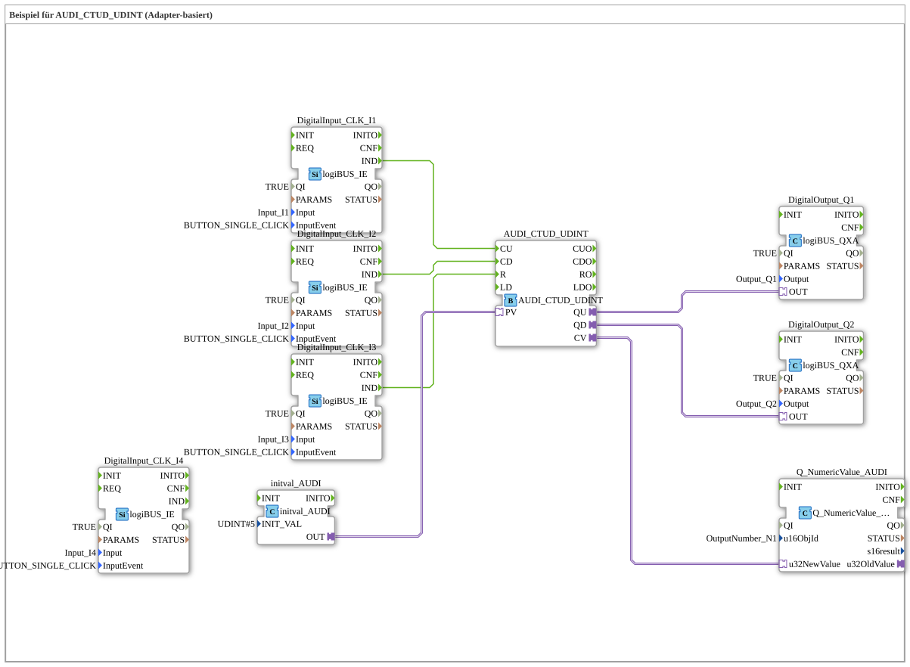

# Uebung_083_AUDI: Beispiel für AUDI_CTUD_UDINT (Adapter-basiert)

* * * * * * * * * *

## Einleitung

Diese Übung demonstriert den Aufwärts-/Abwärtszähler `AUDI_CTUD_UDINT` auf Basis von Adaptern. Drei Taster mit Single-Click-Erkennung steuern den Zähler: `I1` zählt hoch (`CU`), `I2` zählt runter (`CD`), `I3` setzt zurück (`R`). Der Vorgabewert `PV` kommt fest aus `initval_AUDI` (`INIT_VAL = 5`). Der Zählerwert `CV` wird an der Anzeige `OutputNumber_N1` ausgegeben, die Ausgänge `QU` und `QD` schalten `Q1` und `Q2`. Der Baustein `DigitalInput_CLK_I4` (Eingang `I4`) ist im Netzwerk vorhanden, aber nicht verdrahtet.

## Verwendete Funktionsbausteine (FBs)

- **DigitalInput_CLK_I1**, **DigitalInput_CLK_I2**, **DigitalInput_CLK_I3**, **DigitalInput_CLK_I4**: Taster mit Klick-Erkennung
    - **Typ**: [`logiBUS::io::DI::logiBUS_IE`](https://meisterschulen-am-ostbahnhof-munchen-docs.readthedocs.io/projects/4diac-library-reference-docs/de/latest/Bibliotheken/ExternalLibraries/logiBUS/io/DI/logiBUS_IE/)
    - **Parameter**: `QI = TRUE`, `Input = Input_I1` / `Input_I2` / `Input_I3` / `Input_I4`, jeweils `InputEvent = BUTTON_SINGLE_CLICK`
    - **Erklärung**: Melden einen Einzelklick auf den jeweiligen Eingang als Event `IND`.
- **AUDI_CTUD_UDINT**: Adapter-basierter Auf-/Abwärtszähler für `UDINT`
    - **Typ**: [`adapter::events::unidirectional::AUDI_CTUD_UDINT`](https://meisterschulen-am-ostbahnhof-munchen-docs.readthedocs.io/projects/4diac-library-reference-docs/de/latest/Bibliotheken/ExternalLibraries/adapter/events/unidirectional/UDINT/AUDI_CTUD_UDINT/)
    - **Parameter**: keine
    - **Erklärung**: Ereigniseingänge `CU` (hoch), `CD` (runter), `R` (Reset). `CV` ist der aktuelle Zählwert (Adapter), `QU` ist `TRUE`, wenn `CV` größer oder gleich `PV` ist, `QD` ist `TRUE`, wenn `CV` kleiner oder gleich 0 ist.
- **initval_AUDI**: Vorgabewert
    - **Typ**: [`adapter::types::unidirectional::AUDI::initval::initval_AUDI`](https://meisterschulen-am-ostbahnhof-munchen-docs.readthedocs.io/projects/4diac-library-reference-docs/de/latest/Bibliotheken/ExternalLibraries/adapter/types/unidirectional/UDINT/initval/initval_AUDI/)
    - **Parameter**: `INIT_VAL = 5`
    - **Erklärung**: Liefert den Wert 5 als Vorgabewert `PV` an den Zähler.
- **DigitalOutput_Q1**, **DigitalOutput_Q2**: logiBUS Digitalausgänge
    - **Typ**: [`logiBUS::io::DQ::logiBUS_QXA`](https://meisterschulen-am-ostbahnhof-munchen-docs.readthedocs.io/projects/4diac-library-reference-docs/de/latest/Bibliotheken/ExternalLibraries/logiBUS/io/DO/logiBUS_QXA/)
    - **Parameter**: `QI = TRUE`, `Output = Output_Q1` bzw. `Output_Q2`
    - **Erklärung**: `Q1` zeigt `QU`, `Q2` zeigt `QD`.
- **Q_NumericValue_AUDI**: numerische Anzeige
    - **Typ**: [`isobus::UT::Q::Q_NumericValue_AUDI`](https://meisterschulen-am-ostbahnhof-munchen-docs.readthedocs.io/projects/4diac-library-reference-docs/de/latest/Bibliotheken/ExternalLibraries/isobus/UT/Q/Q_NumericValue_AUDI/)
    - **Parameter**: `u16ObjId = OutputNumber_N1`
    - **Erklärung**: Zeigt den Zählerwert `CV` (`u32NewValue`) an `OutputNumber_N1` an.

## Programmablauf und Verbindungen

1. `DigitalInput_CLK_I1.IND` → `AUDI_CTUD_UDINT.CU`, `DigitalInput_CLK_I2.IND` → `AUDI_CTUD_UDINT.CD` und `DigitalInput_CLK_I3.IND` → `AUDI_CTUD_UDINT.R` (EventConnections): Ein Klick auf `I1` zählt hoch, auf `I2` runter, auf `I3` wird der Zähler zurückgesetzt.
2. `initval_AUDI.OUT` → `AUDI_CTUD_UDINT.PV` (AdapterConnection): Der Vorgabewert 5.
3. `AUDI_CTUD_UDINT.QU` → `DigitalOutput_Q1.OUT` und `AUDI_CTUD_UDINT.QD` → `DigitalOutput_Q2.OUT` (AdapterConnections): `Q1` ist an, wenn der Zählwert den Vorgabewert erreicht oder überschreitet; `Q2` ist an, wenn der Zählwert 0 (oder kleiner) ist.
4. `AUDI_CTUD_UDINT.CV` → `Q_NumericValue_AUDI.u32NewValue` (AdapterConnection): Der Zählerwert wird numerisch angezeigt.

## Zusammenfassung

Die Übung veranschaulicht den Einsatz des Adapter-basierten Auf-/Abwärtszählers `AUDI_CTUD_UDINT`. Drei Taster zählen hoch, zählen runter und setzen zurück; der Vorgabewert 5 kommt aus `initval_AUDI`. `QU` und `QD` werden auf `Q1` und `Q2` geführt, der aktuelle Zählerwert wird an `OutputNumber_N1` angezeigt.

---

### 🌐 Passende Themen-Unterseiten auf ms-muc-docs.de

- [🌐 Eclipse 4diac IDE & Farb-Referenz auf ms-muc-docs.de](https://www.ms-muc-docs.de/iec-61499/eclipse-4diac/)
