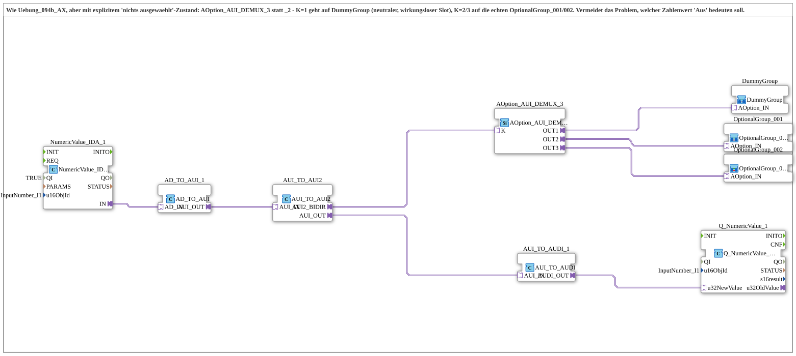

# Uebung_094b2_AX: Optionsauswahl per VT-Eingabefeld mit explizitem "nichts ausgewählt"-Zustand

* * * * * * * * * *

## Einleitung

Die Übung entspricht `Uebung_094b_AX`, verwendet aber [`AOption_AUI_DEMUX_3`](https://meisterschulen-am-ostbahnhof-munchen-docs.readthedocs.io/projects/4diac-library-reference-docs/de/latest/Bibliotheken/ExternalLibraries/Option/selection/AOption_AUI_DEMUX_3/) statt [`AOption_AUI_DEMUX_2`](https://meisterschulen-am-ostbahnhof-munchen-docs.readthedocs.io/projects/4diac-library-reference-docs/de/latest/Bibliotheken/ExternalLibraries/Option/selection/AOption_AUI_DEMUX_2/). Der Wert `K = 1` geht auf eine neutrale [`DummyGroup`](https://meisterschulen-am-ostbahnhof-munchen-docs.readthedocs.io/projects/4diac-library-reference-docs/de/latest/Bibliotheken/ExternalLibraries/MyLib_AX_Option/sys/DummyGroup/) ohne Wirkung, `K = 2` und `K = 3` aktivieren die echten Gruppen [`OptionalGroup_001`](https://meisterschulen-am-ostbahnhof-munchen-docs.readthedocs.io/projects/4diac-library-reference-docs/de/latest/Bibliotheken/ExternalLibraries/MyLib_AX_Option/sys/OptionalGroup_001/) bzw. [`OptionalGroup_002`](https://meisterschulen-am-ostbahnhof-munchen-docs.readthedocs.io/projects/4diac-library-reference-docs/de/latest/Bibliotheken/ExternalLibraries/MyLib_AX_Option/sys/OptionalGroup_002/). Damit entfällt die Frage, welcher Zahlenwert "Aus" bedeuten soll: Es wird einfach ein eigener Platzhalter-Slot im DEMUX reserviert. Die Lese-/Echo-Kette zum VT-Eingabefeld ist hier noch inline verdrahtet.

## Verwendete Funktionsbausteine (FBs)

- **NumericValue_IDA_1**: liest das VT-Eingabefeld
    - **Typ**: `isobus::UT::io::NumericValue::NumericValue_IDA`
    - **Parameter**: `QI = TRUE`, `u16ObjId = InputNumber_I1`
    - **Erklärung**: Liefert den Wert des VT-Zahlenfelds `InputNumber_I1` über den Adapter `IN` (AD).
- **AD_TO_AUI_1**: Adapterumsetzung AD nach AUI
    - **Typ**: `adapter::conversion::unidirectional::AD_TO_AUI`
    - **Parameter**: keine
    - **Erklärung**: Wandelt den DWORD-Wert in einen UINT-Wert (AUI).
- **AUI_TO_AUI2**: Brücke zum bidirektionalen AUI2-Adapter
    - **Typ**: `adapter::conversion::bidirectional::AUI_TO_AUI2`
    - **Parameter**: keine
    - **Erklärung**: Reicht den Wert über `AUI2_BIDIR` an den Consumer (`K` des DEMUX) weiter und nimmt von dort den tatsächlich übernommenen Wert als Echo zurück (`AUI_OUT`).
- **AUI_TO_AUDI_1**: Adapterumsetzung AUI nach AUDI
    - **Typ**: `adapter::conversion::unidirectional::AUI_TO_AUDI`
    - **Parameter**: keine
    - **Erklärung**: Wandelt das Echo wieder in einen UDINT-Wert für das VT.
- **Q_NumericValue_1**: schreibt den Wert ins VT
    - **Typ**: `isobus::UT::Q::Q_NumericValue_AUDI`
    - **Parameter**: `u16ObjId = InputNumber_I1`
    - **Erklärung**: Schreibt den zurückgemeldeten Wert (`u32NewValue`) in das VT-Feld `InputNumber_I1`.
- **AOption_AUI_DEMUX_3**: Optionsauswahl mit drei Ausgängen
    - **Typ**: [`Option::selection::AOption_AUI_DEMUX_3`](https://meisterschulen-am-ostbahnhof-munchen-docs.readthedocs.io/projects/4diac-library-reference-docs/de/latest/Bibliotheken/ExternalLibraries/Option/selection/AOption_AUI_DEMUX_3/)
    - **Parameter**: keine
    - **Erklärung**: Aktiviert abhängig vom Index `K` genau einen der Ausgänge `OUT1`, `OUT2`, `OUT3`.
- **OptionalGroup_001**, **OptionalGroup_002**: echte Optionsgruppen
    - **Typ**: [`MyLib_AX_Option::sys::OptionalGroup_001`](https://meisterschulen-am-ostbahnhof-munchen-docs.readthedocs.io/projects/4diac-library-reference-docs/de/latest/Bibliotheken/ExternalLibraries/MyLib_AX_Option/sys/OptionalGroup_001/) bzw. [`MyLib_AX_Option::sys::OptionalGroup_002`](https://meisterschulen-am-ostbahnhof-munchen-docs.readthedocs.io/projects/4diac-library-reference-docs/de/latest/Bibliotheken/ExternalLibraries/MyLib_AX_Option/sys/OptionalGroup_002/) (SubApp-Instanzen)
    - **Parameter**: keine
    - **Erklärung**: Gruppe 1 enthält den Digitaleingang `I1` und den Digitalausgang `Q1`, Gruppe 2 `I2` und `Q2`. Über den Options-Adapter wird die ganze Gruppe aktiviert bzw. deaktiviert.
- **DummyGroup**: neutraler Platzhalter-Slot
    - **Typ**: [`MyLib_AX_Option::sys::DummyGroup`](https://meisterschulen-am-ostbahnhof-munchen-docs.readthedocs.io/projects/4diac-library-reference-docs/de/latest/Bibliotheken/ExternalLibraries/MyLib_AX_Option/sys/DummyGroup/) (SubApp-Instanz)
    - **Parameter**: keine
    - **Erklärung**: Hat keine reale I/O und keine Wirkung; quittiert die Initialisierung selbst. Dient als Zustand "nichts ausgewählt".

## Programmablauf und Verbindungen

1. `NumericValue_IDA_1.IN` → `AD_TO_AUI_1.AD_IN` → `AUI_TO_AUI2.AUI_IN`: Der Wert des Eingabefelds wird nach AUI und dann in den bidirektionalen AUI2-Adapter überführt.
2. `AUI_TO_AUI2.AUI2_BIDIR` → `AOption_AUI_DEMUX_3.K`: Der Wert wählt den aktiven Ausgang des DEMUX.
3. `AOption_AUI_DEMUX_3.OUT1` → `DummyGroup.OPTION`, `OUT2` → `OptionalGroup_001.OPTION`, `OUT3` → `OptionalGroup_002.OPTION`.
4. Echo-Pfad: `AUI_TO_AUI2.AUI_OUT` → `AUI_TO_AUDI_1.AUI_IN` → `Q_NumericValue_1.u32NewValue`: Der vom DEMUX übernommene Wert wird in das VT-Feld zurückgeschrieben.

**Verhalten**: Im Eingabefeld `InputNumber_I1` ergibt 1 den Zustand "nichts ausgewählt" (DummyGroup), 2 aktiviert Gruppe 1 und 3 aktiviert Gruppe 2.

## Zusammenfassung

Durch den zusätzlichen Platzhalter-Slot im `AOption_AUI_DEMUX_3` ist ein eindeutiger "nichts ausgewählt"-Zustand ohne besondere Zahlenkonvention möglich. Die inline verdrahtete Lese-/Echo-Kette wird in `Uebung_094b3_AX` in einen wiederverwendbaren Baustein ausgelagert.

---

### 🌐 Passende Themen-Unterseiten auf ms-muc-docs.de

- [🌐 Eclipse 4diac IDE & Farb-Referenz auf ms-muc-docs.de](https://www.ms-muc-docs.de/iec-61499/eclipse-4diac/)
