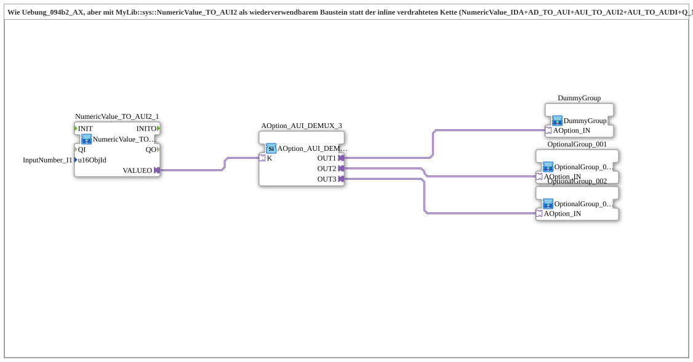

# Uebung_094b3_AX: Optionsauswahl mit wiederverwendbarem Baustein NumericValue_TO_AUI2

* * * * * * * * * *

## Einleitung

Die Übung entspricht `Uebung_094b2_AX`, verwendet aber den wiederverwendbaren Baustein [`MyLib::sys::NumericValue_TO_AUI2`](https://meisterschulen-am-ostbahnhof-munchen-docs.readthedocs.io/projects/4diac-library-reference-docs/de/latest/Bibliotheken/ExternalLibraries/MyLib_AX/sys/NumericValue_TO_AUI2/) statt der inline verdrahteten Kette aus `NumericValue_IDA`, `AD_TO_AUI`, `AUI_TO_AUI2`, `AUI_TO_AUDI` und `Q_NumericValue_AUDI`. Die Objekt-ID des VT-Felds wird als SubApp-Parameter übergeben.

## Verwendete Funktionsbausteine (FBs)

- **NumericValue_TO_AUI2_1**: liest das VT-Eingabefeld und stellt es als bidirektionalen AUI2-Plug bereit
    - **Typ**: [`MyLib::sys::NumericValue_TO_AUI2`](https://meisterschulen-am-ostbahnhof-munchen-docs.readthedocs.io/projects/4diac-library-reference-docs/de/latest/Bibliotheken/ExternalLibraries/MyLib_AX/sys/NumericValue_TO_AUI2/) (SubApp-Instanz)
    - **Parameter**: `u16ObjId = InputNumber_I1`
    - **Erklärung**: Liest das VT-Eingabefeld und reicht den Wert über `VALUEO` an einen Consumer weiter (hier `K` des DEMUX). Der Baustein speichert nicht selbst: Der Consumer meldet den tatsächlich übernommenen Wert über denselben Plug zurück, das Echo wird auf das VT-Feld zurückgeschrieben.
- **AOption_AUI_DEMUX_3**: Optionsauswahl mit drei Ausgängen
    - **Typ**: [`Option::selection::AOption_AUI_DEMUX_3`](https://meisterschulen-am-ostbahnhof-munchen-docs.readthedocs.io/projects/4diac-library-reference-docs/de/latest/Bibliotheken/ExternalLibraries/Option/selection/AOption_AUI_DEMUX_3/)
    - **Parameter**: keine
    - **Erklärung**: Aktiviert abhängig vom Index `K` genau einen der Ausgänge `OUT1`, `OUT2`, `OUT3`.
- **OptionalGroup_001**, **OptionalGroup_002**: echte Optionsgruppen
    - **Typ**: [`MyLib_AX_Option::sys::OptionalGroup_001`](https://meisterschulen-am-ostbahnhof-munchen-docs.readthedocs.io/projects/4diac-library-reference-docs/de/latest/Bibliotheken/ExternalLibraries/MyLib_AX_Option/sys/OptionalGroup_001/) bzw. [`MyLib_AX_Option::sys::OptionalGroup_002`](https://meisterschulen-am-ostbahnhof-munchen-docs.readthedocs.io/projects/4diac-library-reference-docs/de/latest/Bibliotheken/ExternalLibraries/MyLib_AX_Option/sys/OptionalGroup_002/) (SubApp-Instanzen)
    - **Parameter**: keine
    - **Erklärung**: Gruppe 1 enthält `I1`/`Q1`, Gruppe 2 enthält `I2`/`Q2`; die ganze Gruppe wird über den Options-Adapter aktiviert bzw. deaktiviert.
- **DummyGroup**: neutraler Platzhalter-Slot
    - **Typ**: [`MyLib_AX_Option::sys::DummyGroup`](https://meisterschulen-am-ostbahnhof-munchen-docs.readthedocs.io/projects/4diac-library-reference-docs/de/latest/Bibliotheken/ExternalLibraries/MyLib_AX_Option/sys/DummyGroup/) (SubApp-Instanz)
    - **Parameter**: keine
    - **Erklärung**: Ohne reale I/O und ohne Wirkung; Zustand "nichts ausgewählt".

## Programmablauf und Verbindungen

1. `NumericValue_TO_AUI2_1.VALUEO` → `AOption_AUI_DEMUX_3.K`: Der Wert des Eingabefelds wählt den aktiven Ausgang.
2. `AOption_AUI_DEMUX_3.OUT1` → `DummyGroup.AOption_IN`, `OUT2` → `OptionalGroup_001.AOption_IN`, `OUT3` → `OptionalGroup_002.AOption_IN`.

**Verhalten**: Wie in `Uebung_094b2_AX`: 1 = nichts ausgewählt, 2 = Gruppe 1, 3 = Gruppe 2.

## Zusammenfassung

Die Lese-/Echo-Kette ist in [`MyLib::sys::NumericValue_TO_AUI2`](https://meisterschulen-am-ostbahnhof-munchen-docs.readthedocs.io/projects/4diac-library-reference-docs/de/latest/Bibliotheken/ExternalLibraries/MyLib_AX/sys/NumericValue_TO_AUI2/) gekapselt; das Netzwerk der Übung schrumpft auf vier Instanzen und zwei Verbindungsarten, bei gleichem Verhalten wie `Uebung_094b2_AX`.

---

### 🌐 Passende Themen-Unterseiten auf ms-muc-docs.de

- [🌐 Eclipse 4diac IDE & Farb-Referenz auf ms-muc-docs.de](https://www.ms-muc-docs.de/iec-61499/eclipse-4diac/)
