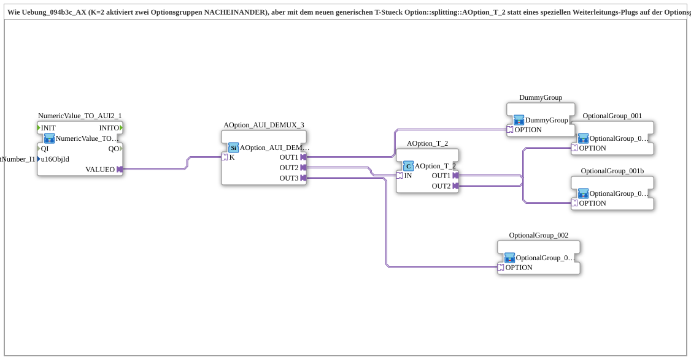

# Uebung_094b3d_AX: Optionsauswahl mit zwei nacheinander aktivierten Optionsgruppen über das T-Stück AOption_T_2

* * * * * * * * * *

## Einleitung

Die Übung entspricht [`Uebung_094b3c_AX`](Uebung_094b3c_AX.md): Der Index `K = 2` aktiviert zwei Optionsgruppen NACHEINANDER. Statt eines speziellen Weiterleitungs-Plugs auf der Optionsgruppe selbst (`PLUG1` bei `OptionalGroup_001a`) wird hier das neue generische T-Stück [`AOption_T_2`](https://meisterschulen-am-ostbahnhof-munchen-docs.readthedocs.io/projects/4diac-library-reference-docs/de/latest/Bibliotheken/ExternalLibraries/Option/splitting/AOption_T_2/) verwendet. `OptionalGroup_001` und `OptionalGroup_001b` sind beide die einfache, unveränderte Variante mit nur einem `OPTION`-Socket. Das T-Stück sitzt extern zwischen DEMUX und den beiden Gruppen und kann genauso an eine dritte Gruppe (oder ein weiteres T-Stück) weitergereicht werden. Die Aktivierung erfolgt sequenziell: zuerst `OUT2` (`OptionalGroup_001`), danach erst `OUT1` (`OptionalGroup_001b`), nicht gleichzeitig.

## Verwendete Funktionsbausteine (FBs)

- **NumericValue_TO_AUI2_1**: liest das VT-Eingabefeld und stellt es als bidirektionalen AUI2-Plug bereit
    - **Typ**: [`MyLib::sys::NumericValue_TO_AUI2`](https://meisterschulen-am-ostbahnhof-munchen-docs.readthedocs.io/projects/4diac-library-reference-docs/de/latest/Bibliotheken/ExternalLibraries/MyLib_AX/sys/NumericValue_TO_AUI2/) (SubApp-Instanz)
    - **Parameter**: `u16ObjId = InputNumber_I1`
    - **Erklärung**: Liest das VT-Eingabefeld und reicht den Wert über `VALUEO` an den DEMUX weiter.
- **AOption_AUI_DEMUX_3**: Optionsauswahl mit drei Ausgängen
    - **Typ**: [`Option::selection::AOption_AUI_DEMUX_3`](https://meisterschulen-am-ostbahnhof-munchen-docs.readthedocs.io/projects/4diac-library-reference-docs/de/latest/Bibliotheken/ExternalLibraries/Option/selection/AOption_AUI_DEMUX_3/)
    - **Parameter**: keine
    - **Erklärung**: Aktiviert abhängig vom Index `K` genau einen der Ausgänge `OUT1`, `OUT2`, `OUT3`.
- **AOption_T_2**: Options-T-Stück
    - **Typ**: `Option::splitting::AOption_T_2`
    - **Parameter**: keine
    - **Erklärung**: Wird am `IN`-Socket vom DEMUX-Ausgang `OUT2` gespeist und aktiviert sequenziell zuerst `OUT2` (`OptionalGroup_001`), nach dessen `INIT_CNF` erst `OUT1` (`OptionalGroup_001b`). `OUT1` kann an den `IN`-Socket eines weiteren `AOption_T_2` angeschlossen werden, um die Kette zu kaskadieren.
- **OptionalGroup_001**: erste Optionsgruppe
    - **Typ**: [`MyLib_AX_Option::sys::OptionalGroup_001`](https://meisterschulen-am-ostbahnhof-munchen-docs.readthedocs.io/projects/4diac-library-reference-docs/de/latest/Bibliotheken/ExternalLibraries/MyLib_AX_Option/sys/OptionalGroup_001/) (SubApp-Instanz)
    - **Parameter**: keine
    - **Erklärung**: Schaltet `Input_I1`/`Output_Q1` frei; nur ein `OPTION`-Socket.
- **OptionalGroup_001b**: zweite Optionsgruppe
    - **Typ**: [`MyLib_AX_Option::sys::OptionalGroup_001b`](https://meisterschulen-am-ostbahnhof-munchen-docs.readthedocs.io/projects/4diac-library-reference-docs/de/latest/Bibliotheken/ExternalLibraries/MyLib_AX_Option/sys/OptionalGroup_001b/) (SubApp-Instanz)
    - **Parameter**: keine
    - **Erklärung**: Baugleich zu `OptionalGroup_001` (ebenfalls `Input_I1`/`Output_Q1`); reicht nichts weiter.
- **OptionalGroup_002**: weitere Optionsgruppe
    - **Typ**: [`MyLib_AX_Option::sys::OptionalGroup_002`](https://meisterschulen-am-ostbahnhof-munchen-docs.readthedocs.io/projects/4diac-library-reference-docs/de/latest/Bibliotheken/ExternalLibraries/MyLib_AX_Option/sys/OptionalGroup_002/) (SubApp-Instanz)
    - **Parameter**: keine
    - **Erklärung**: Gruppe mit `I2`/`Q2`; wird über den Options-Adapter aktiviert bzw. deaktiviert.
- **DummyGroup**: neutraler Platzhalter-Slot
    - **Typ**: [`MyLib_AX_Option::sys::DummyGroup`](https://meisterschulen-am-ostbahnhof-munchen-docs.readthedocs.io/projects/4diac-library-reference-docs/de/latest/Bibliotheken/ExternalLibraries/MyLib_AX_Option/sys/DummyGroup/) (SubApp-Instanz)
    - **Parameter**: keine
    - **Erklärung**: Ohne reale I/O und ohne Wirkung; Zustand „nichts ausgewählt“.

## Programmablauf und Verbindungen

1. `NumericValue_TO_AUI2_1.VALUEO` → `AOption_AUI_DEMUX_3.K`: Der Wert des Eingabefelds wählt den aktiven Ausgang.
2. `AOption_AUI_DEMUX_3.OUT1` → `DummyGroup.OPTION`, `AOption_AUI_DEMUX_3.OUT2` → `AOption_T_2.IN`, `AOption_AUI_DEMUX_3.OUT3` → `OptionalGroup_002.OPTION`.
3. `AOption_T_2.OUT2` → `OptionalGroup_001.OPTION` und `AOption_T_2.OUT1` → `OptionalGroup_001b.OPTION`: Das T-Stück aktiviert zuerst `OptionalGroup_001`, danach `OptionalGroup_001b`.

**Verhalten**: `K = 1` = nichts ausgewählt (`DummyGroup`), `K = 2` = `OptionalGroup_001` und anschließend `OptionalGroup_001b` (sequenziell über `AOption_T_2`), `K = 3` = `OptionalGroup_002`.

## Zusammenfassung

Gegenüber `Uebung_094b3c_AX` entfällt die spezielle Gruppe `OptionalGroup_001a` mit `PLUG1`. Stattdessen verteilt das generische, kaskadierbare T-Stück `AOption_T_2` die Aktivierung extern und sequenziell auf zwei einfache Optionsgruppen.

---

### 🌐 Passende Themen-Unterseiten auf ms-muc-docs.de

- [🌐 Eclipse 4diac IDE & Farb-Referenz auf ms-muc-docs.de](https://www.ms-muc-docs.de/iec-61499/eclipse-4diac/)
