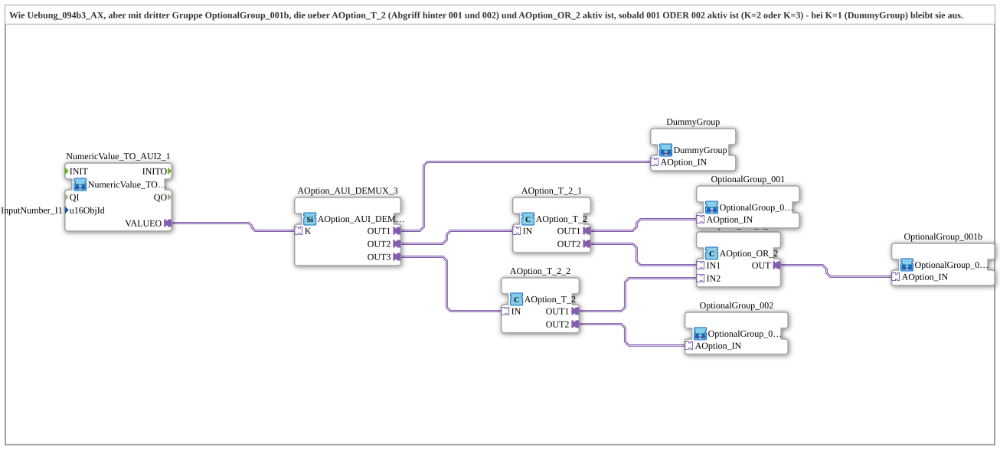

# Uebung_094b3e_AX: Optionsauswahl mit dritter Gruppe hinter 001 und 002 (T-Stück und ODER)

* * * * * * * * * *

## Einleitung

Die Übung baut auf [`Uebung_094b3_AX`](Uebung_094b3_AX.md) auf (`K = 1` Dummy, `K = 2` Gruppe 001, `K = 3` Gruppe 002). Zusätzlich wird eine dritte Gruppe `OptionalGroup_001b` aktiviert, sobald `OptionalGroup_001` ODER `OptionalGroup_002` aktiv ist, nicht aber bei `DummyGroup`. Da ein DEMUX-Ausgang nur an einen Socket angeschlossen werden kann, sitzt hinter `OUT2` und `OUT3` je ein [`AOption_T_2`](https://meisterschulen-am-ostbahnhof-munchen-docs.readthedocs.io/projects/4diac-library-reference-docs/de/latest/Bibliotheken/ExternalLibraries/Option/splitting/AOption_T_2/). Dessen zweiter Ausgang speist [`AOption_OR_2`](https://meisterschulen-am-ostbahnhof-munchen-docs.readthedocs.io/projects/4diac-library-reference-docs/de/latest/Bibliotheken/ExternalLibraries/Option/merging/AOption_OR_2/), dessen `OUT` die dritte Gruppe aktiviert.

## Verwendete Funktionsbausteine (FBs)

- **NumericValue_TO_AUI2_1**: liest das VT-Eingabefeld und stellt es als bidirektionalen AUI2-Plug bereit
    - **Typ**: [`MyLib::sys::NumericValue_TO_AUI2`](https://meisterschulen-am-ostbahnhof-munchen-docs.readthedocs.io/projects/4diac-library-reference-docs/de/latest/Bibliotheken/ExternalLibraries/MyLib_AX/sys/NumericValue_TO_AUI2/) (SubApp-Instanz)
    - **Parameter**: `u16ObjId = InputNumber_I1`
    - **Erklärung**: Liest das VT-Eingabefeld und reicht den Wert über `VALUEO` an den DEMUX weiter.
- **AOption_AUI_DEMUX_3**: Optionsauswahl mit drei Ausgängen
    - **Typ**: [`Option::selection::AOption_AUI_DEMUX_3`](https://meisterschulen-am-ostbahnhof-munchen-docs.readthedocs.io/projects/4diac-library-reference-docs/de/latest/Bibliotheken/ExternalLibraries/Option/selection/AOption_AUI_DEMUX_3/)
    - **Parameter**: keine
    - **Erklärung**: Aktiviert abhängig vom Index `K` genau einen der Ausgänge `OUT1`, `OUT2`, `OUT3`.
- **AOption_T_2_1 / AOption_T_2_2**
    - **Typ**: [`Option::splitting::AOption_T_2`](https://meisterschulen-am-ostbahnhof-munchen-docs.readthedocs.io/projects/4diac-library-reference-docs/de/latest/Bibliotheken/ExternalLibraries/Option/splitting/AOption_T_2/)
    - **Parameter**: keine
    - **Erklärung**: Gespeist von `OUT2` bzw. `OUT3` des DEMUX; `OUT2` aktiviert die Gruppe 001 bzw. 002, danach `OUT1` den ODER-Eingang.
- **AOption_OR_2_1**
    - **Typ**: [`Option::merging::AOption_OR_2`](https://meisterschulen-am-ostbahnhof-munchen-docs.readthedocs.io/projects/4diac-library-reference-docs/de/latest/Bibliotheken/ExternalLibraries/Option/merging/AOption_OR_2/)
    - **Parameter**: keine
    - **Erklärung**: `OUT` ist aktiv, wenn `IN1` oder `IN2` aktiv ist, und aktiviert die dritte Gruppe.
- **OptionalGroup_001**
    - **Typ**: [`MyLib_AX_Option::sys::OptionalGroup_001`](https://meisterschulen-am-ostbahnhof-munchen-docs.readthedocs.io/projects/4diac-library-reference-docs/de/latest/Bibliotheken/ExternalLibraries/MyLib_AX_Option/sys/OptionalGroup_001/) (SubApp-Instanz)
    - **Parameter**: keine
    - **Erklärung**: Schaltet `Input_I1`/`Output_Q1` frei.
- **OptionalGroup_002**
    - **Typ**: [`MyLib_AX_Option::sys::OptionalGroup_002`](https://meisterschulen-am-ostbahnhof-munchen-docs.readthedocs.io/projects/4diac-library-reference-docs/de/latest/Bibliotheken/ExternalLibraries/MyLib_AX_Option/sys/OptionalGroup_002/) (SubApp-Instanz)
    - **Parameter**: keine
    - **Erklärung**: Schaltet `Input_I2`/`Output_Q2` frei.
- **OptionalGroup_001b**
    - **Typ**: [`MyLib_AX_Option::sys::OptionalGroup_001b`](https://meisterschulen-am-ostbahnhof-munchen-docs.readthedocs.io/projects/4diac-library-reference-docs/de/latest/Bibliotheken/ExternalLibraries/MyLib_AX_Option/sys/OptionalGroup_001b/) (SubApp-Instanz)
    - **Parameter**: keine
    - **Erklärung**: Dritte Gruppe (`Input_I1`/`Output_Q1`, baugleich zu 001); aktiv bei `K = 2` oder `K = 3`.
- **DummyGroup**
    - **Typ**: [`MyLib_AX_Option::sys::DummyGroup`](https://meisterschulen-am-ostbahnhof-munchen-docs.readthedocs.io/projects/4diac-library-reference-docs/de/latest/Bibliotheken/ExternalLibraries/MyLib_AX_Option/sys/DummyGroup/) (SubApp-Instanz)
    - **Parameter**: keine
    - **Erklärung**: Ohne reale I/O; Zustand „nichts ausgewählt“.

## Programmablauf und Verbindungen

1. `NumericValue_TO_AUI2_1.VALUEO` → `AOption_AUI_DEMUX_3.K`: Der Wert des Eingabefelds wählt den aktiven Ausgang.
2. `OUT1` → `DummyGroup.AOption_IN`, `OUT2` → `AOption_T_2_1.IN`, `OUT3` → `AOption_T_2_2.IN`.
3. `AOption_T_2_1.OUT2` → `OptionalGroup_001.AOption_IN`, `AOption_T_2_2.OUT2` → `OptionalGroup_002.AOption_IN`.
4. `AOption_T_2_1.OUT1` → `AOption_OR_2_1.IN1`, `AOption_T_2_2.OUT1` → `AOption_OR_2_1.IN2`.
5. `AOption_OR_2_1.OUT` → `OptionalGroup_001b.AOption_IN`.

**Verhalten**: `K = 1` = `DummyGroup` (die dritte Gruppe bleibt aus), `K = 2` = `OptionalGroup_001` und `OptionalGroup_001b`, `K = 3` = `OptionalGroup_002` und `OptionalGroup_001b`.

**Hinweis**: `OptionalGroup_001b` benutzt wie `OptionalGroup_001` die I/O `Input_I1`/`Output_Q1`. Die Übung ist ein Verdrahtungstest und noch nicht auf dem Gerät geprüft.

## Zusammenfassung

Ein DEMUX-Ausgang speist nur einen Socket. Deshalb verteilen zwei `AOption_T_2` die Aktivierung auf die Gruppen und auf das ODER, und `AOption_OR_2` aktiviert die gemeinsame dritte Gruppe bei `K = 2` oder `K = 3`.

---

### 🌐 Passende Themen-Unterseiten auf ms-muc-docs.de

- [🌐 Eclipse 4diac IDE & Farb-Referenz auf ms-muc-docs.de](https://www.ms-muc-docs.de/iec-61499/eclipse-4diac/)
