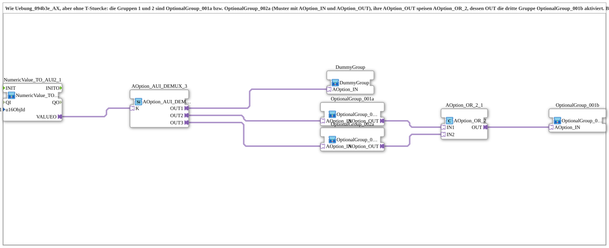

# Uebung_094b3f_AX: Optionsauswahl mit dritter Gruppe über OptionalGroup_001a/002a und ODER

* * * * * * * * * *

## Einleitung

Die Übung entspricht [`Uebung_094b3e_AX`](Uebung_094b3e_AX.md), kommt aber ohne T-Stücke aus: Die Gruppen 1 und 2 sind [`OptionalGroup_001a`](https://meisterschulen-am-ostbahnhof-munchen-docs.readthedocs.io/projects/4diac-library-reference-docs/de/latest/Bibliotheken/ExternalLibraries/MyLib_AX_Option/sys/OptionalGroup_001a/) und [`OptionalGroup_002a`](https://meisterschulen-am-ostbahnhof-munchen-docs.readthedocs.io/projects/4diac-library-reference-docs/de/latest/Bibliotheken/ExternalLibraries/MyLib_AX_Option/sys/OptionalGroup_002a/) mit `AOption_IN` und `AOption_OUT`. Deren `AOption_OUT` gehen an [`AOption_OR_2`](https://meisterschulen-am-ostbahnhof-munchen-docs.readthedocs.io/projects/4diac-library-reference-docs/de/latest/Bibliotheken/ExternalLibraries/Option/merging/AOption_OR_2/), dessen `OUT` die dritte Gruppe `OptionalGroup_001b` aktiviert. `DummyGroup` ist nicht mit dem ODER verbunden.

## Verwendete Funktionsbausteine (FBs)

- **NumericValue_TO_AUI2_1**: liest das VT-Eingabefeld und stellt es als bidirektionalen AUI2-Plug bereit
    - **Typ**: [`MyLib::sys::NumericValue_TO_AUI2`](https://meisterschulen-am-ostbahnhof-munchen-docs.readthedocs.io/projects/4diac-library-reference-docs/de/latest/Bibliotheken/ExternalLibraries/MyLib_AX/sys/NumericValue_TO_AUI2/) (SubApp-Instanz)
    - **Parameter**: `u16ObjId = InputNumber_I1`
    - **Erklärung**: Liest das VT-Eingabefeld und reicht den Wert über `VALUEO` an den DEMUX weiter.
- **AOption_AUI_DEMUX_3**: Optionsauswahl mit drei Ausgängen
    - **Typ**: [`Option::selection::AOption_AUI_DEMUX_3`](https://meisterschulen-am-ostbahnhof-munchen-docs.readthedocs.io/projects/4diac-library-reference-docs/de/latest/Bibliotheken/ExternalLibraries/Option/selection/AOption_AUI_DEMUX_3/)
    - **Parameter**: keine
    - **Erklärung**: Aktiviert abhängig vom Index `K` genau einen der Ausgänge `OUT1`, `OUT2`, `OUT3`.
- **OptionalGroup_001a**
    - **Typ**: [`MyLib_AX_Option::sys::OptionalGroup_001a`](https://meisterschulen-am-ostbahnhof-munchen-docs.readthedocs.io/projects/4diac-library-reference-docs/de/latest/Bibliotheken/ExternalLibraries/MyLib_AX_Option/sys/OptionalGroup_001a/) (SubApp-Instanz)
    - **Parameter**: keine
    - **Erklärung**: Gruppe 1 (`Input_I1`/`Output_Q1`) mit `AOption_IN` und `AOption_OUT`.
- **OptionalGroup_002a**
    - **Typ**: [`MyLib_AX_Option::sys::OptionalGroup_002a`](https://meisterschulen-am-ostbahnhof-munchen-docs.readthedocs.io/projects/4diac-library-reference-docs/de/latest/Bibliotheken/ExternalLibraries/MyLib_AX_Option/sys/OptionalGroup_002a/) (SubApp-Instanz)
    - **Parameter**: keine
    - **Erklärung**: Gruppe 2 (`Input_I2`/`Output_Q2`) mit `AOption_IN` und `AOption_OUT`.
- **AOption_OR_2_1**
    - **Typ**: [`Option::merging::AOption_OR_2`](https://meisterschulen-am-ostbahnhof-munchen-docs.readthedocs.io/projects/4diac-library-reference-docs/de/latest/Bibliotheken/ExternalLibraries/Option/merging/AOption_OR_2/)
    - **Parameter**: keine
    - **Erklärung**: `OUT` ist aktiv, wenn `IN1` oder `IN2` aktiv ist.
- **OptionalGroup_001b**
    - **Typ**: [`MyLib_AX_Option::sys::OptionalGroup_001b`](https://meisterschulen-am-ostbahnhof-munchen-docs.readthedocs.io/projects/4diac-library-reference-docs/de/latest/Bibliotheken/ExternalLibraries/MyLib_AX_Option/sys/OptionalGroup_001b/) (SubApp-Instanz)
    - **Parameter**: keine
    - **Erklärung**: Dritte Gruppe (`Input_I1`/`Output_Q1`), Endglied.
- **DummyGroup**
    - **Typ**: [`MyLib_AX_Option::sys::DummyGroup`](https://meisterschulen-am-ostbahnhof-munchen-docs.readthedocs.io/projects/4diac-library-reference-docs/de/latest/Bibliotheken/ExternalLibraries/MyLib_AX_Option/sys/DummyGroup/) (SubApp-Instanz)
    - **Parameter**: keine
    - **Erklärung**: Ohne reale I/O; Zustand „nichts ausgewählt“.

## Programmablauf und Verbindungen

1. `NumericValue_TO_AUI2_1.VALUEO` → `AOption_AUI_DEMUX_3.K`.
2. `OUT1` → `DummyGroup.AOption_IN`, `OUT2` → `OptionalGroup_001a.AOption_IN`, `OUT3` → `OptionalGroup_002a.AOption_IN`.
3. `OptionalGroup_001a.AOption_OUT` → `AOption_OR_2_1.IN1`, `OptionalGroup_002a.AOption_OUT` → `AOption_OR_2_1.IN2`.
4. `AOption_OR_2_1.OUT` → `OptionalGroup_001b.AOption_IN`.

**Verhalten**: `K = 1` = `DummyGroup` (dritte Gruppe aus), `K = 2` = `OptionalGroup_001a` und danach `OptionalGroup_001b`, `K = 3` = `OptionalGroup_002a` und danach `OptionalGroup_001b`. Die `a`-Gruppen melden `INIT_CNF` erst zurück, wenn die nachgeschaltete Kette bestätigt hat.

**Hinweis**: `OptionalGroup_001b` benutzt dieselben I/O wie `OptionalGroup_001a`. Die Übung ist ein Verdrahtungstest und noch nicht auf dem Gerät geprüft.

## Zusammenfassung

Die Gruppen reichen die Aktivierung selbst über `AOption_OUT` weiter, sodass keine T-Stücke nötig sind. `AOption_OR_2` aktiviert die dritte Gruppe, sobald eine der beiden aktiv ist.

---

### 🌐 Passende Themen-Unterseiten auf ms-muc-docs.de

- [🌐 Eclipse 4diac IDE & Farb-Referenz auf ms-muc-docs.de](https://www.ms-muc-docs.de/iec-61499/eclipse-4diac/)
