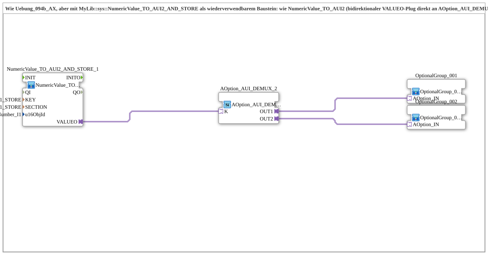

# Uebung_094b4b_AX: Optionsauswahl (2 Optionen) mit INI-persistiertem Index

* * * * * * * * * *

## Einleitung

Die Übung entspricht `Uebung_094b4_AX`, verwendet aber [`MyLib::sys::NumericValue_TO_AUI2_AND_STORE`](https://meisterschulen-am-ostbahnhof-munchen-docs.readthedocs.io/projects/4diac-library-reference-docs/de/latest/Bibliotheken/ExternalLibraries/MyLib_AX/sys/NumericValue_TO_AUI2_AND_STORE/) statt [`NumericValue_TO_AUI2`](https://meisterschulen-am-ostbahnhof-munchen-docs.readthedocs.io/projects/4diac-library-reference-docs/de/latest/Bibliotheken/ExternalLibraries/MyLib_AX/sys/NumericValue_TO_AUI2/): Der bidirektionale `VALUEO`-Plug geht direkt an `AOption_AUI_DEMUX_2.K`, zusätzlich wird der Index per INI persistiert. Die Konstanten `KEY_I1_STORE` und `SECTION_I1_STORE` sind bereits aus `Uebung_012c_AUDI` bekannt.

## Verwendete Funktionsbausteine (FBs)

- **NumericValue_TO_AUI2_AND_STORE_1**: VT-Eingabefeld lesen, als AUI2-Plug bereitstellen und in INI speichern
    - **Typ**: [`MyLib::sys::NumericValue_TO_AUI2_AND_STORE`](https://meisterschulen-am-ostbahnhof-munchen-docs.readthedocs.io/projects/4diac-library-reference-docs/de/latest/Bibliotheken/ExternalLibraries/MyLib_AX/sys/NumericValue_TO_AUI2_AND_STORE/) (SubApp-Instanz)
    - **Parameter**: `KEY = KEY_I1_STORE`, `SECTION = SECTION_I1_STORE`, `u16ObjId = InputNumber_I1`
    - **Erklärung**: Wie `NumericValue_TO_AUI2`, zusätzlich mit INI-Persistenz: Beim Boot gewinnt der aus der INI geladene Wert gegen die Live-VT-Lesung, danach jede Live-Änderung.
- **AOption_AUI_DEMUX_2**: Optionsauswahl mit zwei Ausgängen
    - **Typ**: [`Option::selection::AOption_AUI_DEMUX_2`](https://meisterschulen-am-ostbahnhof-munchen-docs.readthedocs.io/projects/4diac-library-reference-docs/de/latest/Bibliotheken/ExternalLibraries/Option/selection/AOption_AUI_DEMUX_2/)
    - **Parameter**: keine
    - **Erklärung**: Aktiviert abhängig vom Index `K` genau einen der Ausgänge `OUT1` oder `OUT2`.
- **OptionalGroup_001**, **OptionalGroup_002**: Optionsgruppen
    - **Typ**: [`MyLib_AX_Option::sys::OptionalGroup_001`](https://meisterschulen-am-ostbahnhof-munchen-docs.readthedocs.io/projects/4diac-library-reference-docs/de/latest/Bibliotheken/ExternalLibraries/MyLib_AX_Option/sys/OptionalGroup_001/) bzw. [`MyLib_AX_Option::sys::OptionalGroup_002`](https://meisterschulen-am-ostbahnhof-munchen-docs.readthedocs.io/projects/4diac-library-reference-docs/de/latest/Bibliotheken/ExternalLibraries/MyLib_AX_Option/sys/OptionalGroup_002/) (SubApp-Instanzen)
    - **Parameter**: keine
    - **Erklärung**: Gruppe 1 enthält `I1`/`Q1`, Gruppe 2 enthält `I2`/`Q2`.

## Programmablauf und Verbindungen

1. `NumericValue_TO_AUI2_AND_STORE_1.VALUEO` → `AOption_AUI_DEMUX_2.K`: Der (ggf. aus der INI geladene) Index wählt den aktiven Ausgang.
2. `AOption_AUI_DEMUX_2.OUT1` → `OptionalGroup_001.AOption_IN`, `OUT2` → `OptionalGroup_002.AOption_IN`.

**Verhalten**: Wie `Uebung_094b4_AX` (Index 1 = Gruppe 1, Index 2 = Gruppe 2), die Auswahl bleibt zusätzlich über einen Neustart erhalten.

## Zusammenfassung

Der Austausch durch die `_AND_STORE`-Variante macht die Optionsauswahl neustartfest, ohne das restliche Netzwerk zu ändern.

---

### 🌐 Passende Themen-Unterseiten auf ms-muc-docs.de

- [🌐 Eclipse 4diac IDE & Farb-Referenz auf ms-muc-docs.de](https://www.ms-muc-docs.de/iec-61499/eclipse-4diac/)
