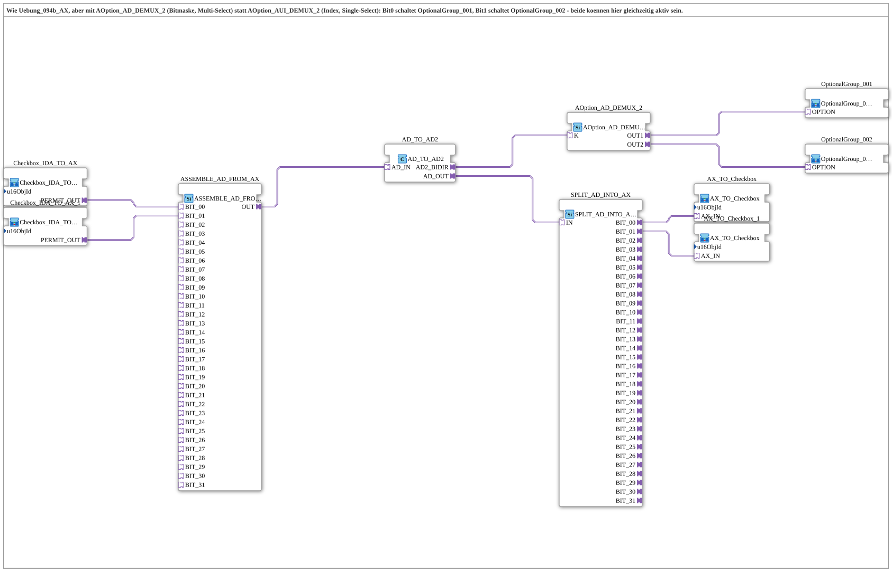

# Uebung_094b5_AX: Optionsauswahl per Bitmaske (Mehrfachauswahl) mit AOption_AD_DEMUX_2

* * * * * * * * * *

## Einleitung

Die Übung entspricht `Uebung_094b_AX`, verwendet aber [`AOption_AD_DEMUX_2`](https://meisterschulen-am-ostbahnhof-munchen-docs.readthedocs.io/projects/4diac-library-reference-docs/de/latest/Bibliotheken/ExternalLibraries/Option/selection/AOption_AD_DEMUX_2/) (Bitmaske, Mehrfachauswahl) statt [`AOption_AUI_DEMUX_2`](https://meisterschulen-am-ostbahnhof-munchen-docs.readthedocs.io/projects/4diac-library-reference-docs/de/latest/Bibliotheken/ExternalLibraries/Option/selection/AOption_AUI_DEMUX_2/) (Index, Einzelauswahl): Bit 0 schaltet [`OptionalGroup_001`](https://meisterschulen-am-ostbahnhof-munchen-docs.readthedocs.io/projects/4diac-library-reference-docs/de/latest/Bibliotheken/ExternalLibraries/MyLib_AX_Option/sys/OptionalGroup_001/), Bit 1 schaltet [`OptionalGroup_002`](https://meisterschulen-am-ostbahnhof-munchen-docs.readthedocs.io/projects/4diac-library-reference-docs/de/latest/Bibliotheken/ExternalLibraries/MyLib_AX_Option/sys/OptionalGroup_002/); beide können gleichzeitig aktiv sein. Die Bitmaske wird hier aus zwei VT-Checkboxen zusammengesetzt und der Zustand wieder in die Checkboxen zurückgeschrieben. `AD_TO_AUI` und `AUI_TO_AUI2` sind durch [`AD_TO_AD2`](https://meisterschulen-am-ostbahnhof-munchen-docs.readthedocs.io/projects/4diac-library-reference-docs/de/latest/Bibliotheken/ExternalLibraries/adapter/conversion/bidirectional/DWORD/AD_TO_AD2/) ersetzt, da der Wert bereits als DWORD (AD) vorliegt.

## Verwendete Funktionsbausteine (FBs)

- **Checkbox_IDA_TO_AX**, **Checkbox_IDA_TO_AX_1**: VT-Checkbox lesen
    - **Typ**: `MyLib::sys::Checkbox_IDA_TO_AX` (SubApp-Instanzen)
    - **Parameter**: keine gesetzt (`u16ObjId` bleibt auf dem Standardwert `ID_NULL`)
    - **Erklärung**: Reicht den Ein/Aus-Zustand einer VT-Checkbox als AX-Pegel über `PERMIT_OUT` weiter. Die Objekt-ID (`u16ObjId`, ObjectID der von der Checkbox referenzierten NumberVariable) muss für den realen Betrieb noch gesetzt werden.
- **ASSEMBLE_AD_FROM_AX**: Bitmaske zusammensetzen
    - **Typ**: `adapter::assembling::ASSEMBLE_AD_FROM_AX`
    - **Parameter**: keine
    - **Erklärung**: Setzt aus den AX-Eingängen `BIT_00` und `BIT_01` einen DWORD-Wert (AD) zusammen.
- **AD_TO_AD2**: Brücke zum bidirektionalen AD2-Adapter
    - **Typ**: [`adapter::conversion::bidirectional::AD_TO_AD2`](https://meisterschulen-am-ostbahnhof-munchen-docs.readthedocs.io/projects/4diac-library-reference-docs/de/latest/Bibliotheken/ExternalLibraries/adapter/conversion/bidirectional/DWORD/AD_TO_AD2/)
    - **Parameter**: keine
    - **Erklärung**: Reicht die Bitmaske über `AD2_BIDIR` an den Consumer (`K` des DEMUX) weiter und liefert den vom Consumer übernommenen Wert über `AD_OUT` zurück.
- **AOption_AD_DEMUX_2**: Optionsauswahl per Bitmaske
    - **Typ**: [`Option::selection::AOption_AD_DEMUX_2`](https://meisterschulen-am-ostbahnhof-munchen-docs.readthedocs.io/projects/4diac-library-reference-docs/de/latest/Bibliotheken/ExternalLibraries/Option/selection/AOption_AD_DEMUX_2/)
    - **Parameter**: keine
    - **Erklärung**: Bit 0 von `K` aktiviert `OUT1`, Bit 1 aktiviert `OUT2`; mehrere Ausgänge können gleichzeitig aktiv sein.
- **OptionalGroup_001**, **OptionalGroup_002**: Optionsgruppen
    - **Typ**: [`MyLib_AX_Option::sys::OptionalGroup_001`](https://meisterschulen-am-ostbahnhof-munchen-docs.readthedocs.io/projects/4diac-library-reference-docs/de/latest/Bibliotheken/ExternalLibraries/MyLib_AX_Option/sys/OptionalGroup_001/) bzw. [`MyLib_AX_Option::sys::OptionalGroup_002`](https://meisterschulen-am-ostbahnhof-munchen-docs.readthedocs.io/projects/4diac-library-reference-docs/de/latest/Bibliotheken/ExternalLibraries/MyLib_AX_Option/sys/OptionalGroup_002/) (SubApp-Instanzen)
    - **Parameter**: keine
    - **Erklärung**: Gruppe 1 enthält `I1`/`Q1`, Gruppe 2 enthält `I2`/`Q2`.
- **SPLIT_AD_INTO_AX**: Bitmaske zerlegen
    - **Typ**: `adapter::splitting::SPLIT_AD_INTO_AX`
    - **Parameter**: keine
    - **Erklärung**: Zerlegt den zurückgemeldeten DWORD-Wert in die AX-Pegel `BIT_00` und `BIT_01`.
- **AX_TO_Checkbox**, **AX_TO_Checkbox_1**: VT-Checkbox schreiben
    - **Typ**: [`MyLib::sys::AX_TO_Checkbox`](https://meisterschulen-am-ostbahnhof-munchen-docs.readthedocs.io/projects/4diac-library-reference-docs/de/latest/Bibliotheken/ExternalLibraries/MyLib_AX/sys/AX_TO_Checkbox/) (SubApp-Instanzen)
    - **Parameter**: keine gesetzt (`u16ObjId` bleibt auf dem Standardwert `ID_NULL`)
    - **Erklärung**: Gegenstück zu `Checkbox_IDA_TO_AX`: schreibt den AX-Pegel von `AX_IN` bei jeder Änderung auf die VT-Checkbox.

## Programmablauf und Verbindungen

1. `Checkbox_IDA_TO_AX.PERMIT_OUT` → `ASSEMBLE_AD_FROM_AX.BIT_00` und `Checkbox_IDA_TO_AX_1.PERMIT_OUT` → `ASSEMBLE_AD_FROM_AX.BIT_01`: Die beiden Checkboxen bilden Bit 0 und Bit 1 der Maske.
2. `ASSEMBLE_AD_FROM_AX.OUT` → `AD_TO_AD2.AD_IN`, `AD_TO_AD2.AD2_BIDIR` → `AOption_AD_DEMUX_2.K`: Die Maske wählt die aktiven Ausgänge.
3. `AOption_AD_DEMUX_2.OUT1` → `OptionalGroup_001.AOption_IN`, `OUT2` → `OptionalGroup_002.AOption_IN`.
4. Echo-Pfad: `AD_TO_AD2.AD_OUT` → `SPLIT_AD_INTO_AX.IN`; `BIT_00` → `AX_TO_Checkbox.AX_IN`, `BIT_01` → `AX_TO_Checkbox_1.AX_IN`: Der übernommene Wert wird in die Checkboxen zurückgeschrieben.

**Verhalten**: Checkbox 1 schaltet Gruppe 1, Checkbox 2 schaltet Gruppe 2; beide Gruppen können gleichzeitig aktiv sein.

## Zusammenfassung

Mit `AOption_AD_DEMUX_2` wird aus der Einzelauswahl der Vorgängerübungen eine Mehrfachauswahl per Bitmaske. `ASSEMBLE_AD_FROM_AX` und `SPLIT_AD_INTO_AX` verbinden die einzelnen Checkbox-Pegel mit der Bitmaske und zurück.

---

### 🌐 Passende Themen-Unterseiten auf ms-muc-docs.de

- [🌐 Eclipse 4diac IDE & Farb-Referenz auf ms-muc-docs.de](https://www.ms-muc-docs.de/iec-61499/eclipse-4diac/)
